# src/bridge/server/ipc 架构

## 目录定位

应用 action 路由；等待资料独立导入/目录/取消入口不启动模型，受理只读保存快照。队列插入传递原expectedRunId，由调度拒绝缺失、过期及停止。公开准入游标读取和版本化设置，不开放许可领取/撤销。报告、核实和业务重规划保持独立；启动额度不足明确未受理，桌面发送方在 Electron 接入处核验。 人工提交参数不接受 actor，保存不启动模型；查询保留历史身份。 161项应用操作按业务组装配，request统一保留关闭/受理前错误码后解析，实际处理器受响应映射约束。 dispatch.ownerInspect 只读核原任务并返回当前观察；正式派发必须显式绑定主周期。 dispatch.commandReport 固定原工作区、主根、运行和调用，桌面与模型共用同一只读服务。 五项影响观察／处置／原回执／历史／关联入口相互分开，查询不启动新任务；保存只接受本机显式决定。 四个文件报告/补偿入口固定原调用或原命令；actor 由桌面入口注入，查询不启动文件操作，补偿不得改变目标路径或内容。

本文描述当前实现。通过分析目录边界后维护的 [源码架构脚本](../../../../scripts/source-architecture.mjs) 同步清单和声明；代码变更时仍须核对职责、关键成员与关系。

## 代码清单

| 文件 | 当前职责 |
| --- | --- |
| [agent-history.ts](agent-history.ts) | 将角色历史 IPC 请求解析后交给已打开工作区的只读查询端口。 |
| [automation-actions.ts](automation-actions.ts) | 将自动化桌面请求路由到当前工作区唯一调度器。 |
| [chat-handlers.ts](chat-handlers.ts) | 显式附件导入与快照预览的主进程处理器。 |
| [dispatch-handlers.ts](dispatch-handlers.ts) | 成员派发、运行核实与人工处置的主进程处理器。 |
| [dispatch.ts](dispatch.ts) | 将经过主进程接入的 action 路由到明确的工作区和应用服务；主 Agent 两处设置入口共用同一配置服务。 |
| [governance-handlers.ts](governance-handlers.ts) | 模块治理观察、提案、决定与实施的主进程处理器。 |
| [loop-handlers.ts](loop-handlers.ts) | 会话、排队、历史与安全续接的主进程处理器。 |
| [people-handlers.ts](people-handlers.ts) | 岗位登记与模块责任的主进程处理器。 |
| [request.ts](request.ts) | 主进程 IPC 的运行时请求解析与受理前拒绝，保留旧队列插入的失效运行错误码。 |
| [resources-handlers.ts](resources-handlers.ts) | 资源仓库、共享连接与架构包的主进程处理器。 |
| [services.ts](services.ts) | 定义 IPC 路由需要的执行审批、静态角色履历、岗位与模块责任、全局监管、配额、桌面资源导入、模块治理和工作区生命周期入口。 |
| [settings-handlers.ts](settings-handlers.ts) | 模型、准入、预算与反馈账号设置的主进程处理器。 |
| [workspace-handlers.ts](workspace-handlers.ts) | 工作区生命周期与知识编辑的主进程处理器。 |

## 架构类图

### agent-history.ts

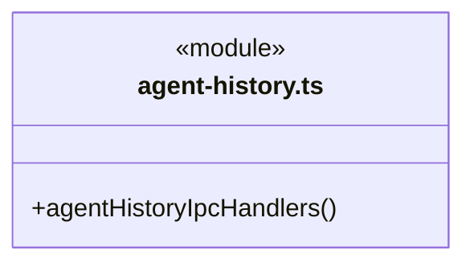

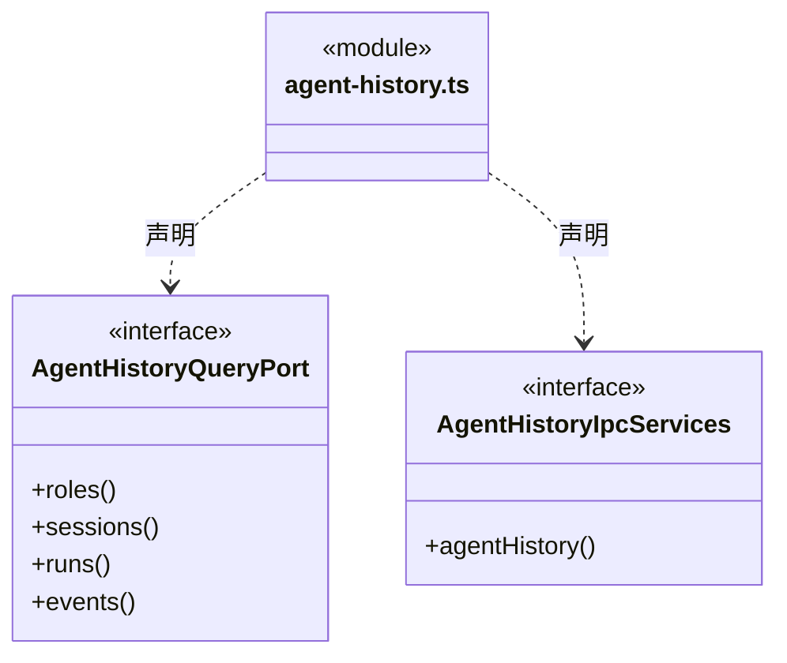

直接依赖：[../../contracts/agent-history-ipc.ts](../../contracts/agent-history-ipc.ts)、[../../contracts/ipc-call.ts](../../contracts/ipc-call.ts)。

### automation-actions.ts

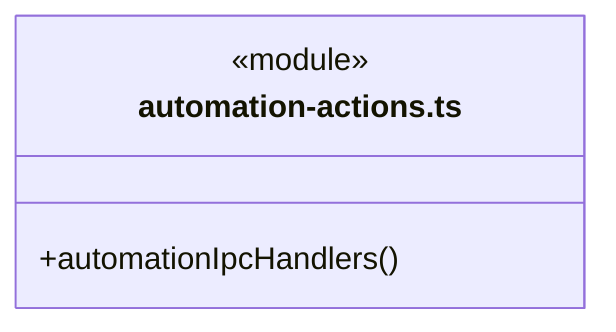

直接依赖：[../../contracts/automation.ts](../../contracts/automation.ts)、[../../contracts/ipc-call.ts](../../contracts/ipc-call.ts)、[services.ts](services.ts)。

### chat-handlers.ts

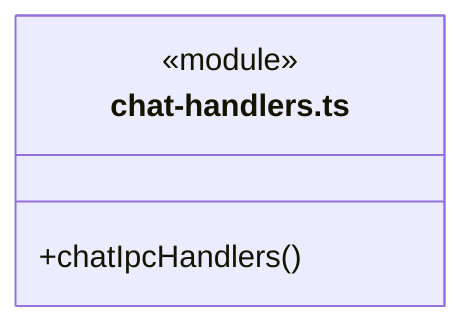

直接依赖：[services.ts](services.ts)、[../../contracts/ipc-call.ts](../../contracts/ipc-call.ts)、[../../contracts/ipc-chat.ts](../../contracts/ipc-chat.ts)、[../../../logic/materials/service/chat-inputs.ts](../../../logic/materials/service/chat-inputs.ts)。

### dispatch-handlers.ts

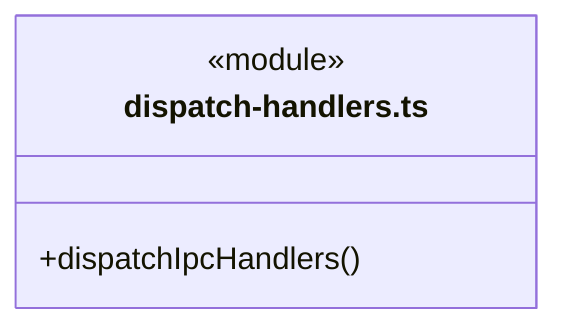

直接依赖：[services.ts](services.ts)、[../../contracts/ipc-call.ts](../../contracts/ipc-call.ts)、[../../contracts/ipc-dispatch.ts](../../contracts/ipc-dispatch.ts)。

### dispatch.ts

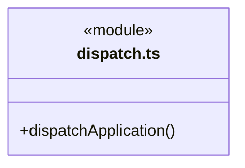

直接依赖：[request.ts](request.ts)、[services.ts](services.ts)、[../../../core/errors.ts](../../../core/errors.ts)、[../../contracts/ipc-call.ts](../../contracts/ipc-call.ts)、[../../contracts/ipc-desktop.ts](../../contracts/ipc-desktop.ts)、[agent-history.ts](agent-history.ts)、[people-handlers.ts](people-handlers.ts)、[governance-handlers.ts](governance-handlers.ts)、[dispatch-handlers.ts](dispatch-handlers.ts)、[settings-handlers.ts](settings-handlers.ts)、[loop-handlers.ts](loop-handlers.ts)、[chat-handlers.ts](chat-handlers.ts)、[resources-handlers.ts](resources-handlers.ts)、[workspace-handlers.ts](workspace-handlers.ts)、[automation-actions.ts](automation-actions.ts)。

### governance-handlers.ts

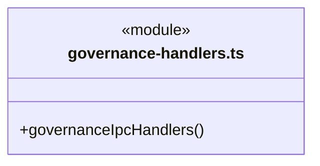

直接依赖：[services.ts](services.ts)、[../../contracts/ipc-call.ts](../../contracts/ipc-call.ts)、[../../contracts/ipc-governance.ts](../../contracts/ipc-governance.ts)。

### loop-handlers.ts

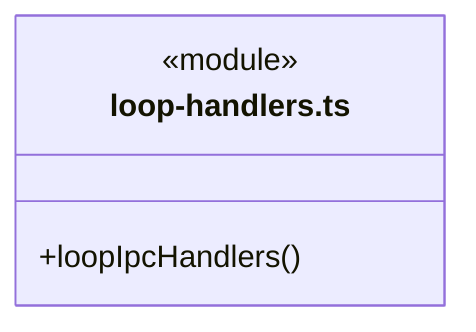

直接依赖：[services.ts](services.ts)、[../../contracts/ipc-call.ts](../../contracts/ipc-call.ts)、[../../contracts/ipc-loop.ts](../../contracts/ipc-loop.ts)、[../../../logic/materials/service/chat-inputs.ts](../../../logic/materials/service/chat-inputs.ts)、[../../../core/errors.ts](../../../core/errors.ts)。

### people-handlers.ts

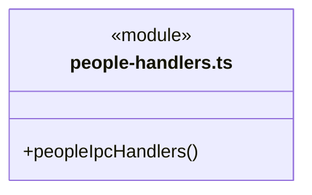

直接依赖：[services.ts](services.ts)、[../../contracts/ipc-call.ts](../../contracts/ipc-call.ts)、[../../contracts/ipc-people.ts](../../contracts/ipc-people.ts)。

### request.ts

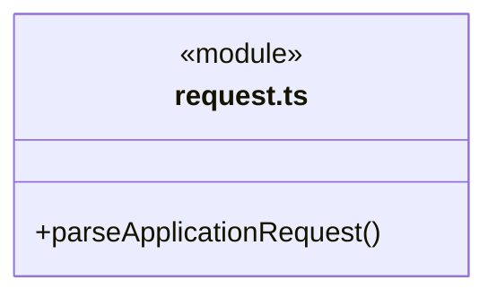

直接依赖：[../../contracts/ipc-call.ts](../../contracts/ipc-call.ts)、[../../../core/errors.ts](../../../core/errors.ts)。

### resources-handlers.ts

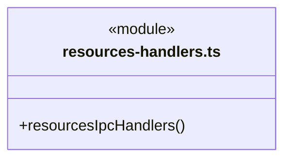

直接依赖：[services.ts](services.ts)、[../../contracts/ipc-call.ts](../../contracts/ipc-call.ts)、[../../contracts/ipc-resources.ts](../../contracts/ipc-resources.ts)、[../../../logic/resources/packages/workspace-packages.ts](../../../logic/resources/packages/workspace-packages.ts)。

### services.ts

成员 1/3（同名节点为同一声明，跨图合并阅读）。

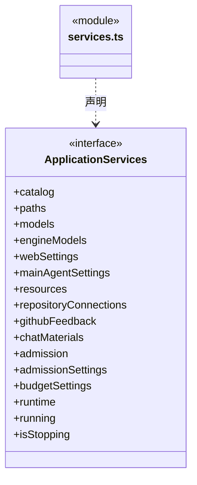

成员 2/3（同名节点为同一声明，跨图合并阅读）。

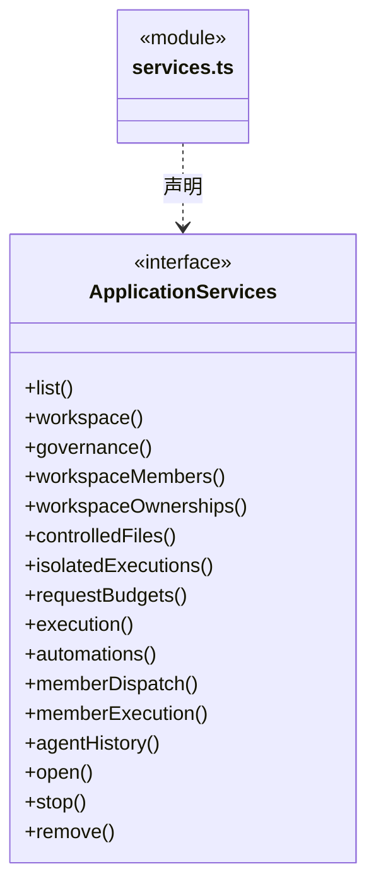

成员 3/3（同名节点为同一声明，跨图合并阅读）。

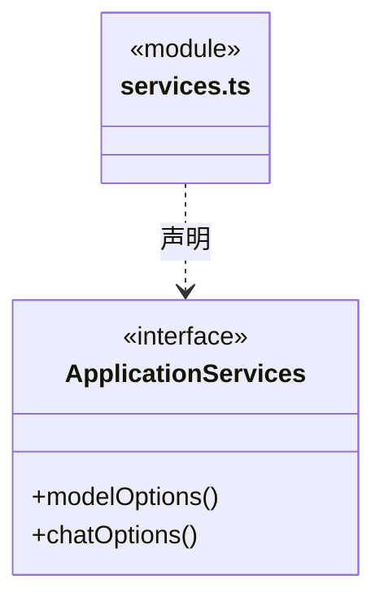

直接依赖：[../../../logic/web/service/index.ts](../../../logic/web/service/index.ts)、[../../../logic/automation/service/service.ts](../../../logic/automation/service/service.ts)、[../../../logic/workspace/service/catalog.ts](../../../logic/workspace/service/catalog.ts)、[../../../logic/workspace/service/workspace.ts](../../../logic/workspace/service/workspace.ts)、[../../../logic/workspace/service/paths.ts](../../../logic/workspace/service/paths.ts)、[../../../logic/team/settings/main-agent-settings.ts](../../../logic/team/settings/main-agent-settings.ts)、[../../../logic/models/service/index.ts](../../../logic/models/service/index.ts)、[../../../logic/engines/service/index.ts](../../../logic/engines/service/index.ts)、[../../../logic/resources/service/index.ts](../../../logic/resources/service/index.ts)、[../../../logic/connectors/service/repository-connections.ts](../../../logic/connectors/service/repository-connections.ts)、[../../../logic/feedback/service/index.ts](../../../logic/feedback/service/index.ts)、[../../../logic/governance/service/module-governance.ts](../../../logic/governance/service/module-governance.ts)、[../../../logic/conversation/runtime/execution-manager.ts](../../../logic/conversation/runtime/execution-manager.ts)、[../../../logic/dispatch/runtime/dispatch-service.ts](../../../logic/dispatch/runtime/dispatch-service.ts)、[../../../logic/team/runtime/member-execution.ts](../../../logic/team/runtime/member-execution.ts)、[../../../logic/history/runtime/agent-history.ts](../../../logic/history/runtime/agent-history.ts)、[../../../logic/runtime/rules/types.ts](../../../logic/runtime/rules/types.ts)、[../../contracts/workspace.ts](../../contracts/workspace.ts)、[../../../logic/runtime/settings/admission-settings.ts](../../../logic/runtime/settings/admission-settings.ts)、[../../../logic/budget/settings/budget-settings.ts](../../../logic/budget/settings/budget-settings.ts)、[../../../logic/team/service/workspace-members.ts](../../../logic/team/service/workspace-members.ts)、[../../../logic/workspace/service/module-ownerships.ts](../../../logic/workspace/service/module-ownerships.ts)、[../../../logic/file-operations/service/controlled-files.ts](../../../logic/file-operations/service/controlled-files.ts)、[../../../logic/file-operations/service/isolated-executions.ts](../../../logic/file-operations/service/isolated-executions.ts)、[../../../logic/materials/service/chat-material-imports.ts](../../../logic/materials/service/chat-material-imports.ts)、[../../../logic/runtime/rules/admission.ts](../../../logic/runtime/rules/admission.ts)、[../../../logic/budget/runtime/model-request-budget-service.ts](../../../logic/budget/runtime/model-request-budget-service.ts)。

### settings-handlers.ts

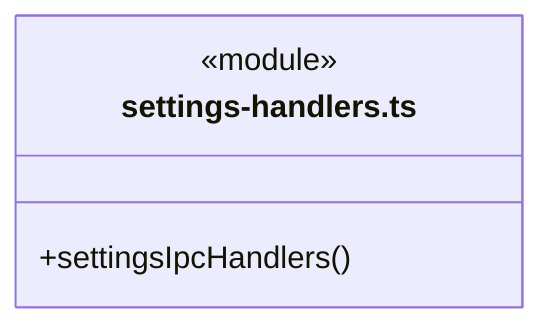

直接依赖：[services.ts](services.ts)、[../../contracts/ipc-call.ts](../../contracts/ipc-call.ts)、[../../contracts/ipc-settings.ts](../../contracts/ipc-settings.ts)。

### workspace-handlers.ts

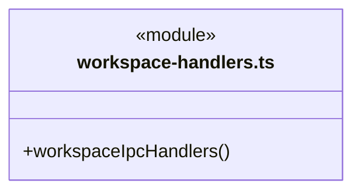

直接依赖：[services.ts](services.ts)、[../../contracts/ipc-call.ts](../../contracts/ipc-call.ts)、[../../contracts/ipc-workspace.ts](../../contracts/ipc-workspace.ts)、[../../../logic/workspace/service/architecture-service.ts](../../../logic/workspace/service/architecture-service.ts)、[../../../core/errors.ts](../../../core/errors.ts)。

### 本目录调用边界

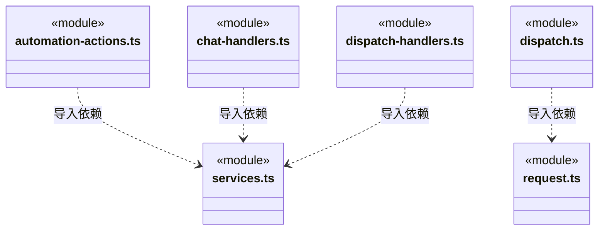

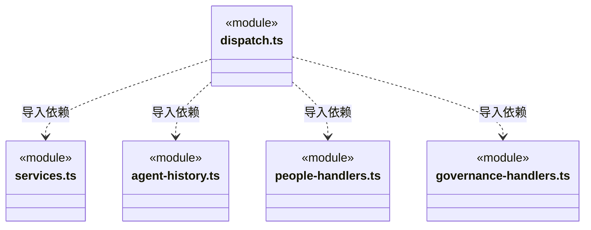

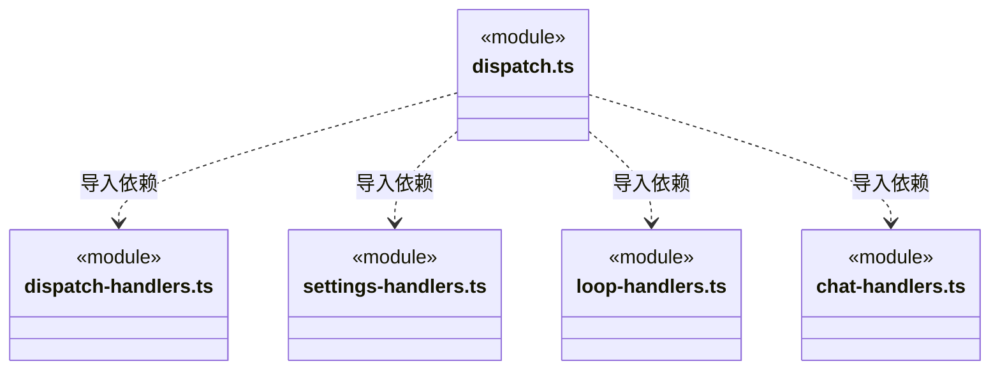

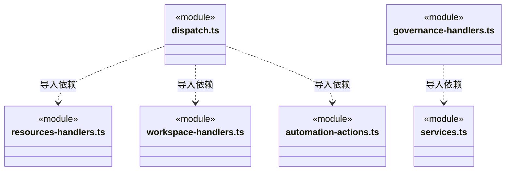

```mermaid
classDiagram
class N_src_bridge_server_ipc_loop_handlers_ts["loop-handlers.ts"] {
  <<module>>
}
class N_src_bridge_server_ipc_services_ts["services.ts"] {
  <<module>>
}
class N_src_bridge_server_ipc_people_handlers_ts["people-handlers.ts"] {
  <<module>>
}
class N_src_bridge_server_ipc_resources_handlers_ts["resources-handlers.ts"] {
  <<module>>
}
class N_src_bridge_server_ipc_settings_handlers_ts["settings-handlers.ts"] {
  <<module>>
}
N_src_bridge_server_ipc_loop_handlers_ts ..> N_src_bridge_server_ipc_services_ts : 导入依赖
N_src_bridge_server_ipc_people_handlers_ts ..> N_src_bridge_server_ipc_services_ts : 导入依赖
N_src_bridge_server_ipc_resources_handlers_ts ..> N_src_bridge_server_ipc_services_ts : 导入依赖
N_src_bridge_server_ipc_settings_handlers_ts ..> N_src_bridge_server_ipc_services_ts : 导入依赖
```

```mermaid
classDiagram
class N_src_bridge_server_ipc_workspace_handlers_ts["workspace-handlers.ts"] {
  <<module>>
}
class N_src_bridge_server_ipc_services_ts["services.ts"] {
  <<module>>
}
N_src_bridge_server_ipc_workspace_handlers_ts ..> N_src_bridge_server_ipc_services_ts : 导入依赖
```


## 子目录导航

无子目录。

[返回上层](../ARCHITECTURE.md)。

每次修改本目录代码，同步维护文件头、关键契约说明及本图。未实现的治理、证据验收和自动编排能力不列入当前类图。

## 设计契约 v1 与落地范围

以下内容区分已接通能力与后续设计；以各节的实现状态为准，不将目标图当作现状图。维护源：[CONTRACT.md](CONTRACT.md)；生成类图时同步附加，勿直接修改本附录。

### 粘贴入口

chat.image 严格图片类型/名称/base64上限；chat.paths 为最多12个明确本地绝对路径，Main 核存在/类型/.cbim后保存快照。两者在退出期间拒绝，发送窗口/Main Frame仍沿桌面入口校验。chat.preview 可返回已验证图片字节；没有通过图片名任意写源文件或按预览字符串读磁盘的入口。

### 模型兼容接口测试

settingsIpcHandlers 将 models.test 的 engine、modelId 与供应商 id 交给 EngineModelProfiles，由其向 LlmProfiles 传入协议要求。实际协议和地址只由已保存配置解析；请求不能注入任意地址或密钥，返回值不含凭据。切换引擎、读取列表不自动测试。

### 网页设置 IPC

web.settings 返回无密钥摘要及 browserRobotsPolicy；web.configure 用 revision/开关/可选新密钥或 clearKey 显式保存，可选 allow/respect 策略，省略时保留当前策略，退出期间拒绝写。没有任意 URL 抓取 IPC，网络仅从可信主 Agent 工具端口进入。

### 桌面软件更新

`desktop.updates.status/check/download/install` 仅在 Electron 主 Frame 可信边界下处理，不接受 URL、路径、版本或命令参数，也不进入模型工具表。status 只读，check 联网只读，download 由用户点击，install 必须处于校验完成状态并先正常排空应用；安装期间拒绝其它业务入口。正式包标记、平台、实际版本及 NSIS 卸载程序共同决定启用，开发或便携包不启用安装更新。

### GitHub 反馈登录协议

`github.feedback.status/begin/poll/cancel/disconnect` 仅管理本机明确授权；`begin` 必须带公开配置和 autoSubmit:true。设备授权、凭据和目标核验由服务负责；`openLogin` 在 Electron 主 Frame 边界后只打开固定官方设备页。IPC 没有提交 Issue 或覆盖原回执的入口；实际创建须经主会话注册工具与运行权限。公开结果无 token、device_code、Issue 链接或提交正文。

### 工作区岗位登记

`workspace.members.list/get/preview/commit/receipt` 仅为桌面提供岗位摘要、实时差异、预览、明确提交与原命令查询。前四项绑定当前 workspaceId/instanceId；receipt 只带 workspaceId/commandId，允许读旧实例回执。提交的 actor 由可信主 Frame 路由固定为 local_desktop/explicit_submit，请求不能自报模型快照、能力正文或签署者。

列表和详情不创建运行；提交仅在原 DispatchStore 追加岗位审计。未知通信、存储错误或命令冲突须保留原命令查询；只有首次明确的输入、身份、版本、basis、来源、无变化、退休或容量拒绝能确认没有本次提交。回执不存在仍是未知，不授权自动换 ID。模型工具没有这五个入口，岗位 active 不是执行或审批许可。

### 单模块知识治理

`governance.list/register/observe/propose/decide/apply/receipt/unaccepted` 显式绑定工作区；写动作还绑定实例、稳定命令及对应版本。模型没有此工具族。主 Frame 守卫核实发送方，register/decide 在后端注入 `local_desktop / explicit_submit`；保存决定和实施知识是两个独立动作，无额外模型、业务执行或权限提升。

统一回执包含原 identity、commandId、action 和对应 record。apply 的 committed 必须有原知识 result；pending、not_applied、rolled_back 和 recovery_required 保持各自事实。receipt 允许查询退役实例的原记录，不执行写入；unaccepted 只有旧实例且账本/原 journal 无命令才为 true。通信未知必须保留原命令，不将再次收到前置错误当作取消原受理的依据。

### 桌面资源仓库只读连接

`resources.connection.list / preview / commit / grant / revoke / check` 显式绑定工作区实例。登记经知识事务，授权独立保存；只有当前应用已显式开启的共享仓库可连接，请求不接受 URL 或令牌。`check` 才显式核验网络并返回受限目录摘要，主 Frame 接入规则继续适用，入口不注册到模型工具清单。

`receipt` 按 workspaceId/commandId 查询原授权命令；`commitReceipt` 按 workspaceId/planId 只读查询真实原知识事务，可保留旧实例身份。查询不到仍为未知，不触发提交。`unaccepted` 使用原实例/action/ID，只在后端证明旧实例退役且原请求未持久受理时返回 true；前端不能把一般报错或 undefined 当成该证明。退出拒绝新授权，关闭排空已进入的工作。

### 本机人工决定的独立入口

`dispatch.humanPreview / humanDecide / humanReceipt / humanHistory` 仅按明确 workspace/root/scope 访问人工决定服务。预览显式选择 criterion 与基线，提交还须携带稳定 commandId、expectedBasis、expectedDecisionRevision、决定和 comment；actor、proof、路径及文件哈希不属于请求。

Electron 接入仍核对本窗口与主 Frame；`humanDecide` 在可信闭包注入 `local_desktop / explicit_submit`，不冒充登录认证、不增加二次原生弹窗，模型工具表不注册此入口。保存只追加 waiting 周期历史，不调用模型、补充/恢复入口或批准普通队列。退出前拒绝新提交；通信未知保留原命令查询，不把查询未找到解释成可以换 ID 重发。

`loop.humanContinue` 是另外的显式运行入口，严格接收 scope/wait 与 goal/input/decision 版本、最新决定 ID 全集、固定 commandId 和实际模型/权限配置；不接 message、actor 或伪造依据。执行管理器先查原回执，再在真实 beforeRun 内消费一次等待。`loop.humanContinuation` 只查三层身份与 commandId，返回当前 scopeStatus 和不可变 human_decisions 意图；不启动、不续队列，也不把 closed/active 回执解释为正在运行。CONFLICT/UNKNOWN/REPLAY 保持原命令核实，不能自动换 ID。

### 文件基线的独立只读复核

`dispatch.artifactReport` 交当前工作区 `MemberExecutionManager.artifactReport`，必须明确 workspace/root/task/run。未指定 baselineId 只读取 canonical 日志中的已确认引用，不猜最新基线且不读业务文件；指定基线才取得短期业务读占用并有界核实。结果不包含原生会话路径、文件正文或未经核实的模型声明。

该入口与执行回执分页分开，不写日志、不领模型名额、不确认候选或启动恢复。缺失、损坏、在途及前后基线变化都明确保留未知；匹配指纹不代表整个工作区未变或业务验收通过。

### 全局并发准入与设置

`admission.read({cursor})` 仅读应用内准入器，独立于历史监管索引；返回 snapshot 或同版本 noop，不启动运行、不扫描日志。`admission.settings` 返回已经生效的策略；`admission.configure({revision,maxConcurrentRuns})` 经串行版本校验和可靠写盘后生效，关闭期间拒绝改配。IPC 不公开 attempt、withdraw 或 release，页面和模型不能自行签发或伪造归还名额。

### 正式业务重规划

`dispatch.replans.preview` 只读复核指定主会话已完成核实周期的可信证据，返回覆盖模块、继承人工约束和可核对的依据版本；不是模型已生成的执行计划，也不批准业务写入。

`loop.replanStart` 接收严格的新目标、ask/execute 配置、来源核实周期、依据版本和稳定 commandId，交执行管理器在真实运行租约内重新核验并保存启动意图。不能提交旧工具参数、执行实例或原生路径，也不修改原只读周期。`loop.replanReceipt` 只查询同一命令的持久受理事实，未知响应不允许自动改换命令。停止、重复提交和重启不重放已受理目标。

### 显式新只读核实与历史诊断

`loop.recoveryStart` 将严格 `RecoveryRequest` 交执行管理器，创建独立的只读核实周期，不通过普通 resume 恢复旧日志。`loop.recoveryReceipt` 只按工作区、主会话和稳定 commandId 查持久意图；查询、重开页面或重启都不再次执行。

`loop.threadView` 返回 `ConversationThreadView`：全部可读历史、坏记录的通用问题提示和后端核实的可续聊头。缺少可续聊头时界面不能使用较早可读轮次代替。既有 `loop.thread` 保留严格执行预检语义，不把异常转为空列表。

### 显式目标补充

`chat.materialTargets({id})` 只返回当前工作区已授权、共享就绪的仓库目标，不访问 HTTP。`chat.materialList` 使用 importId、connectorId、connectionId 及可选分页/expectedRevision 读取真实目录。`chat.import` 只接受 link/web URL 或 repository_resource 的 connectorId、connectionId、expectedRevision、resourceId；不接受路径、proof、token 或授权字段。所有参数严格校验，七类仓库正文均作为静态资料保存。

`chat.importCancel({id,importId})` 取消同一在途操作并保留墓碑，不能用于撤销已保存文件或业务事务。原生 `chat.pick` 的 importId 走同一取消表。未知导入结果不自动重做；每个新显式导入使用新 ID，已保存但未返回的快照不会自动进入等待请求。`chat.attach` 的旧 connector 分支仍是定义引用，安全等待必须重新选择真实资料来源。

`loop.goalContinue` 接收完整 `GoalContinuationRequest`，纯文本、明确模型配置与权限、scope/wait/input 版本和稳定 commandId 交执行管理器。不能提交原生会话路径、来源或人工批准字段。相同请求查询原回执，不再启动；原等待已消费时换 ID 拒绝。

`loop.goalContinuation` 只读查询同一工作区/主会话/scope/commandId 的回执。返回 undefined 不保证旧请求从未在途，客户端仍须复用原 ID；回执含完整身份、当前 scopeStatus 和原补充记录，不代表模型正在运行或验收通过。普通 `loop.resume/enqueue` 不变成此入口。

### 主会话目标与任务图读取

`dispatchApplication` 将 `dispatch.sessionRead` 路由到 `app.memberDispatch(args.identity.workspaceId).sessionRead(args)`。身份、两个独立游标、所选周期和缓存 stamp 由调度服务严格校验；不从界面选中状态推断目标工作区，不返回全工作区派发存储。

该入口只读，在同一个已提交屏障读取任务图、周期摘要和选中详情。审批、任务开始/停止及信封确认保留各自命令入口；图读取不能触发它们。既有 `dispatch.graphSnapshot / dispatch.graphDelta` 保持兼容。
### 成员执行的只读核实

`dispatch.executionReport` 路由到当前工作区 `MemberExecutionManager.report`，按主会话、任务与可选明确运行查询。省略 runId 只核实领取记录，不猜最新轮次。报告包含核实基线、完整性、受限工具回执和未验收候选；不调用启动、确认、恢复或改派。分页必须绑定同一基线，服务严格校验身份。

### 队列插入绑定原主轮

`loop.queueInsert` 将 `taskId/queueId/expectedRunId` 原样传入执行管理器。路由不查询并替换客户端原 run，不给旧请求补字段；缺失、非法或已变化的主运行统一由后台拒绝，原排队消息保留。停止请求仍走独立入口，后端判断发送前拒绝、原生已接受或结果未知，IPC 不将迟到停止解释为消息未被接受或自动重发依据。

### 模块岗位负责人

`workspace.ownerships.list/get/byMember/preview/commit/receipt` 路由到当前工作区同一责任服务。新读写携带明确 instanceId；只读原回执按 workspaceId/commandId 核实，不要求旧实例重新运行。commit 只接冻结变更、责任游标、basis 与 commandId，由本路由注入本机显式 actor，不接受客户端主运行来源或权限证明。

指定、换人和解除不修改任务派发，也不替岗位执行模型。第一次确定的预受理错误允许用户修改请求；通信、存储或已提交回包异常必须保留原命令核实，receipt 缺失不证明未受理，不能按当前关系相等推断提交成功。

### 正式岗位执行入口

`dispatch.task` 必须显式携带原 active `scopeId`，路由剥离该字段后交同一派发服务核验当前计划和 `ownerSelection`，不会根据界面或最近周期猜 scope。`dispatch.ownerInspect` 只读返回指定任务的原 revision/binding 及当前分组观察；不改绑定、不领取任务。`loop.start` 在模型选型前明确拒绝新的旧业务通道，普通 chat 续聊及历史查询保留。
### 原主调用命令报告

`dispatch.commandReport({workspaceId,rootSessionId,runId,toolCallId})` 路由到已有工作区的 `WorkspaceDispatchService.commandReport`。原工具名、input、scope、commandId 和 fingerprint 均由可信日志与 Store 推导，客户端不能补身份或结论；不调用 execute/commit/start/resume 来试探回执。查无记录仍是未知，不清原未确认工具。

`dispatch.effectObserve`、`effectDispositionList`、`effectDispositionReceipt` 和 `effectRelations` 仅读已打开工作区；`effectDisposition` 才由本机显式提交入口注入 local_desktop actor。五入口共用同一服务，模型不装配新的处置工具；请求不收任意文件路径、scope 身份或自行声明的核实结果。loop.resume 对未确认调用拒绝裸 ID 解锁，直接 IPC 与 Runtime 门禁一致。

## 受控操作与补偿桌面入口

四入口 dispatch.controlledFileReport/fileCompensationPreview/fileCompensate/fileCompensationReceipt 只路由到已打开工作区的 ControlledFiles。报告与回执不启动模型或执行文件；预览只核当前文件，提交必须携稳定 command 和明确预览依据。原操作、补偿意图及原未知工具记录分开，模型没有桌面补偿能力。

## 逐请求预算（R06）

`dispatch.requestBudget` 只读已打开工作区的 workspace/root/scope 摘要，不启动模型、不释放未决、不修改策略；预留与结算没有 IPC 写入路由。`budget.configure` 只改变未来周期的默认模式与额度。


## R07-A 完整产物清单运行与复核

dispatch.manifestReport 必须明确 workspace/root/task/run；省略 manifestId 只列原 canonical 引用，明确选定才重新枚举完整冻结范围。无隐式最新、补采、恢复或验收；错误和变化保留原历史。

## 原隔离执行核实与清理

dispatch.isolatedExecutionReport显式读取原运行，dispatch.isolatedExecutionCleanup显式提交当前instanceId及原执行/basis/commandId；不允许renderer传入路径、PID、profile或运行脚本。
## 全量关联 IPC 分派

`dispatch.ts` 仅识别和组合已登记操作，161 项应用入口按历史、设置、自动化及既有业务分组；其它 11 项原生操作留在 Electron main.ts。`request.ts` 先执行既有关闭门禁，再按共享 Schema 解析，保留受理前领域错误码。服务调用后的异常不经解析错误转换；失败不自动重试。退役 loop.start 在取服务及选模型前继续拒绝，未知或原型属性名称返回 ACTION。

队列插入仅缺少或无效的 `expectedRunId` 时，结构拒绝仍返回 `QUEUE_INSERT_STALE`；不取得执行服务、不补成当前运行，原队列项保留。历史派发的缺省 `scopeId` 则交给服务先查原回执，新派发继续以 `DISPATCH_SCOPE_REQUIRED` 拒绝。

每个处理器实际参数和返回受对应 `IpcHandlers` 约束。登记、责任、治理与处置只由本机闭包提供 actor，客户端不能发送授权来源。查询只取得当前工作区原服务，不隐式打开工作区或恢复执行。governance 命令按实际 action 核实回执；通用 receipt 仍是不同种类或 undefined，消费者必须分别判断。

角色历史由 `agent-history.ts` 的最小端口装配，与其它组共用统一解析；端口没有索引写入、运行、恢复或生命周期能力。领域身份/路径/游标核验不被桥类型取代，查询失败不折算为空历史。


### 0.1.7 功能接入完整映射

自动化六项请求先由共享严格 Schema 解析，再只投影 workspaceId/instanceId 交给原服务核实代际；定义、修订和命令仍由同一调度器校验。agent.mainSettings/configureMain 使用 model-actions.ts 的唯一协议；修改主配置沿既有关闭门禁，不增加旁路路由。

## 指定话题补充与排空

`loop.topicInterrupt` 仅转交工作区执行管理器的整话题补充入口；错误参数映射 TOPIC_INPUT_INVALID。后端检查原话题并等待真实停止，IPC 返回不是自行签发运行权限；普通 loop.chat/enqueue/resume 保持普通新任务语义。

loop.enqueue 转交明确的 followupOf；IPC 不恢复原话题，执行管理器与派发事务独立核实来源。
