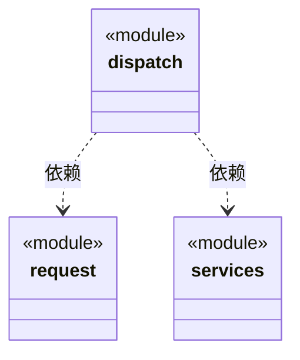

# src/bridge/server/ipc 架构

## 设计意图

把已接入的桌面操作分派到应用服务。统一入口负责请求解析和路由，业务处理器按领域分组；这里传递身份和返回事实，不拥有业务规则或第二套状态。

## 主要组成

| 组成 | 定位 |
| --- | --- |
| [dispatch](dispatch.ts) | 将经过主进程接入的 action 路由到明确的工作区和应用服务；主 Agent 两处设置入口共用同一配置服务。 |
| [request](request.ts) | 主进程 IPC 的运行时请求解析与受理前拒绝；源浏览在退出期间停止接单且畸形参数返回可读提示，保留旧队列插入的失效运行错误码。 |
| [services](services.ts) | 定义 IPC 路由需要的执行审批、静态角色履历、岗位与模块责任、全局监管、配额、桌面资源导入、模块治理和工作区生命周期入口。 |

<!-- architecture:generated:start -->

## 架构关系

[上层设计](../ARCHITECTURE.md)

<!-- architecture:generated:end -->
