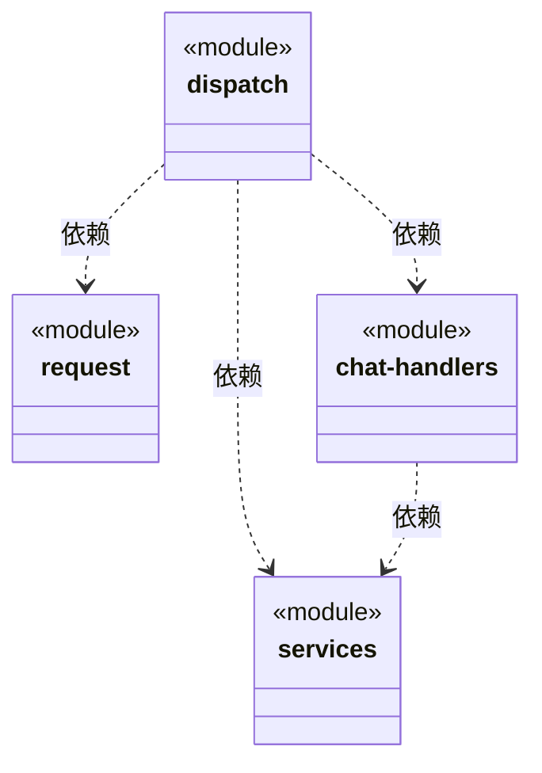

# src/bridge/server/ipc 架构

## 设计意图

将已接入的桌面操作解析并分派到对应业务服务，保持传输路由与领域决策分离。

`request` 先校验 action、输入及退出阶段的受理条件，`dispatch` 组合各领域处理器，`services` 描述处理器所需能力。处理器取得具体工作区和服务后委托调用，不缓存另一份业务状态；旧 `loop.start` 入口明确拒绝，不能绕过当前负责人派发。

## 主要组成

| 组成 | 定位 |
| --- | --- |
| [dispatch](dispatch.ts) | 将经过主进程接入的 action 路由到明确的工作区和应用服务；主 Agent 两处设置入口共用同一配置服务。 |
| [request](request.ts) | 主进程 IPC 的运行时请求解析与受理前拒绝；源浏览在退出期间停止接单且畸形参数返回可读提示，保留旧队列插入的失效运行错误码。 |
| [services](services.ts) | 定义 IPC 路由需要的执行审批、静态角色履历、岗位与模块责任、全局监管、配额、桌面资源导入、模块治理和工作区生命周期入口。 |
| [chat-handlers](chat-handlers.ts) | 把对话、输入和队列操作委托当前工作区的会话服务。 |

<!-- architecture:generated:start -->

## 架构关系

[上层设计](../ARCHITECTURE.md)

<!-- architecture:generated:end -->
