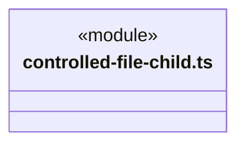
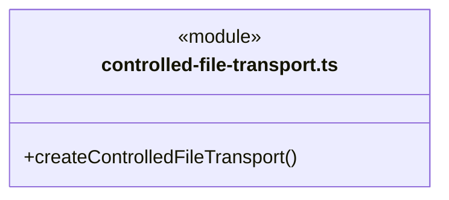
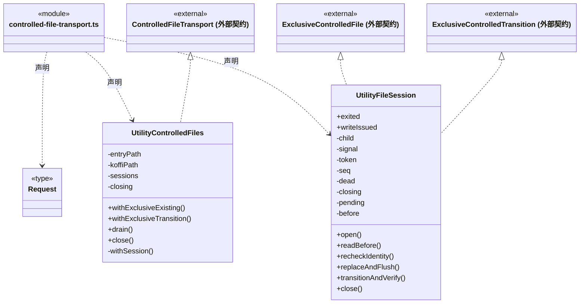
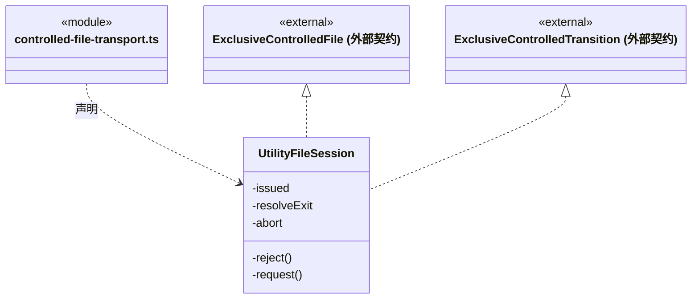

# src/bridge/server/platform 架构

## 目录定位

Electron utility 文件传输和子进程入口；处理可信私有协议，业务文件规则与 Win32 实现归 Logic。

本文描述当前实现。通过分析目录边界后维护的 [源码架构脚本](../../../../scripts/source-architecture.mjs) 同步清单和声明；代码变更时仍须核对职责、关键成员与关系。

## 代码清单

| 文件 | 当前职责 |
| --- | --- |
| [controlled-file-child.ts](controlled-file-child.ts) | 独立 Electron utility 文件工人入口，只接收固定私有消息，不启动 Application 或模型。 |
| [controlled-file-transport.ts](controlled-file-transport.ts) | Electron 主进程为每次受控内容替换或删除/移动创建专用 utility 子进程，并返回不透明会话。 |

## 架构类图

### controlled-file-child.ts

直接依赖：[../../../logic/file-operations/platform/files/controlled-file-protocol.ts](../../../logic/file-operations/platform/files/controlled-file-protocol.ts)、[../../../logic/file-operations/platform/files/controlled-file-win32.ts](../../../logic/file-operations/platform/files/controlled-file-win32.ts)。

### controlled-file-transport.ts

成员 1/2（同名节点为同一声明，跨图合并阅读）。

成员 2/2（同名节点为同一声明，跨图合并阅读）。

直接依赖：[../../../core/errors.ts](../../../core/errors.ts)、[../../../logic/file-operations/platform/files/controlled-file-protocol.ts](../../../logic/file-operations/platform/files/controlled-file-protocol.ts)。

## 子目录导航

无子目录。

[返回上层](../ARCHITECTURE.md)。

每次修改本目录代码，同步维护文件头、关键契约说明及本图。未实现的治理、证据验收和自动编排能力不列入当前类图。
