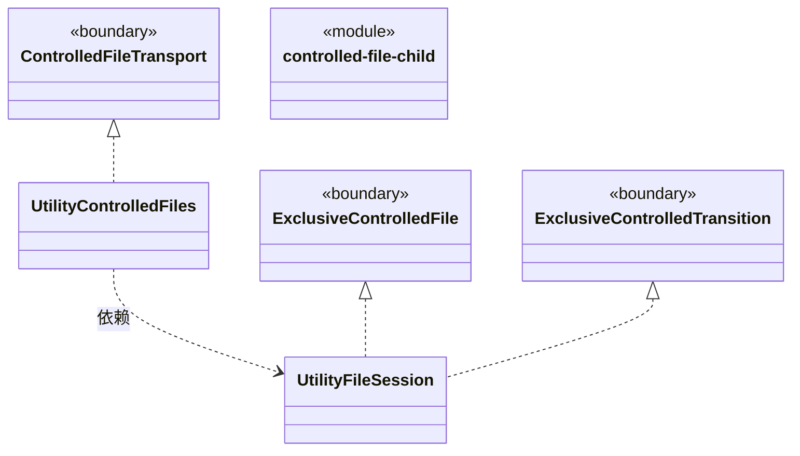

# src/bridge/server/platform 架构

## 设计意图

以 Electron utility 子进程承载受控文件的可信传输，将宿主进程管理与业务文件规则分开。

`UtilityControlledFiles` 管理活动会话，`UtilityFileSession` 关联单个子进程的消息、唯一 apply 与退出等待；`controlled-file-child` 接收固定私有协议并调用 Logic 的文件实现。取消请求与进程真实退出分别处理，传输层不重新决定路径许可或文件补偿策略。

## 主要组成

| 组成 | 定位 |
| --- | --- |
| [UtilityControlledFiles](controlled-file-transport.ts) | 管理文件工人的活动会话与关闭过程，将平台传输提供给业务文件服务。 |
| [UtilityFileSession](controlled-file-transport.ts) | 封装单个真实子进程的消息关联、唯一 apply 与退出等待。 |
| [controlled-file-child](controlled-file-child.ts) | 独立 Electron utility 文件工人入口，只接收固定私有消息，不启动 Application 或模型。 |

<!-- architecture:generated:start -->

## 架构关系

外部继承／实现边界：[ControlledFileTransport](../../../logic/file-operations/platform/files/controlled-file-protocol.ts)、[ExclusiveControlledFile](../../../logic/file-operations/platform/files/controlled-file-protocol.ts)、[ExclusiveControlledTransition](../../../logic/file-operations/platform/files/controlled-file-protocol.ts)。

[上层设计](../ARCHITECTURE.md)

<!-- architecture:generated:end -->
