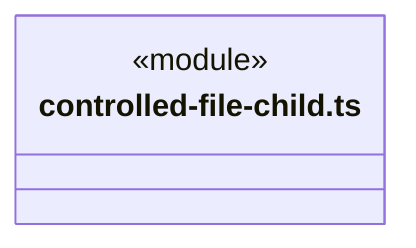
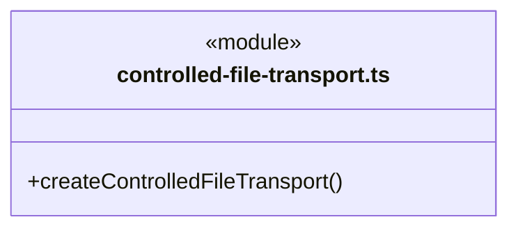
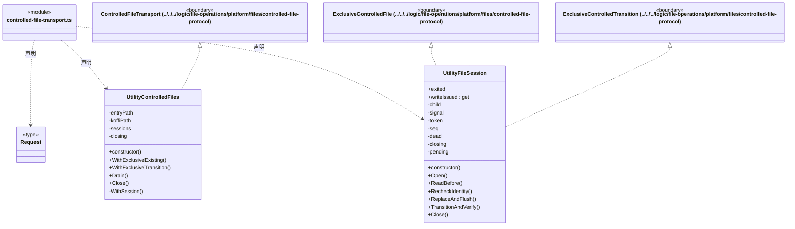
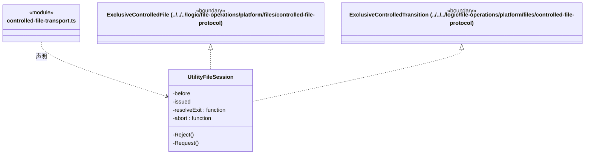

# src/bridge/server/platform 架构

本目录只维护这一份说明。设计与契约直接编辑本文；文件清单、类图和导航由 [架构脚本](../../../../scripts/source-architecture.mjs) 更新，生成区域之外的人工说明会保留。

## 封装意图

Electron utility 文件传输和子进程入口；处理可信私有协议，业务文件规则与 Win32 实现归 Logic。

## 类与模块的设计意图

下表依据源码声明及文件头说明定位封装。字段表示该实例持有的状态或协作引用，不表示它拥有被引用服务的生命周期；实际资源责任和调用限制见下文契约及源码注释。

| 类／模块 | 实现形式与实例字段 | 封装依据 |
| --- | --- | --- |
| [controlled-file-child.ts](controlled-file-child.ts) | 函数／契约模块 | 同步 Win32 与 GetLastError 留在同线程；父进程可靠保存 executing 后才发送一次内容替换或冻结的删除/移动。 |
| [UtilityControlledFiles](controlled-file-transport.ts) | 实例类；持有 `sessions`、`closing`、`entryPath`、`koffiPath` | 关闭失败保留活动 child；再次 close 可核实原进程，不创建替代工人或重发 apply。 |
| [UtilityFileSession](controlled-file-transport.ts) | 实例类；持有 `token`、`seq`、`dead`、`closing`、`pending`、`before`、`issued`、`exited`、`resolveExit`、`abort`、`child`、`signal` | seq、token、唯一 apply 和 exit promise 均绑定真实进程；退出码不作为业务成功依据。 |

## 接口设计契约

- [controlled-file-child.ts](controlled-file-child.ts)：独立 Electron utility 文件工人入口，只接收固定私有消息，不启动 Application 或模型。
- [controlled-file-transport.ts](controlled-file-transport.ts)：Electron 主进程为每次受控内容替换或删除/移动创建专用 utility 子进程，并返回不透明会话。

## 开闭边界

本目录的职责及允许协作由[封装意图](#封装意图)限定，输入输出、状态与失败语义以[接口设计契约](#接口设计契约)为准。扩展从已有公开入口及实际装配位置进入；没有明确可替换契约的部分按真实影响修改和验证，不预建未使用的基类或插件入口。

<!-- architecture:generated:start -->

## 文件清单

| 文件 | 形式 | 当前职责 |
| --- | --- | --- |
| [ARCHITECTURE.md](ARCHITECTURE.md) | 说明文档 | 本目录的文件清单、真实声明、依赖与子封装导航。 |
| [controlled-file-child.ts](controlled-file-child.ts) | 源码模块 | 独立 Electron utility 文件工人入口，只接收固定私有消息，不启动 Application 或模型。 |
| [controlled-file-transport.ts](controlled-file-transport.ts) | 源码模块 | Electron 主进程为每次受控内容替换或删除/移动创建专用 utility 子进程，并返回不透明会话。 |

## 架构类图

成员标记：`+` 公开、`-` 私有、`#` 受保护、`$` 静态；`function` 为函数值成员，`get`／`set` 为访问器。调用／构造／索引签名按匿名签名列出，不虚构方法名；`global.` 表示全局声明补充，非运行时嵌套类。构造函数单独列出，运行时私有字段保留 `#`。文档和资源仅在文件清单中导航，不作为代码节点。

### controlled-file-child.ts

[查看源码](controlled-file-child.ts)。

直接依赖：[../../../logic/file-operations/platform/files/controlled-file-protocol.ts](../../../logic/file-operations/platform/files/controlled-file-protocol.ts)、[../../../logic/file-operations/platform/files/controlled-file-win32.ts](../../../logic/file-operations/platform/files/controlled-file-win32.ts)。

### controlled-file-transport.ts

[查看源码](controlled-file-transport.ts)。

成员 1/2（同名节点为同一声明，跨图合并阅读）。

成员 2/2（同名节点为同一声明，跨图合并阅读）。

继承／实现来源：`ControlledFileTransport` → [../../../logic/file-operations/platform/files/controlled-file-protocol.ts](../../../logic/file-operations/platform/files/controlled-file-protocol.ts)（声明 `ControlledFileTransport`）。
继承／实现来源：`ExclusiveControlledFile` → [../../../logic/file-operations/platform/files/controlled-file-protocol.ts](../../../logic/file-operations/platform/files/controlled-file-protocol.ts)（声明 `ExclusiveControlledFile`）。
继承／实现来源：`ExclusiveControlledTransition` → [../../../logic/file-operations/platform/files/controlled-file-protocol.ts](../../../logic/file-operations/platform/files/controlled-file-protocol.ts)（声明 `ExclusiveControlledTransition`）。
直接依赖：[../../../core/errors.ts](../../../core/errors.ts)、[../../../logic/file-operations/platform/files/controlled-file-protocol.ts](../../../logic/file-operations/platform/files/controlled-file-protocol.ts)。

## 子目录导航

无子目录。

[返回上层](../ARCHITECTURE.md)。

每次修改本目录代码，同步维护文件头、关键契约说明及本图。未实现的治理、证据验收和自动编排能力不列入当前类图。

<!-- architecture:generated:end -->
