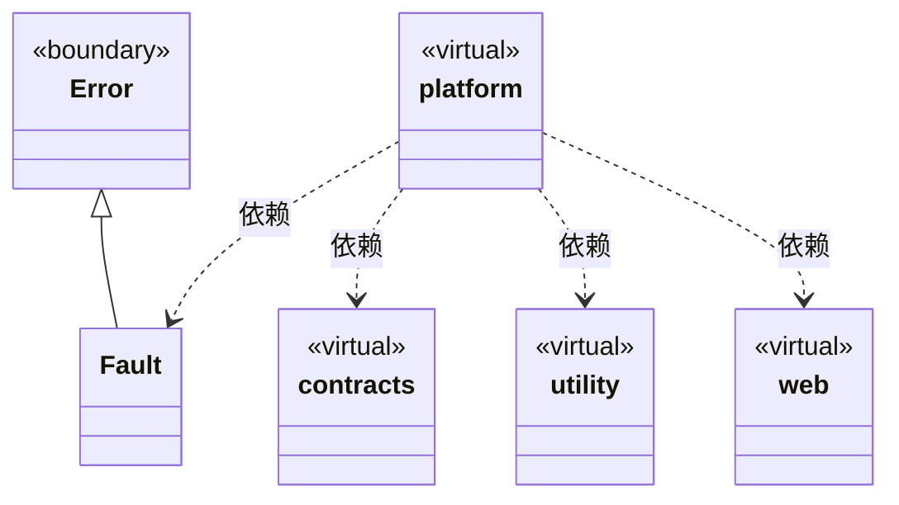
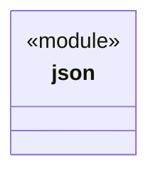

# src/core 架构

## 设计意图

提供不依赖业务的共享技术机制。便携工具、通用端口与平台实现分别封装，由消费者选择入口并持有业务策略；错误与 JSON 适配保留统一的基础协议。

## 主要组成

| 组成 | 定位 |
| --- | --- |
| [Fault](errors.ts) | 携带调用方定义的错误码，保持跨模块一致的异常身份。 |
| [json](json.ts) | 将 utility 的严格 JSON 解析事实适配为 Core 原有 JSON 错误协议。 |

<!-- architecture:generated:start -->

## 架构关系

标注为 `virtual` 的节点是直接子模块的虚拟类封装；内部设计沿下方入口阅读。

### 关系组 1

### 关系组 2

### 跨图协作

- [json](json.ts)（图 2）→ [utility](utility/ARCHITECTURE.md)（图 1）：依赖。

外部继承／实现边界：`Error`。

## 子模块

| 虚拟封装 | 整体职责 |
| --- | --- |
| [contracts](contracts/ARCHITECTURE.md) | 通用技术端口；当前 SecretCipher 由模型、Web 与反馈共同使用，具体平台实现由宿主注入。 |
| [platform](platform/ARCHITECTURE.md) | 按运行环境隔离基础实现；Node 提供摘要、原生锁、文件和网页，Electron 提供匿名网页适配与系统加密。便携 Core 不依赖平台。 |
| [utility](utility/ARCHITECTURE.md) | 提供按异步协调、字节、JSON、字符串和图组织的通用算法与数据结构。无状态算法采用静态类，有状态协调器按实例隔离；业务规则、取消策略和资源生命周期由消费者决定。 |
| [web](web/ARCHITECTURE.md) | 纯网页输入/浏览器契约与 HTML 正文算法；公开 index.ts，不加载 Node、Electron 或业务。 |

[上层设计](../ARCHITECTURE.md)

<!-- architecture:generated:end -->
