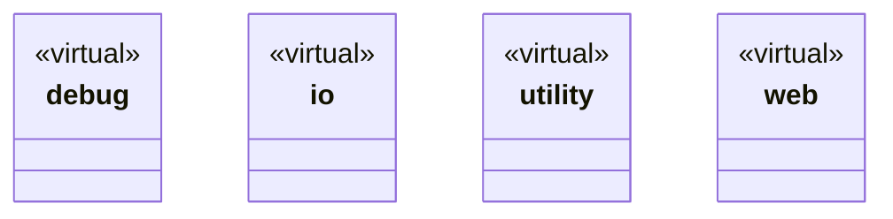

# src/core 架构

## 设计意图

提供不认识工作区、Agent 或任务身份的技术机制，让业务在明确端口上组合算法、文件、网络和平台能力。

`utility` 提供便携算法和实例协调器，`web` 保存纯网页协议与转换，各模块按运行环境提供入口。IO 报告技术错误，调用方按业务场景处理失败；权限和资源策略由消费者决定。

## 主要组成

Core 的每个一级子模块都是独立基础库。一级子模块之间禁止任何导入、转导出及类型依赖；跨库组合由上层负责。

<!-- architecture:generated:start -->

## 架构关系

标注为 `virtual` 的节点是直接子模块的虚拟类封装；内部设计沿下方入口阅读。

## 子模块

| 虚拟封装 | 整体职责 |
| --- | --- |
| [debug](debug/ARCHITECTURE.md) | 集中开发诊断的控制台输出和 JSON 行日志写入。调用方管理日志文件的位置、业务字段与事件顺序。 |
| [io](io/ARCHITECTURE.md) | 统一维护字符串、字节、JSON 序列化和反序列化及其优化。便携入口可用于浏览器和服务端；文件、摘要与凭据操作按运行环境导入。 |
| [utility](utility/ARCHITECTURE.md) | 维护异步协调与图算法，供不同业务复用机制而不共享业务状态。 |
| [web](web/ARCHITECTURE.md) | 按执行环境组织网页读取。Node 端编排静态读取，并按需调用桌面宿主注入的浏览器。 |

[上层设计](../ARCHITECTURE.md)

<!-- architecture:generated:end -->
