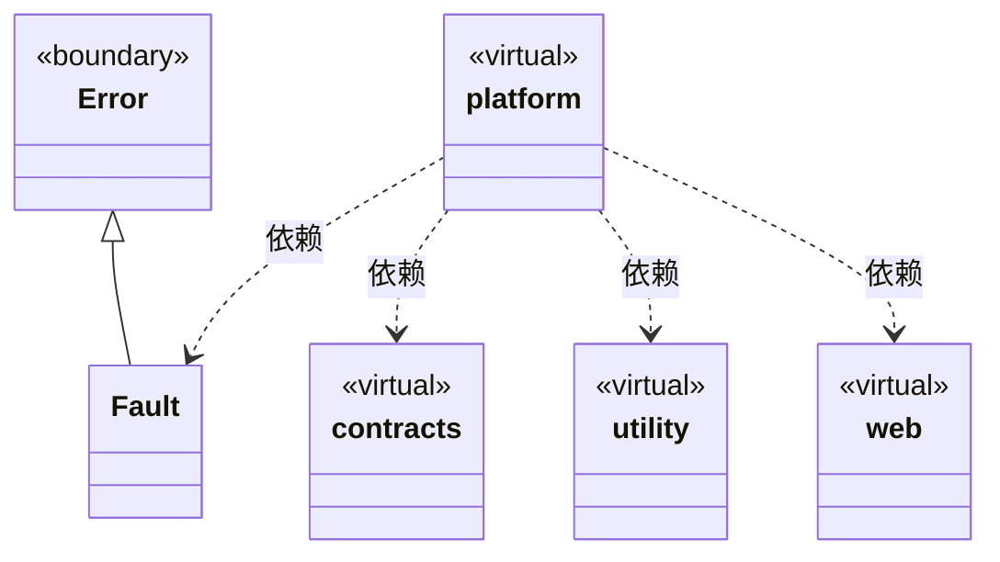
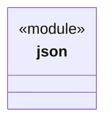

# src/core 架构

## 设计意图

提供不认识工作区、Agent 或任务身份的技术机制，让业务在明确端口上组合算法、文件、网络和平台能力。

`utility` 提供便携算法和实例协调器，`contracts` 声明技术端口，`web` 保存纯网页协议与转换，`platform` 隔离 Node/Electron 实现。本层 `Fault` 统一错误身份，`json` 将严格解析事实映射为既有错误协议；业务错误码、权限和资源策略由消费者决定。

## 主要组成

| 组成 | 定位 |
| --- | --- |
| [Fault](errors.ts) | 携带调用方定义的错误码，保持跨模块一致的异常身份。 |
| [json](json.ts) | 将 utility 的严格 JSON 解析事实适配为 Core 原有 JSON 错误协议。 |

## 现状与目标边界

当前父层仍直接保存 [errors.ts](errors.ts) 和 [json.ts](json.ts)，与四个子模块并存。前者被全工程用于相同异常身份，后者组合 utility 并保持旧 JSON 错误协议。目标是按错误协议和解析适配的真实职责收敛入口，使父层只描述组合；尚未形成对应子封装，不在图中画未来目录。迁移必须同步引用并保持同一 Fault 构造器及错误语义。

<!-- architecture:generated:start -->

## 架构关系

标注为 `virtual` 的节点是直接子模块的虚拟类封装；内部设计沿下方入口阅读。

### 关系组 1：platform

### 关系组 2：json

### 跨图协作

按引用方归并目标，保留全部跨图关系；分图只用于阅读，不表示新增模块或依赖边界。

| 引用方 | 关系 | 目标 |
| --- | --- | --- |
| [json](json.ts)（图 2） | 依赖 | [utility](utility/ARCHITECTURE.md)（图 1） |

外部继承／实现边界：`Error`。

## 子模块

| 虚拟封装 | 整体职责 |
| --- | --- |
| [contracts](contracts/ARCHITECTURE.md) | 定义跨业务共用的技术能力端口，使配置服务不必依赖具体操作系统或 Electron。 |
| [platform](platform/ARCHITECTURE.md) | 按运行环境封装技术实现，避免便携算法和纯协议隐式加载系统能力。 |
| [utility](utility/ARCHITECTURE.md) | 按异步协调、字节、JSON、字符串和图组织独立算法与数据结构，供不同业务复用机制而不共享业务状态。 |
| [web](web/ARCHITECTURE.md) | 定义与平台无关的网页读取输入、浏览器端口和 HTML 正文转换，使网络与 Chromium 实现能够分别接入。 |

[上层设计](../ARCHITECTURE.md)

<!-- architecture:generated:end -->
