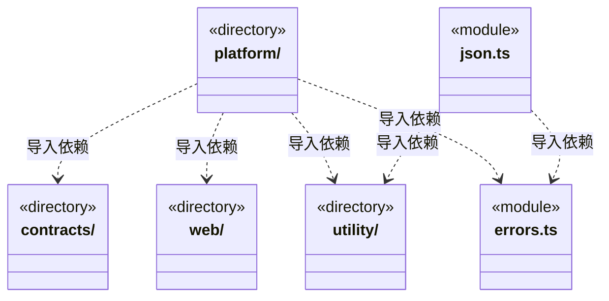
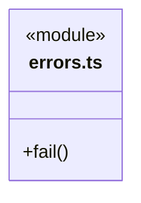
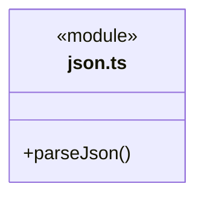

# src/core 架构

## 目录定位

四层架构的共享基础公共层：utility 提供便携算法与数据结构，platform 隔离运行环境；不依赖业务、桥接或视图。前端比较和后端指纹适配组合相同排序实现，业务策略留在消费者。

本文描述当前实现。通过分析目录边界后维护的 [源码架构脚本](../../scripts/source-architecture.mjs) 同步清单和声明；代码变更时仍须核对职责、关键成员与关系。

## 代码清单

| 文件 | 当前职责 |
| --- | --- |
| [errors.ts](errors.ts) | 不依赖业务或平台的带错误码异常与抛出入口。 |
| [json.ts](json.ts) | 将 utility 的严格 JSON 解析事实适配为 Core 原有 JSON 错误协议。 |

## 架构类图

各图中的同名节点表示同一目录边界；跨组及完整直接依赖如下（无边不代表继承）：

- `json.ts` → `utility`：导入。
- `json.ts` → `errors.ts`：导入。
- `platform` → `contracts`：导入。
- `platform` → `web`：导入。
- `platform` → `errors.ts`：导入。
- `platform` → `utility`：导入。

### errors.ts 公开入口

### json.ts 公开入口

## 子目录导航

- [contracts/](contracts/ARCHITECTURE.md)：通用技术端口；当前 SecretCipher 由模型、Web 与反馈共同使用，具体平台实现由宿主注入。
- [platform/](platform/ARCHITECTURE.md)：按运行环境隔离基础实现；Node 提供摘要、原生锁、文件和网页，Electron 提供匿名网页适配。便携 Core 不依赖平台。
- [utility/](utility/ARCHITECTURE.md)：前后端共享通用算法与数据结构，按 JSON、字符串、字节、异步协调和图类别内聚。index.ts 是便携公开入口；Node 摘要归 ../platform/node/digest.ts。无业务、Node、Electron 或页面依赖；排序比较器、字段规则、生命周期和业务策略由消费者持有。
- [web/](web/ARCHITECTURE.md)：纯网页输入/浏览器契约与 HTML 正文算法；公开 index.ts，不加载 Node、Electron 或业务。

[返回上层](../ARCHITECTURE.md)。

每次修改本目录代码，同步维护文件头、关键契约说明及本图。未实现的治理、证据验收和自动编排能力不列入当前类图。

## 设计契约 v1 与落地范围

以下内容区分已接通能力与后续设计；以各节的实现状态为准，不将目标图当作现状图。维护源：[CONTRACT.md](CONTRACT.md)；生成类图时同步附加，勿直接修改本附录。

# 共享 Core

Core 是四层架构的基础公共层，不含业务规则、通信操作、页面状态或应用装配。前端和后端可以组合相同公开能力；运行环境是独立约束，Node 能力不经便携入口加载。

当前真实入口为 [utility](utility/CONTRACT.md) 、[Node 摘要与文件](platform/node/CONTRACT.md) 和 errors.ts 的 Fault/fail。utility 仅使用语言/Web Streams 原语及 jsonc-parser；platform/node/digest.ts 仅使用 node:crypto。它们都不依赖 logic、bridge、view 或旧 backend/frontend，包含类型引用。跨模块仅使用已登记公开入口；新 Core 模块必须登记职责、入口及第三方依赖，否则检查失败。

前端 equalJson 是第一条双端复用路径：控制器 → 前端比较适配 → Core orderJsonValue；后端历史指纹适配也调用同一算法。比较器、字段选择、错误映射和业务接受条件仍由消费者拥有。共享实现不要求不同策略产生相同字节。

旧领域规则已迁入 Logic；identity 与 StoragePaths 归各自业务端口。json.ts 提供严格 JSON 解析的 Fault 适配，platform/node/serialization.ts 保留 hash/json 的既有字节语义。旧 errors 转发已移除，所有消费者使用同一 Core Fault 构造器。服务、调度、桥接和视图均已按四层归属迁移。

没有全局 Core 容器或统一大导出。公共函数不持有业务状态，队列/集合由调用方逐实例创建并负责关闭策略。通用入口不能经重导出或间接依赖加载 Node/Electron；业务数据、路径权限、事务和进程生命周期不因使用基础库而转移。

Web 迁移补充：core/web 为纯契约与正文算法，platform/node/web 为抓取编排，platform/electron/web-reader.ts 为宿主渲染适配。contracts/secrets.ts 提供独立加密端口；模型保留原类型兼容出口，Web 不依赖模型模块。

Node 原生锁位于 platform/node/locking.ts，保留旧锁身份与释放行为；业务决定持有范围。SecretCipher 同时用于模型、Web 和反馈服务，Core 不依赖这些消费者。
