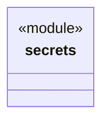

# src/core/contracts 架构

## 设计意图

通用技术端口；当前 SecretCipher 由模型、Web 与反馈共同使用，具体平台实现由宿主注入。

## 主要组成

| 组成 | 定位 |
| --- | --- |
| [secrets](secrets.ts) | 模型、网页和其他配置服务共用的凭据加解密技术端口。 |

<!-- architecture:generated:start -->

## 架构关系

[上层设计](../ARCHITECTURE.md)

<!-- architecture:generated:end -->
