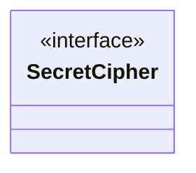

# src/core/contracts 架构

## 设计意图

定义跨业务共用的技术能力端口，使配置服务不必依赖具体操作系统或 Electron。

当前仅有 `SecretCipher` 加解密约定，由模型、网页及反馈配置消费，具体系统加密实现在平台层并由宿主注入。端口没有凭据存储或账号状态，密文持久化和何时解密仍由各配置服务负责。

## 主要组成

| 组成 | 定位 |
| --- | --- |
| [SecretCipher](secrets.ts) | 模型、网页和其他配置服务共用的凭据加解密技术端口。 |

<!-- architecture:generated:start -->

## 架构关系

[上层设计](../ARCHITECTURE.md)

<!-- architecture:generated:end -->
