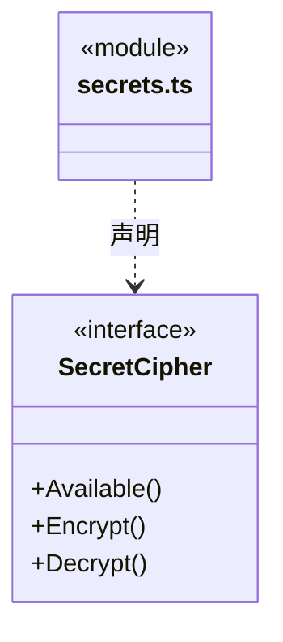

# src/core/contracts 架构

本目录只维护这一份说明。设计与契约直接编辑本文；文件清单、类图和导航由 [架构脚本](../../../scripts/source-architecture.mjs) 更新，生成区域之外的人工说明会保留。

## 封装意图

通用技术端口；当前 SecretCipher 由模型、Web 与反馈共同使用，具体平台实现由宿主注入。

## 类与模块的设计意图

下表依据源码声明及文件头说明定位封装。字段表示该实例持有的状态或协作引用，不表示它拥有被引用服务的生命周期；实际资源责任和调用限制见下文契约及源码注释。

| 类／模块 | 实现形式与实例字段 | 封装依据 |
| --- | --- | --- |
| [secrets.ts](secrets.ts) | 函数／契约模块 | 业务决定何时解析凭据，宿主提供系统加密；端口不依赖模型业务或具体平台。 |

## 接口设计契约

### 通用技术端口

当前只有 secrets.ts 的 SecretCipher，提供可用性与字符串加解密能力，不定义凭据用途、存储位置或错误策略。调用者在平台不可用时拒绝持久化密钥，不回退明文。模型原公开端口保留同一类型的兼容导出，Web 直接使用 Core；具体系统加密实现仍由宿主注入。

## 开闭边界

本目录的职责及允许协作由[封装意图](#封装意图)限定，输入输出、状态与失败语义以[接口设计契约](#接口设计契约)为准。扩展从已有公开入口及实际装配位置进入；没有明确可替换契约的部分按真实影响修改和验证，不预建未使用的基类或插件入口。

<!-- architecture:generated:start -->

## 文件清单

| 文件 | 形式 | 当前职责 |
| --- | --- | --- |
| [ARCHITECTURE.md](ARCHITECTURE.md) | 说明文档 | 本目录的文件清单、真实声明、依赖与子封装导航。 |
| [secrets.ts](secrets.ts) | 源码模块 | 模型、网页和其他配置服务共用的凭据加解密技术端口。 |

## 架构类图

成员标记：`+` 公开、`-` 私有、`#` 受保护、`$` 静态；构造函数单独列出。文档和资源仅在文件清单中导航，不作为代码节点。

### secrets.ts

## 子目录导航

无子目录。

[返回上层](../ARCHITECTURE.md)。

每次修改本目录代码，同步维护文件头、关键契约说明及本图。未实现的治理、证据验收和自动编排能力不列入当前类图。

<!-- architecture:generated:end -->
