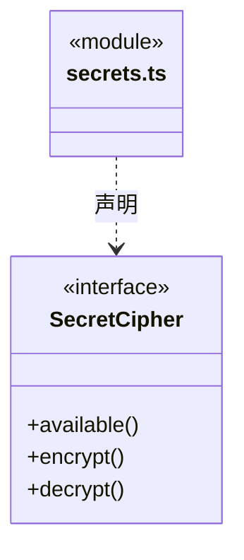

# src/core/contracts 架构

## 目录定位

通用技术端口；当前 SecretCipher 由模型、Web 与反馈共同使用，具体平台实现由宿主注入。

本文描述当前实现。通过分析目录边界后维护的 [源码架构脚本](../../../scripts/source-architecture.mjs) 同步清单和声明；代码变更时仍须核对职责、关键成员与关系。

## 代码清单

| 文件 | 当前职责 |
| --- | --- |
| [secrets.ts](secrets.ts) | 模型、网页和其他配置服务共用的凭据加解密技术端口。 |

## 架构类图

### secrets.ts

## 子目录导航

无子目录。

[返回上层](../ARCHITECTURE.md)。

每次修改本目录代码，同步维护文件头、关键契约说明及本图。未实现的治理、证据验收和自动编排能力不列入当前类图。

## 设计契约 v1 与落地范围

以下内容区分已接通能力与后续设计；以各节的实现状态为准，不将目标图当作现状图。维护源：[CONTRACT.md](CONTRACT.md)；生成类图时同步附加，勿直接修改本附录。

# 通用技术端口

当前只有 secrets.ts 的 SecretCipher，提供可用性与字符串加解密能力，不定义凭据用途、存储位置或错误策略。调用者在平台不可用时拒绝持久化密钥，不回退明文。模型原公开端口保留同一类型的兼容导出，Web 直接使用 Core；具体系统加密实现仍由宿主注入。
