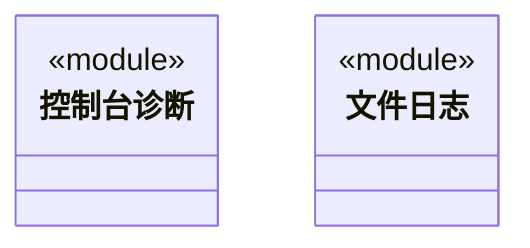

# Core Debug

## 设计意图

集中开发诊断的控制台输出和 JSON 行日志写入。调用方管理日志文件的位置、业务字段与事件顺序。

## 主要组成

| 入口 | 能力 |
| --- | --- |
| [控制台诊断](index.ts) | 将诊断参数交给当前宿主输出。 |
| [文件日志](node.ts) | 普通追加供工作区诊断使用，可靠追加在同步文件并关闭句柄后返回。 |

<!-- architecture:generated:start -->

## 架构关系

[上层设计](../ARCHITECTURE.md)

<!-- architecture:generated:end -->
