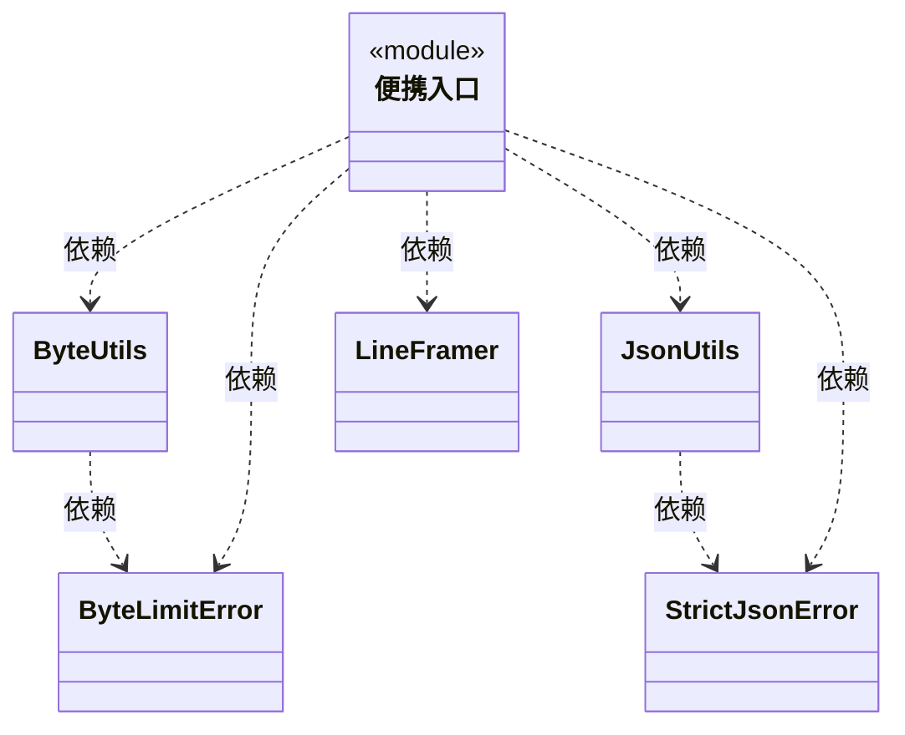
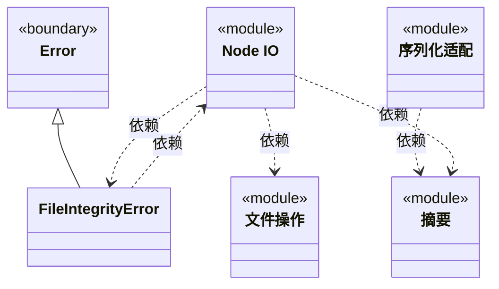
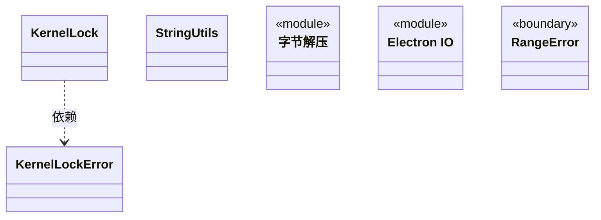
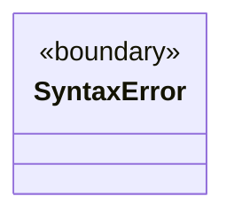

# Core IO

## 设计意图

统一维护字符串、字节、JSON 序列化和反序列化及其优化。便携入口可用于浏览器和服务端；文件、摘要与凭据操作按运行环境导入。

## 主要组成

| 入口 | 能力 |
| --- | --- |
| [ByteLimitError](bytes.ts) | 表达字节流超限这一技术事实，具体错误文案由消费者决定。 |
| [ByteUtils](bytes.ts) | 无状态的有界字节流读取；单次调用管理 reader、缓冲与取消监听。 |
| [StrictJsonError](json.ts) | 区分 JSON 语法错误与重复键事实，保留给消费者映射的错误身份。 |
| [JsonUtils](json.ts) | 维护 JSON 格式化、严格解析与键排序；parseJson 保留技术错误。 |
| [LineFramer](strings.ts) | 按单个输入流缓存文本并按 LF 分帧，保留未结束的尾部。 |
| [StringUtils](strings.ts) | 集中维护精确字符串处理算法，不持有业务状态。 |
| [FileIntegrityError](node.ts) | 区分超长与摘要校验失败。 |
| [便携入口](index.ts) | 字符串脱敏和分帧、有界字节读取、JSON 格式化和严格解析。 |
| [文件操作](text-files.ts) | 存在探测、读取 JSON 和原子替换文本文件。 |
| [摘要](digest.ts) | 计算字符串或可见字节范围的 SHA-256。 |
| [KernelLockError](locking.ts) | 区分锁占用和权限失败。 |
| [KernelLock](locking.ts) | 跨进程独占锁，独立入口按需装载原生库。 |
| [字节解压](compression.ts) | 对 gzip、deflate 和 Brotli 强制执行输出字节上限。 |
| [序列化适配](serialization.ts) | 既有 hash 和 json 名称映射到 IO 实现。 |
| [Node IO](node.ts) | 原子写入、JSON 文件读取、SHA-256 和带摘要校验的流式写盘。调用方拥有暂存目录及失败文件。 |
| [Electron IO](electron.ts) | 为可信桌面宿主提供系统凭据加解密。 |

<!-- architecture:generated:start -->

## 架构关系

### 关系组 1：便携入口

### 关系组 2：Node IO

### 关系组 3：KernelLockError

### 关系组 4：SyntaxError

### 跨图协作

按引用方归并目标，保留全部跨图关系；分图只用于阅读，不表示新增模块或依赖边界。

| 引用方 | 关系 | 目标 |
| --- | --- | --- |
| [ByteLimitError](bytes.ts)（图 1） | 继承 | `RangeError`（图 3） |
| [StrictJsonError](json.ts)（图 1） | 继承 | `SyntaxError`（图 4） |
| [便携入口](index.ts)（图 1） | 依赖 | [StringUtils](strings.ts)（图 3） |
| [KernelLockError](locking.ts)（图 3） | 继承 | `Error`（图 2） |
| [序列化适配](serialization.ts)（图 2） | 依赖 | [JsonUtils](json.ts)（图 1）、[便携入口](index.ts)（图 1） |

外部继承／实现边界：`RangeError`、`SyntaxError`、`Error`。

[上层设计](../ARCHITECTURE.md)

<!-- architecture:generated:end -->
