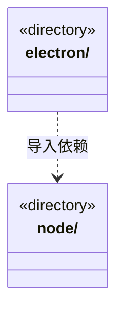

# src/core/platform 架构

本目录只维护这一份说明。设计与契约直接编辑本文；文件清单、类图和导航由 [架构脚本](../../../scripts/source-architecture.mjs) 更新，生成区域之外的人工说明会保留。

## 封装意图

按运行环境隔离基础实现；Node 提供摘要、原生锁、文件和网页，Electron 提供匿名网页适配与系统加密。便携 Core 不依赖平台。

## 类与模块的设计意图

本层没有直接源码声明，负责组合下级封装；各子系统的类、状态与公开入口见本文的[子目录导航](#子目录导航)。

## 接口设计契约

### 平台基础能力

按运行环境隔离必要的基础实现，业务策略仍留在调用方。当前只包含 Node SHA-256；不预建没有实现的 browser/electron 目录。

便携 utility 不依赖本目录。前端/View 不能引用 Node 或 Electron 实现，类型引用也不能穿透；允许使用某个平台不等于允许访问它的私有文件。Node 能力不依赖视图、桥接、业务或其他运行环境。

## 开闭边界

本目录的职责及允许协作由[封装意图](#封装意图)限定，输入输出、状态与失败语义以[接口设计契约](#接口设计契约)为准。扩展从已有公开入口及实际装配位置进入；没有明确可替换契约的部分按真实影响修改和验证，不预建未使用的基类或插件入口。

<!-- architecture:generated:start -->

## 文件清单

| 文件 | 形式 | 当前职责 |
| --- | --- | --- |
| [ARCHITECTURE.md](ARCHITECTURE.md) | 说明文档 | 本目录的文件清单、真实声明、依赖与子封装导航。 |

本层无直接代码文件。

## 架构类图

成员标记：`+` 公开、`-` 私有、`#` 受保护、`$` 静态；`function` 为函数值成员，`get`／`set` 为访问器。调用／构造／索引签名按匿名签名列出，不虚构方法名；`global.` 表示全局声明补充，非运行时嵌套类。构造函数单独列出，运行时私有字段保留 `#`。文档和资源仅在文件清单中导航，不作为代码节点。

各图中的同名节点表示同一目录边界；跨组及完整直接依赖如下（无边不代表继承）：

- `electron` → `node`：导入。

## 子目录导航

- [electron/](electron/ARCHITECTURE.md)：Electron 独立技术入口：匿名网页读取与系统加密；由可信 Bridge 注入，普通业务不导入 Electron。
- [node/](node/ARCHITECTURE.md)：Node 专属摘要、原生互斥锁、单文件 I/O 与网页读取，分别通过独立公开入口使用；不依赖业务或 Electron。

[返回上层](../ARCHITECTURE.md)。

每次修改本目录代码，同步维护文件头、关键契约说明及本图。未实现的治理、证据验收和自动编排能力不列入当前类图。

<!-- architecture:generated:end -->
