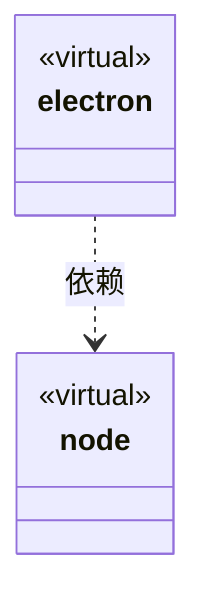

# src/core/platform 架构

## 设计意图

按运行环境封装技术实现，避免便携算法和纯协议隐式加载系统能力。

`node` 提供摘要、跨进程锁、单文件 I/O 和 HTTP 读取；`electron` 提供 Chromium 网页适配与系统加密。消费者按环境选择入口，Electron 能力由可信宿主注入业务；目录并列不表示所有平台能力可相互依赖。

## 主要组成

本层没有直接产品实现，由下方子模块组成；每个直接子模块作为一个虚拟封装，只在本层呈现整体职责与协作。

<!-- architecture:generated:start -->

## 架构关系

标注为 `virtual` 的节点是直接子模块的虚拟类封装；内部设计沿下方入口阅读。

## 子模块

| 虚拟封装 | 整体职责 |
| --- | --- |
| [electron](electron/ARCHITECTURE.md) | 将 Chromium 网页读取和系统加密适配为 Core 的小型技术接口，供可信桌面宿主装配。 |
| [node](node/ARCHITECTURE.md) | 集中 Node 专属的基础能力入口，隔离摘要、原生互斥、文件与网络实现对运行环境的依赖。 |

[上层设计](../ARCHITECTURE.md)

<!-- architecture:generated:end -->
