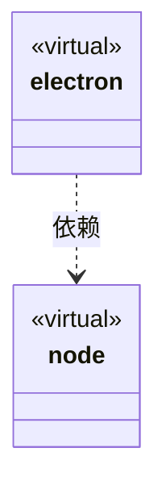

# src/core/platform 架构

## 设计意图

按运行环境隔离基础实现；Node 提供摘要、原生锁、文件和网页，Electron 提供匿名网页适配与系统加密。便携 Core 不依赖平台。

## 主要组成

本层由下列子模块组合，每个子模块作为独立的虚拟类封装参与本层协作。

<!-- architecture:generated:start -->

## 架构关系

标注为 `virtual` 的节点是直接子模块的虚拟类封装；内部设计沿下方入口阅读。

## 子模块

| 虚拟封装 | 整体职责 |
| --- | --- |
| [electron](electron/ARCHITECTURE.md) | Electron 独立技术入口：匿名网页读取与系统加密；由可信 Bridge 注入，普通业务不导入 Electron。 |
| [node](node/ARCHITECTURE.md) | Node 专属摘要、原生互斥锁、单文件 I/O 与网页读取，分别通过独立公开入口使用；不依赖业务或 Electron。 |

[上层设计](../ARCHITECTURE.md)

<!-- architecture:generated:end -->
