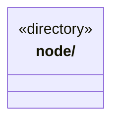

# src/core/platform 架构

## 目录定位

按运行环境隔离基础实现；当前 Node 提供摘要与单文件 I/O，便携 Core 不依赖平台实现。

本文描述当前实现。通过分析目录边界后维护的 [源码架构脚本](../../../scripts/source-architecture.mjs) 同步清单和声明；代码变更时仍须核对职责、关键成员与关系。

## 代码清单

本层无直接代码文件。

## 架构类图

各图中的同名节点表示同一目录边界；跨组及完整直接依赖如下（无边不代表继承）：

本层无目录间直接导入关系。

## 子目录导航

- [node/](node/ARCHITECTURE.md)：Node 专属摘要及文件能力分别从 digest.ts 与 files/index.ts 公开；不决定业务字段、路径权限或事务。浏览器与便携入口禁止加载本目录。

[返回上层](../ARCHITECTURE.md)。

每次修改本目录代码，同步维护文件头、关键契约说明及本图。未实现的治理、证据验收和自动编排能力不列入当前类图。

## 设计契约 v1 与落地范围

以下内容区分已接通能力与后续设计；以各节的实现状态为准，不将目标图当作现状图。维护源：[CONTRACT.md](CONTRACT.md)；生成类图时同步附加，勿直接修改本附录。

# 平台基础能力

按运行环境隔离必要的基础实现，业务策略仍留在调用方。当前只包含 Node SHA-256；不预建没有实现的 browser/electron 目录。

便携 utility 不依赖本目录。前端/View 不能引用 Node 或 Electron 实现，类型引用也不能穿透；允许使用某个平台不等于允许访问它的私有文件。Node 能力不依赖视图、桥接、业务或其他运行环境。
