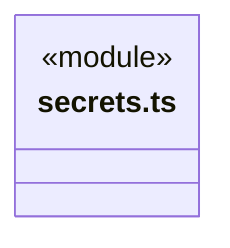
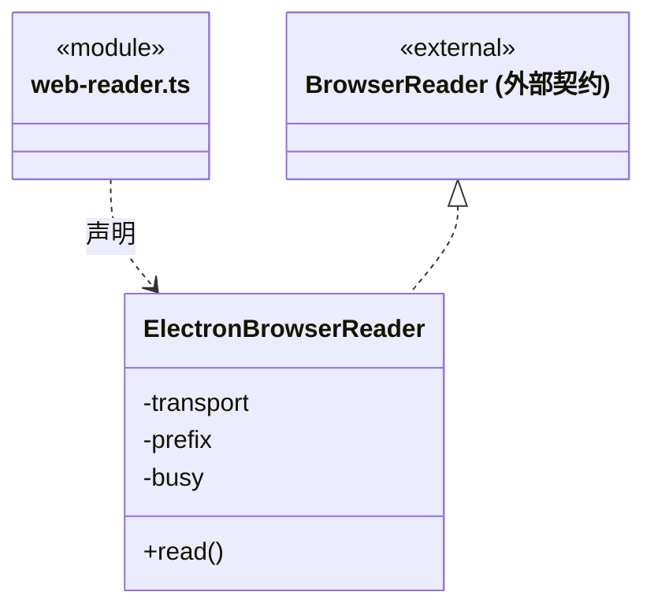

# src/core/platform/electron 架构

## 目录定位

Electron 独立技术入口：匿名网页读取与系统加密；由可信 Bridge 注入，普通业务不导入 Electron。

本文描述当前实现。通过分析目录边界后维护的 [源码架构脚本](../../../../scripts/source-architecture.mjs) 同步清单和声明；代码变更时仍须核对职责、关键成员与关系。

## 代码清单

| 文件 | 当前职责 |
| --- | --- |
| [secrets.ts](secrets.ts) | 用 Electron 系统加密能力保护 LLM 与 GitHub 反馈凭据。 |
| [web-reader.ts](web-reader.ts) | 基础网页能力的 Electron/Chromium 适配，采集脚本执行后的正文及跨域 iframe。 |

## 架构类图

### secrets.ts

直接依赖：[../../contracts/secrets.ts](../../contracts/secrets.ts)。

### web-reader.ts

直接依赖：[../node/web/index.ts](../node/web/index.ts)、[../../web/index.ts](../../web/index.ts)。

## 子目录导航

无子目录。

[返回上层](../ARCHITECTURE.md)。

每次修改本目录代码，同步维护文件头、关键契约说明及本图。未实现的治理、证据验收和自动编排能力不列入当前类图。

## 设计契约 v1 与落地范围

以下内容区分已接通能力与后续设计；以各节的实现状态为准，不将目标图当作现状图。维护源：[CONTRACT.md](CONTRACT.md)；生成类图时同步附加，勿直接修改本附录。

# Electron 技术适配

web-reader.ts 是独立宿主入口；只在桌面 ready 后由 bridge/server/main.ts 装配，普通 Node 和业务纯入口不加载它。实现 Core BrowserReader，使用 Core Node web 的公开代理和地址校验。

保持匿名内存会话、隐藏隔离窗口、逐资源授权、取消释放、跨域 iframe 采集与一次读取限额。没有登录、任意脚本或点击入口；最多两个并行槽位，错误不被改写为页面私有。具体限额与资源清理规则见 [网页读取契约](../node/web/CONTRACT.md)。

真实 Electron 验证由 tests/web-browser-electron-fixture.ts 和 scripts/web-browser-smoke.mjs 承担，单元通过不等同于真实网站验收。

system-secret-cipher.ts 实现 core/contracts/secrets.ts 的 SecretCipher，通过 Electron safeStorage 加解密；由 Bridge 向 Logic 配置服务注入。凭据与业务配置的持久化、版本及解密时机归调用方，Core 不持有账号或模型状态。
