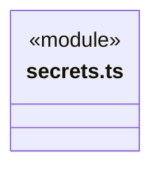
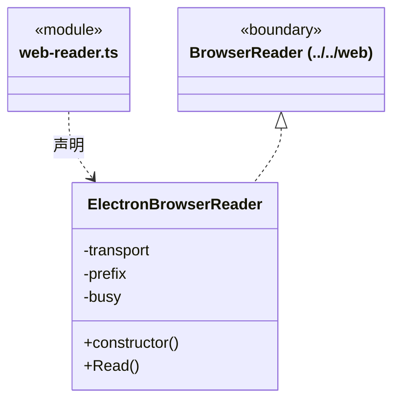

# src/core/platform/electron 架构

本目录只维护这一份说明。设计与契约直接编辑本文；文件清单、类图和导航由 [架构脚本](../../../../scripts/source-architecture.mjs) 更新，生成区域之外的人工说明会保留。

## 封装意图

Electron 独立技术入口：匿名网页读取与系统加密；由可信 Bridge 注入，普通业务不导入 Electron。

## 类与模块的设计意图

下表依据源码声明及文件头说明定位封装。字段表示该实例持有的状态或协作引用，不表示它拥有被引用服务的生命周期；实际资源责任和调用限制见下文契约及源码注释。

| 类／模块 | 实现形式与实例字段 | 封装依据 |
| --- | --- | --- |
| [secrets.ts](secrets.ts) | 函数／契约模块 | 平台实现位于 Core Electron 入口，只组合独立 SecretCipher 技术契约；禁止不安全的明文回退。 |
| [ElectronBrowserReader](web-reader.ts) | 实例类；持有 `prefix`、`busy`、`transport` | 由 Electron ready 后的桌面入口创建；不会被 CLI、模型工具参数或前端直接构造。 |

## 接口设计契约

### Electron 技术适配

web-reader.ts 是独立宿主入口；只在桌面 ready 后由 bridge/server/main.ts 装配，普通 Node 和业务纯入口不加载它。实现 Core BrowserReader，使用 Core Node web 的公开代理和地址校验。

保持匿名内存会话、隐藏隔离窗口、逐资源授权、取消释放、跨域 iframe 采集与一次读取限额。没有登录、任意脚本或点击入口；最多两个并行槽位，错误不被改写为页面私有。具体限额与资源清理规则见 [网页读取契约](../node/web/ARCHITECTURE.md#contract)。

真实 Electron 验证由 tests/web-browser-electron-fixture.ts 和 scripts/web-browser-smoke.mjs 承担，单元通过不等同于真实网站验收。

system-secret-cipher.ts 实现 core/contracts/secrets.ts 的 SecretCipher，通过 Electron safeStorage 加解密；由 Bridge 向 Logic 配置服务注入。凭据与业务配置的持久化、版本及解密时机归调用方，Core 不持有账号或模型状态。

## 开闭边界

本目录的职责及允许协作由[封装意图](#封装意图)限定，输入输出、状态与失败语义以[接口设计契约](#接口设计契约)为准。扩展从已有公开入口及实际装配位置进入；没有明确可替换契约的部分按真实影响修改和验证，不预建未使用的基类或插件入口。

<!-- architecture:generated:start -->

## 文件清单

| 文件 | 形式 | 当前职责 |
| --- | --- | --- |
| [ARCHITECTURE.md](ARCHITECTURE.md) | 说明文档 | 本目录的文件清单、真实声明、依赖与子封装导航。 |
| [secrets.ts](secrets.ts) | 源码模块 | 用 Electron 系统加密能力保护 LLM 与 GitHub 反馈凭据。 |
| [web-reader.ts](web-reader.ts) | 源码模块 | 基础网页能力的 Electron/Chromium 适配，采集脚本执行后的正文及跨域 iframe。 |

## 架构类图

成员标记：`+` 公开、`-` 私有、`#` 受保护、`$` 静态；`function` 为函数值成员，`get`／`set` 为访问器。调用／构造／索引签名按匿名签名列出，不虚构方法名；`global.` 表示全局声明补充，非运行时嵌套类。构造函数单独列出，运行时私有字段保留 `#`。文档和资源仅在文件清单中导航，不作为代码节点。

### secrets.ts

[查看源码](secrets.ts)。

直接依赖：[../../contracts/secrets.ts](../../contracts/secrets.ts)。

### web-reader.ts

[查看源码](web-reader.ts)。

继承／实现来源：`BrowserReader` → [../../web/browser-reader.ts](../../web/browser-reader.ts)（声明 `BrowserReader`）。
直接依赖：[../node/web/index.ts](../node/web/index.ts)、[../../web/index.ts](../../web/index.ts)。

## 子目录导航

无子目录。

[返回上层](../ARCHITECTURE.md)。

每次修改本目录代码，同步维护文件头、关键契约说明及本图。未实现的治理、证据验收和自动编排能力不列入当前类图。

<!-- architecture:generated:end -->
