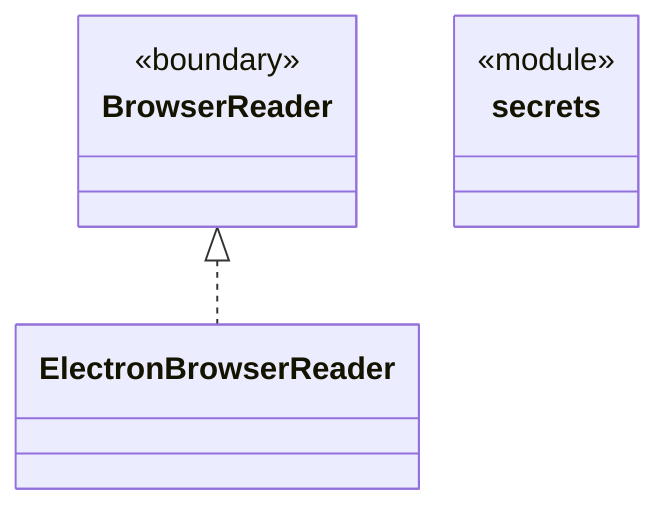

# src/core/platform/electron 架构

## 设计意图

将 Chromium 网页读取和系统加密适配为 Core 的小型技术接口，供可信桌面宿主装配。

`ElectronBrowserReader` 执行匿名页面采集并管理本次浏览资源，`secrets` 使用 Electron 系统加密。两项能力相互独立，不拥有业务登录、网页工具权限或配置文件；Logic 消费注入端口而不导入 Electron。

## 主要组成

| 组成 | 定位 |
| --- | --- |
| [ElectronBrowserReader](web-reader.ts) | 基础网页能力的 Electron/Chromium 适配，采集脚本执行后的正文及跨域 iframe。 |
| [secrets](secrets.ts) | 用 Electron 系统加密能力保护 LLM 与 GitHub 反馈凭据。 |

<!-- architecture:generated:start -->

## 架构关系

外部继承／实现边界：[BrowserReader](../../web/browser-reader.ts)。

[上层设计](../ARCHITECTURE.md)

<!-- architecture:generated:end -->
