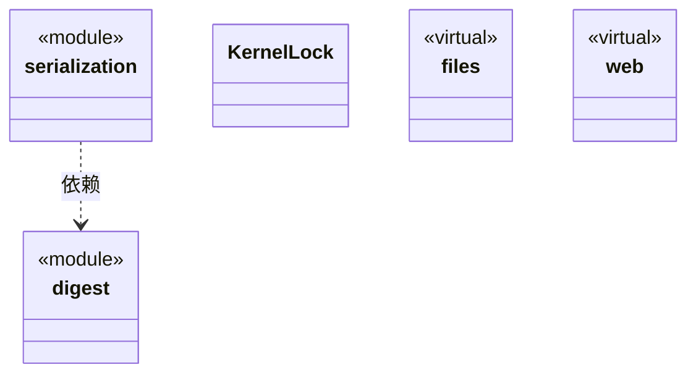

# src/core/platform/node 架构

## 设计意图

Node 专属摘要、原生互斥锁、单文件 I/O 与网页读取，分别通过独立公开入口使用；不依赖业务或 Electron。

## 主要组成

| 组成 | 定位 |
| --- | --- |
| [KernelLock](locking.ts) | Core 的 Node 原生锁入口；KernelLock：使用 Windows mutex 或 POSIX flock，防止跨进程并发持有。 |
| [digest](digest.ts) | 共享 Core 的 Node 专属摘要入口，提供 SHA-256 摘要。 |
| [serialization](serialization.ts) | 后端既有 hash/json 名称的兼容适配，格式化来自共享 Core utility，摘要来自独立 Node 入口。 |

<!-- architecture:generated:start -->

## 架构关系

标注为 `virtual` 的节点是直接子模块的虚拟类封装；内部设计沿下方入口阅读。

## 子模块

| 虚拟封装 | 整体职责 |
| --- | --- |
| [files](files/ARCHITECTURE.md) | Node 单文件 I/O 基础方案：存在探测、JSON 读取、内容 fsync 后原子替换；路径权限、并发顺序和业务事务属于调用方。 |
| [web](web/ARCHITECTURE.md) | Node 网页读取机制：安全 HTTP、静态正文、robots、节流、缓存和一次浏览器兜底；仅组合 Core 纯网页入口。 |

[上层设计](../ARCHITECTURE.md)

<!-- architecture:generated:end -->
