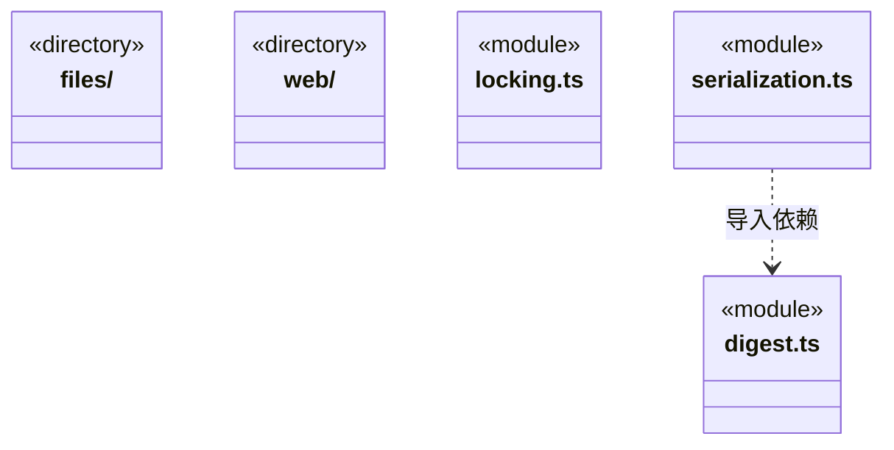
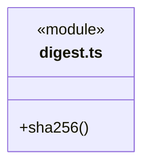

# src/core/platform/node 架构

本目录只维护这一份说明。设计与契约直接编辑本文；文件清单、类图和导航由 [架构脚本](../../../../scripts/source-architecture.mjs) 更新，生成区域之外的人工说明会保留。

## 封装意图

Node 专属摘要、原生互斥锁、单文件 I/O 与网页读取，分别通过独立公开入口使用；不依赖业务或 Electron。

## 类与模块的设计意图

下表依据源码声明及文件头说明定位封装。字段表示该实例持有的状态或协作引用，不表示它拥有被引用服务的生命周期；实际资源责任和调用限制见下文契约及源码注释。

| 类／模块 | 实现形式与实例字段 | 封装依据 |
| --- | --- | --- |
| [digest.ts](digest.ts) | 函数／契约模块 | 把 Node 依赖与通用算法隔离；直接承载现有算法，避免仅为转发增加一层文件。 |
| [KernelLock](locking.ts) | 实例类；持有 `handle`、`fd`、`key` | 同步获取操作系统互斥锁；不等待、不重试，调用方负责在 finally 中释放。 |
| [serialization.ts](serialization.ts) | 函数／契约模块 | 知识版本及幂等指纹保留原字节、错误和导入契约；json 直接引用 JsonUtils.FormatJson，保持函数身份而不创建第二套算法。 |

## 接口设计契约

### Node 摘要与文件

单文件 I/O 通过 [files/index.ts](files/index.ts) 使用，契约见 [files](files/ARCHITECTURE.md#contract)。模型服务与 Logic 存储适配直接组合此入口，不能穿透 text-files.ts；没有旧路径转发。文件原子替换不承担业务事务或跨进程锁。

摘要公开入口为 digest.ts 的 sha256：字符串按 UTF-8、字节视图按可见范围计算 SHA-256，返回小写十六进制。仅依赖 node:crypto，无文件或网络副作用。

本目录 serialization.ts 的 hash 名称仍单向重导出此实现，历史知识版本和指纹字节保持。Node 摘要不经 core/utility 导出，View/前端/桥接客户端不得导入。现阶段引擎、调度器、更新器也不因新增 Core 而扩大原依赖许可。

独立单元仍在 tests/unit/foundations/utility/digest.test.ts，模块归属为 core/platform/node。字段选择、序列化顺序、授权或验签决定不属于摘要算法。

#### 原生互斥锁

locking.ts 提供 KernelLock，使用 Windows mutex 或 POSIX flock。保留 Global\\CBIM 命名、scope/id 键、错误与进程内 held 集合；创建目录、重试、事务顺序与释放时机由消费者决定。工作区、资源、执行和反馈消费者直接导入此唯一构造器，旧锁转发入口已移除。koffi 只按固定安装包或 node_modules 路径加载；便携 Core 和前端不得导入。

#### 共享算法调用边界

本目录通过 Core 公开入口调用 `JsonUtils.FormatJson`。静态类只承载原算法；本目录继续决定字段、比较器、错误映射及资源生命周期。函数改为静态方法不改变原持久化字节或失败语义。

## 开闭边界

本目录的职责及允许协作由[封装意图](#封装意图)限定，输入输出、状态与失败语义以[接口设计契约](#接口设计契约)为准。扩展从已有公开入口及实际装配位置进入；没有明确可替换契约的部分按真实影响修改和验证，不预建未使用的基类或插件入口。

<!-- architecture:generated:start -->

## 文件清单

| 文件 | 形式 | 当前职责 |
| --- | --- | --- |
| [ARCHITECTURE.md](ARCHITECTURE.md) | 说明文档 | 本目录的文件清单、真实声明、依赖与子封装导航。 |
| [digest.ts](digest.ts) | 源码模块 | 共享 Core 的 Node 专属摘要入口，提供 SHA-256 摘要。 |
| [locking.ts](locking.ts) | 源码模块 | Core 的 Node 原生锁入口；KernelLock：使用 Windows mutex 或 POSIX flock，防止跨进程并发持有。 |
| [serialization.ts](serialization.ts) | 源码模块 | 后端既有 hash/json 名称的兼容适配，格式化来自共享 Core utility，摘要来自独立 Node 入口。 |

## 架构类图

成员标记：`+` 公开、`-` 私有、`#` 受保护、`$` 静态；构造函数单独列出。文档和资源仅在文件清单中导航，不作为代码节点。

各图中的同名节点表示同一目录边界；跨组及完整直接依赖如下（无边不代表继承）：

- `serialization.ts` → `digest.ts`：导入。

### digest.ts 公开入口

## 子目录导航

- [files/](files/ARCHITECTURE.md)：Node 单文件 I/O 基础方案：存在探测、JSON 读取、内容 fsync 后原子替换；路径权限、并发顺序和业务事务属于调用方。
- [web/](web/ARCHITECTURE.md)：Node 网页读取机制：安全 HTTP、静态正文、robots、节流、缓存和一次浏览器兜底；仅组合 Core 纯网页入口。

[返回上层](../ARCHITECTURE.md)。

每次修改本目录代码，同步维护文件头、关键契约说明及本图。未实现的治理、证据验收和自动编排能力不列入当前类图。

<!-- architecture:generated:end -->
