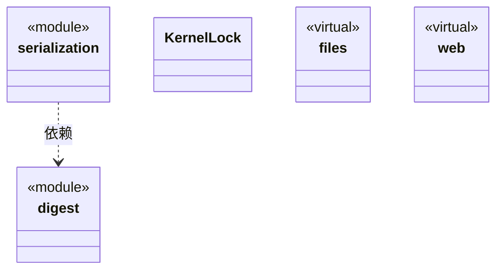

# src/core/platform/node 架构

## 设计意图

集中 Node 专属的基础能力入口，隔离摘要、原生互斥、文件与网络实现对运行环境的依赖。

`KernelLock` 表达跨进程独占，`digest` 计算 SHA-256，`serialization` 保留原 hash/json 兼容名称。`files` 与 `web` 独立封装 I/O 方案；锁的业务范围和释放时机由持有者决定，本层不认识应用生命周期。

## 主要组成

| 组成 | 定位 |
| --- | --- |
| [KernelLock](locking.ts) | 实例持有 Windows mutex 或 POSIX flock；供消费者在明确范围内取得与释放跨进程独占。 |
| [digest](digest.ts) | 共享 Core 的 Node 专属摘要入口，提供 SHA-256 摘要。 |
| [serialization](serialization.ts) | 后端既有 hash/json 名称的兼容适配，格式化来自共享 Core utility，摘要来自独立 Node 入口。 |

## 现状与目标边界

当前 [locking.ts](locking.ts)、[digest.ts](digest.ts) 和 [serialization.ts](serialization.ts) 仍与 files/web 子模块同层。前两项是独立技术实现，serialization 是已有 hash/json 名称的兼容入口。目标是按锁、摘要与序列化适配的职责聚合，不混入一个通用杂项模块；迁移要保持锁构造器身份和 hash/json 行为，并继续隔离便携入口与 Node 入口。

<!-- architecture:generated:start -->

## 架构关系

标注为 `virtual` 的节点是直接子模块的虚拟类封装；内部设计沿下方入口阅读。

## 子模块

| 虚拟封装 | 整体职责 |
| --- | --- |
| [files](files/ARCHITECTURE.md) | 提供可复用的单文件读取与原子文本替换机制，让业务单独决定路径权限、并发与事务范围。 |
| [web](web/ARCHITECTURE.md) | 组合公开 HTTP 传输、正文提取和可选浏览器读取，提供有界的网页读取技术方案。 |

[上层设计](../ARCHITECTURE.md)

<!-- architecture:generated:end -->
