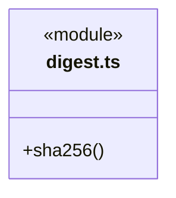

# src/core/platform/node 架构

## 目录定位

Node 专属摘要公开入口 digest.ts，仅以 node:crypto 计算 SHA-256；字段选择、序列化、权限与验签由业务负责。前端、桥接客户端及便携 Core 不得依赖此目录。

本文描述当前实现。通过分析目录边界后维护的 [源码架构脚本](../../../../scripts/source-architecture.mjs) 同步清单和声明；代码变更时仍须核对职责、关键成员与关系。

## 代码清单

| 文件 | 当前职责 |
| --- | --- |
| [digest.ts](digest.ts) | 共享 Core 的 Node 专属摘要入口，提供 SHA-256 摘要。 |

## 架构类图

### digest.ts

## 子目录导航

无子目录。

[返回上层](../ARCHITECTURE.md)。

每次修改本目录代码，同步维护文件头、关键契约说明及本图。未实现的治理、证据验收和自动编排能力不列入当前类图。

## 设计契约 v1 与落地范围

以下内容区分已接通能力与后续设计；以各节的实现状态为准，不将目标图当作现状图。维护源：[CONTRACT.md](CONTRACT.md)；生成类图时同步附加，勿直接修改本附录。

# Node 摘要

当前公开入口为 digest.ts 的 sha256：字符串按 UTF-8、字节视图按可见范围计算 SHA-256，返回小写十六进制。仅依赖 node:crypto，无文件或网络副作用。

原 backend/core/foundation/serialization.ts 的 hash 名称仍单向重导出此实现，历史知识版本和指纹字节保持。Node 摘要不经 core/utility 导出，View/前端/桥接客户端不得导入。现阶段引擎、调度器、更新器也不因新增 Core 而扩大原依赖许可。

独立单元仍在 tests/unit/foundations/utility/digest.test.ts，模块归属为 core/platform/node。字段选择、序列化顺序、授权或验签决定不属于摘要算法。
