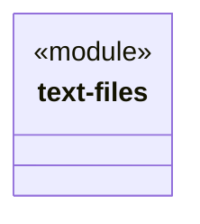

# src/core/platform/node/files 架构

## 设计意图

Node 单文件 I/O 基础方案：存在探测、JSON 读取、内容 fsync 后原子替换；路径权限、并发顺序和业务事务属于调用方。

## 主要组成

| 组成 | 定位 |
| --- | --- |
| [text-files](text-files.ts) | 公开入口背后的单文件读取与原子文本替换机制。 |

<!-- architecture:generated:start -->

## 架构关系

[上层设计](../ARCHITECTURE.md)

<!-- architecture:generated:end -->
