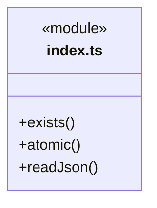
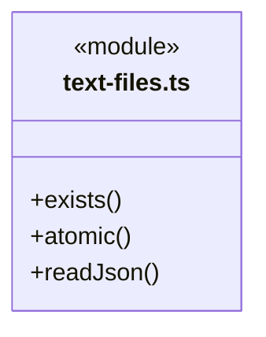
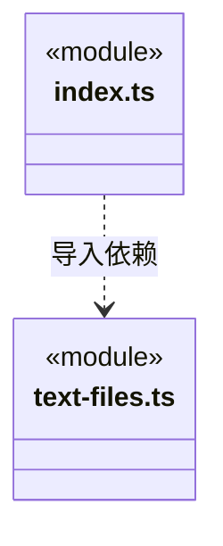

# src/core/platform/node/files 架构

本目录只维护这一份说明。设计与契约直接编辑本文；文件清单、类图和导航由 [架构脚本](../../../../../scripts/source-architecture.mjs) 更新，生成区域之外的人工说明会保留。

## 封装意图

Node 单文件 I/O 基础方案：存在探测、JSON 读取、内容 fsync 后原子替换；路径权限、并发顺序和业务事务属于调用方。

## 类与模块的设计意图

下表依据源码声明及文件头说明定位封装。字段表示该实例持有的状态或协作引用，不表示它拥有被引用服务的生命周期；实际资源责任和调用限制见下文契约及源码注释。

| 类／模块 | 实现形式与实例字段 | 封装依据 |
| --- | --- | --- |
| [index.ts](index.ts) | 函数／契约模块 | 目录策略、权限授予与业务事务属于调用者；此独立 Node 入口只提供单文件 I/O，不认识工作区或业务。 |
| [text-files.ts](text-files.ts) | 函数／契约模块 | 写同目录临时文件、同步内容、再重命名，让配置和存储共享机制，业务自行决定序列化与提交时机。 |

## 接口设计契约

### 单文件存储原语

公开入口为 index.ts；只依赖 Node 标准库，不依赖 Core 业务、父目录约定或其他能力。`exists`、`readJson` 和 `atomic` 的实现位于 text-files.ts；消费者直接引用本目录公开入口，不能穿透私有实现。

- `atomic` 创建父目录，用同目录独占 0600 临时文件写 UTF-8 文本，fsync 内容并关闭后 rename。写入或替换失败均清理本次临时文件。返回成功不承诺目录 fsync、断电恢复或多文件原子事务。
- `exists` 保持 access 失败即 false 的原语义，不能区分缺失与无权限；不得据此授予访问。`readJson<T>` 不验证 T 对应的业务 Schema，解析/读取错误由调用方处理。
- 调用者负责可信路径、权限、版本冲突、跨进程锁、序列化格式和提交后状态发布。同一路径的并发写不会由基础库自动合并；需要顺序时消费者组合独立队列。

真实消费者为知识文件探测、Logic 模型服务与 Main 的配置、资源、工作区、历史及存储适配。新增一种配置不修改原子替换机制，只在业务模块定义 Schema、路径和生效规则。对受控文件写入、命名空间身份核验、签名更新和多文件日志事务，不以此原语替换其安全/一致性流程。

模块测试在 `tests/unit/foundations/files.test.ts`；失败清理使用真实目录及受控写入故障，不初始化 Application。

## 开闭边界

本目录的职责及允许协作由[封装意图](#封装意图)限定，输入输出、状态与失败语义以[接口设计契约](#接口设计契约)为准。扩展从已有公开入口及实际装配位置进入；没有明确可替换契约的部分按真实影响修改和验证，不预建未使用的基类或插件入口。

<!-- architecture:generated:start -->

## 文件清单

| 文件 | 形式 | 当前职责 |
| --- | --- | --- |
| [ARCHITECTURE.md](ARCHITECTURE.md) | 说明文档 | 本目录的文件清单、真实声明、依赖与子封装导航。 |
| [index.ts](index.ts) | 源码模块 | Node 文件基础能力的公开入口，供存储适配使用。 |
| [text-files.ts](text-files.ts) | 源码模块 | 公开入口背后的单文件读取与原子文本替换机制。 |

## 架构类图

成员标记：`+` 公开、`-` 私有、`#` 受保护、`$` 静态；`function` 为函数值成员，`get`／`set` 为访问器。调用／构造／索引签名按匿名签名列出，不虚构方法名；`global.` 表示全局声明补充，非运行时嵌套类。构造函数单独列出，运行时私有字段保留 `#`。文档和资源仅在文件清单中导航，不作为代码节点。

### index.ts

[查看源码](index.ts)。

直接依赖：[text-files.ts](text-files.ts)。

### text-files.ts

[查看源码](text-files.ts)。

### 本目录调用边界

## 子目录导航

无子目录。

[返回上层](../ARCHITECTURE.md)。

每次修改本目录代码，同步维护文件头、关键契约说明及本图。未实现的治理、证据验收和自动编排能力不列入当前类图。

<!-- architecture:generated:end -->
