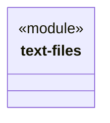

# src/core/platform/node/files 架构

## 设计意图

提供可复用的单文件读取与原子文本替换机制，让业务单独决定路径权限、并发与事务范围。

`index.ts` 公开 `text-files` 的存在探测、JSON 读取和替换能力；写入先同步文件内容再替换目标。这里没有多文件事务、业务回执或恢复账本，也不承诺目录 fsync、跨进程串行或崩溃临时文件清理。

## 主要组成

| 组成 | 定位 |
| --- | --- |
| [text-files](text-files.ts) | 公开入口背后的单文件读取与原子文本替换机制。 |

<!-- architecture:generated:start -->

## 架构关系

[上层设计](../ARCHITECTURE.md)

<!-- architecture:generated:end -->
