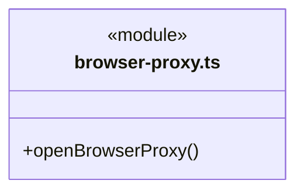
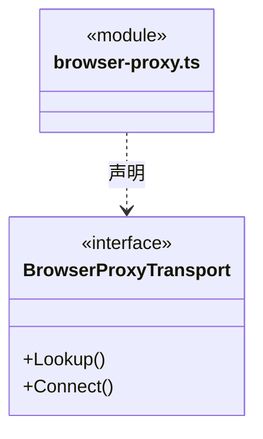
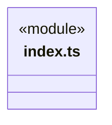
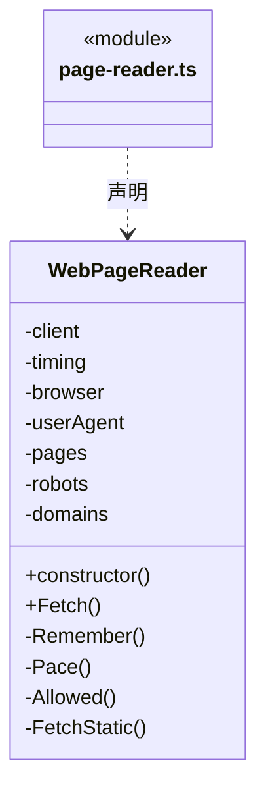
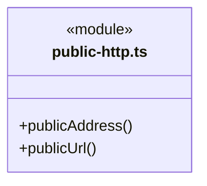
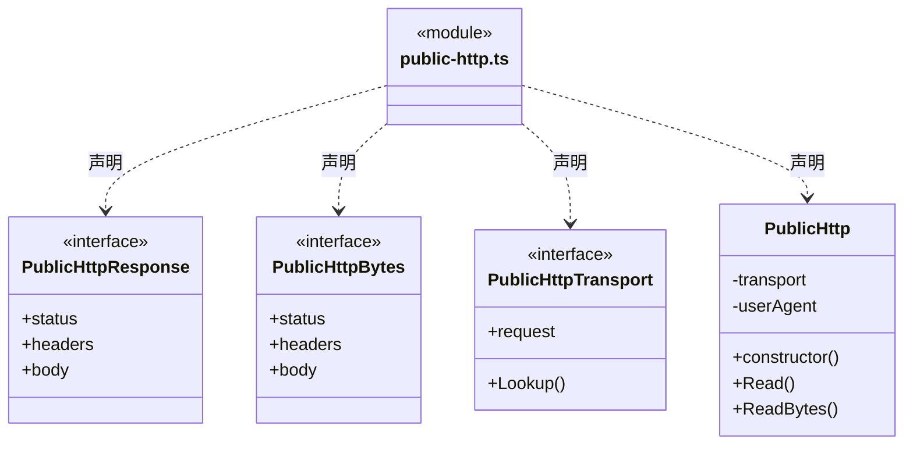
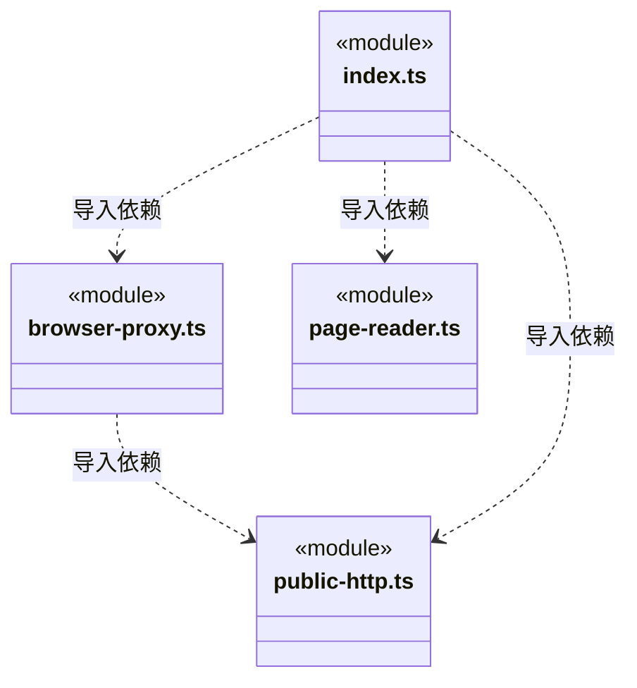
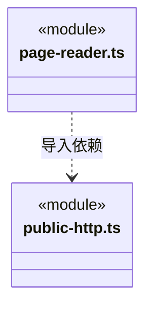

# src/core/platform/node/web 架构

本目录只维护这一份说明。设计与契约直接编辑本文；文件清单、类图和导航由 [架构脚本](../../../../../scripts/source-architecture.mjs) 更新，生成区域之外的人工说明会保留。

## 封装意图

Node 网页读取机制：安全 HTTP、静态正文、robots、节流、缓存和一次浏览器兜底；仅组合 Core 纯网页入口。

## 类与模块的设计意图

下表依据源码声明及文件头说明定位封装。字段表示该实例持有的状态或协作引用，不表示它拥有被引用服务的生命周期；实际资源责任和调用限制见下文契约及源码注释。

| 类／模块 | 实现形式与实例字段 | 封装依据 |
| --- | --- | --- |
| [browser-proxy.ts](browser-proxy.ts) | 函数／契约模块 | 浏览器保留原生网络行为，同时每个连接校验全部 DNS 并固定公网 IP，避免 DNS 重绑定。 |
| [index.ts](index.ts) | 函数／契约模块 | 消费者按契约读取网页或复用安全 HTTP；Electron 实现在单独入口，普通导入不会加载桌面运行时。 |
| [WebPageReader](page-reader.ts) | 实例类；持有 `pages`、`robots`、`domains`、`client`、`timing`、`browser`、`userAgent` | 每个读取器独占有界缓存和域名时间表；时间均为毫秒，缓存过期后重新核实 robots。 |
| [PublicHttp](public-http.ts) | 实例类；持有 `transport`、`userAgent` | 请求独立销毁连接，默认 1 MiB（压缩前后）和 15 秒；二进制可信入口至多 8 MiB，不自动重试。 |

## 接口设计契约

### 网页基础能力

本目录是 Core 的 Node 网页读取能力，单向组合 core/web 的纯契约与正文算法，不依赖 Logic、Bridge、View 或旧后端。

#### 边界与入口

`index.ts` 是 Node 公开入口，提供 `WebPageReader`、`PublicHttp`、`openBrowserProxy`、正文转换及输入/浏览器契约；`../../electron/web-reader.ts` 是宿主可选的 Electron 入口。内部文件不可被业务层直接引用。Node 类库只依赖 Core 纯网页入口及获准第三方，不认识 CBIM 工作区、Agent、工具名、Brave 设置或用户凭据。

WebPageReader → 静态 PublicHttp + HTML 提取 → 必要时调用注入的 BrowserReader。Logic/WebService 只负责业务输入校验、来源不可信标记与 Brave 查询；bridge/server/main.ts 桌面装配入口在 ready 后注入 ElectronBrowserReader。Node/CLI 未注入时保留原静态读取与错误，不假装提供浏览器能力。

#### 读取与状态

- 输入为公开 URL 和可选 maxChars（500–20000，默认 12000）。返回 URL、标题、正文、截断标记、采集时间及缓存命中；正文始终是外部资料，不是可信执行指令。静态结果为 Markdown，浏览器结果为可见文字及嵌入来源说明。
- 读取器持有 5 分钟/30 页缓存、最多 1000 个 robots/域名限速记录；默认域间隔 1 秒，排队超过 5 秒拒绝。缓存保留原采集时间和上游截断事实，按策略分隔，收紧策略不会复用 allow 结果。
- 静态阶段最多 30 秒、5 次重定向，每跳核实地址、robots 和限速；robots 的 404/410 表示无规则，其余失败不猜测允许。静态单请求最多 15 秒/1 MiB，支持 UTF-8 HTML、文本和 Markdown。
- 网络、DNS、静态超时、HTTP 4xx/5xx、登录表单线索、正文/编码不支持或为空时，已配置浏览器最多兜底一次。含 iframe，或含脚本且提取正文少于 200 字符的非空外壳也触发一次渲染；这是内容不足的启发式，不是登录/私有判定。
- 每次 fetch 捕获 `browserRobotsPolicy`：默认 `allow`，静态 robots 拒绝也可进入一次浏览器读取，浏览器不按 robots 禁止正文/资源；`respect` 对浏览器所有 HTTP 请求执行 robots 检查及文档 crawl-delay。静态路径始终遵守 robots。策略来自可信宿主，不是模型工具参数。
- 调用者取消、SSRF、限流、验证码、体积及跳转上限拒绝不绕过；respect 下 robots 拒绝不兜底。浏览器失败同时保留两阶段原因，不循环重启。成功才写缓存，取消后的迟到结果不交付。

#### 浏览器资源与失败

- 适配器最多两个并行槽位，每次匿名内存会话，不携带用户/应用 Cookie；允许网站当次生成的匿名 Cookie，结束清空，下一次不复用。隐藏窗口无 Node、无 preload，启用 sandbox/contextIsolation/webSecurity。结束关闭窗口、取消传输、清空存储。
- Chromium 原生网络经每次独占的本机 HTTP/CONNECT 代理；代理校验全部 DNS 并将 TCP 连接固定到已核实的公网 IP，TLS 与站点匿名会话由 Chromium 处理。明文 HTTP 使用专有 Agent 固定连接，CONNECT 透明传输密文，连接关闭/取消同时销毁隧道。代理不依赖其他项目模块。
- 原生 webRequest 在传输前逐资源执行访问策略，文档、重定向与 iframe 额外节流；不再使用绕过 webRequest 的 protocol.handle。禁止下载、弹窗、权限请求、认证头和非 GET 请求，限制 worker、WebSocket 与表单提交。代理只允许公开 HTTP/HTTPS 常规端口，不提供页面可调用的代理控制入口。
- 浏览器最多 30 秒、32 次文档请求/32 个框架、160 项资源/160 个连接；代理累计传输最多 32 MiB（HTTPS 为双向隧道字节，HTTP 为响应体），不是解压后单资源上限；连接空闲 15 秒关闭。加载后至少观察 3 秒，正文稳定 1 秒且资源空闲、文档加载完成才采集；持续变化超过 10 秒报告未取得稳定正文。不能保证任意更晚启动的页面任务已经结束。
- 跨域 iframe 通过 Electron frame API 分别读取，最多聚合 20000 Unicode 字符并标记截断。不做 canvas 截图识别，不自动点击、登录或解决验证码。真实 HTTP 失败、挑战、可见登录表单且无正文、空正文及超时分别报告；任何单个 404 均不证明“仅作者可见”。

#### 变化边界与维护

网页缓存/robots/正文契约是稳定候选，尚无长期独立使用证据；浏览器实现随平台 API 变化，业务设置随供应商/产品需求变化，两者分开。新增浏览器实现仅实现 BrowserReader 并在宿主装配，新增搜索供应商不修改基础读取器。

阅读顺序：contracts/browser-reader → page-reader → public-http 与 Core web-content → Electron web-reader/browser-proxy。定向测试见 `tests/web-service.test.ts`、`tests/web-browser-fallback.test.ts`、`tests/web-browser-proxy.test.ts`；`scripts/web-browser-smoke.mjs` 构建独立真实 Electron 夹具，不操作用户 CBIM 实例。`--live-only` 沿生产 WebService 读取 Saltline，缺少游戏标题与 Deploy 即失败，不将抓取外壳视作通过。全量回归和桌面制品验收仍由集成/发布执行。

## 开闭边界

已说明的稳定能力、变化位置和扩展约束见[变化边界与维护](#contract-变化边界与维护)，不重复维护第二份正文。

<!-- architecture:generated:start -->

## 文件清单

| 文件 | 形式 | 当前职责 |
| --- | --- | --- |
| [ARCHITECTURE.md](ARCHITECTURE.md) | 说明文档 | 本目录的文件清单、真实声明、依赖与子封装导航。 |
| [browser-proxy.ts](browser-proxy.ts) | 源码模块 | 匿名浏览器专用的本机 HTTP/CONNECT 出口，TLS 与页面协议仍由 Chromium 执行。 |
| [index.ts](index.ts) | 源码模块 | 高内聚网页基础类库的 Node 公开入口。 |
| [page-reader.ts](page-reader.ts) | 源码模块 | 静态正文、一次浏览器兜底、robots、域名节流与短缓存。 |
| [public-http.ts](public-http.ts) | 源码模块 | 仅公开 HTTP/HTTPS 的有界传输，供网页工具使用。 |

## 架构类图

成员标记：`+` 公开、`-` 私有、`#` 受保护、`$` 静态；构造函数单独列出。文档和资源仅在文件清单中导航，不作为代码节点。

### browser-proxy.ts

直接依赖：[public-http.ts](public-http.ts)。

### index.ts

直接依赖：[page-reader.ts](page-reader.ts)、[public-http.ts](public-http.ts)、[browser-proxy.ts](browser-proxy.ts)、[../../../web/index.ts](../../../web/index.ts)。

### page-reader.ts

直接依赖：[../../../web/index.ts](../../../web/index.ts)、[public-http.ts](public-http.ts)。

### public-http.ts

### 本目录调用边界

## 子目录导航

无子目录。

[返回上层](../ARCHITECTURE.md)。

每次修改本目录代码，同步维护文件头、关键契约说明及本图。未实现的治理、证据验收和自动编排能力不列入当前类图。

<!-- architecture:generated:end -->
