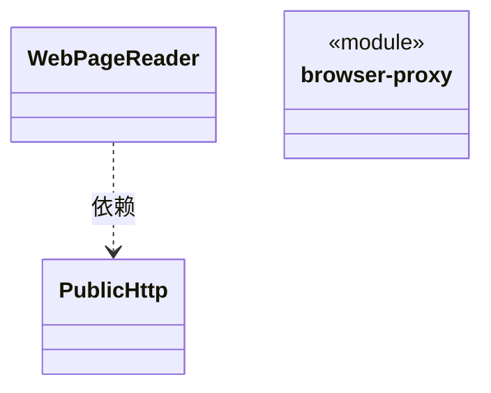

# src/core/platform/node/web 架构

## 设计意图

组合公开 HTTP 传输、正文提取和可选浏览器读取，提供有界的网页读取技术方案。

`WebPageReader` 组织静态正文、robots、节流、缓存及一次浏览器兜底；`PublicHttp` 核实公开 HTTP/HTTPS 目标并限制传输；`browser-proxy` 为匿名浏览器提供出口。浏览器由外部注入，TLS 和脚本执行仍属于浏览器实现；业务搜索设置与工具授权不进入本模块。

## 主要组成

| 组成 | 定位 |
| --- | --- |
| [WebPageReader](page-reader.ts) | 静态正文、一次浏览器兜底、robots、域名节流与短缓存。 |
| [PublicHttp](public-http.ts) | 仅公开 HTTP/HTTPS 的有界传输，供网页工具使用。 |
| [browser-proxy](browser-proxy.ts) | 匿名浏览器专用的本机 HTTP/CONNECT 出口，TLS 与页面协议仍由 Chromium 执行。 |

<!-- architecture:generated:start -->

## 架构关系

[上层设计](../ARCHITECTURE.md)

<!-- architecture:generated:end -->
