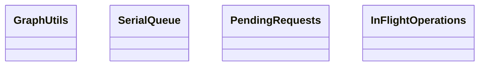

# src/core/utility 架构

## 设计意图

维护异步协调与图算法，供不同业务复用机制而不共享业务状态。

静态工具类处理单次输入，`SerialQueue`、`PendingRequests`、`InFlightOperations` 和 `LineFramer` 各自保存一个实例的队列、关联或缓冲。错误类只报告技术事实。等待 Promise 快照、请求超时和业务取消不是同一保证；进程退出、重试及权限策略仍由消费者控制。

## 主要组成

| 组成 | 定位 |
| --- | --- |
| [SerialQueue](async.ts) | 按实例串行执行已提交操作，失败不阻断后续排队；业务取消由调用方决定。 |
| [PendingRequests](async.ts) | 按实例关联请求 ID、回执与超时计时器，由协议适配器处理超时结果。 |
| [InFlightOperations](async.ts) | 跟踪已开始的 Promise，并等待当前在途快照，不承担业务取消。 |
| [GraphUtils](graphs.ts) | 提供有向图结构算法，不解释任务或业务边的含义。 |

<!-- architecture:generated:start -->

## 架构关系

[上层设计](../ARCHITECTURE.md)

<!-- architecture:generated:end -->
