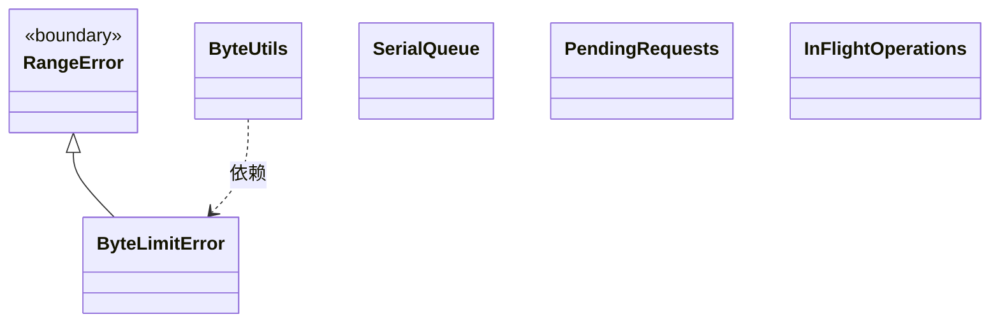
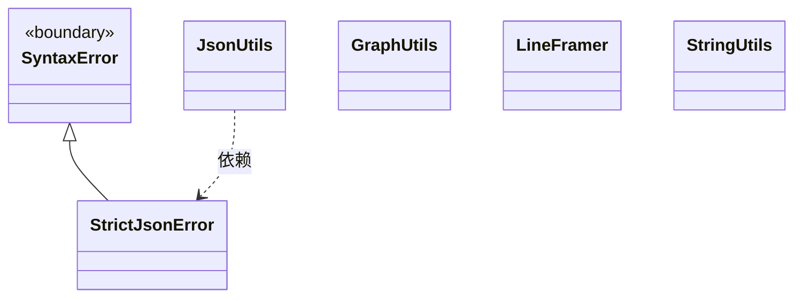

# src/core/utility 架构

## 设计意图

提供按异步协调、字节、JSON、字符串和图组织的通用算法与数据结构。无状态算法采用静态类，有状态协调器按实例隔离；业务规则、取消策略和资源生命周期由消费者决定。

## 主要组成

| 组成 | 定位 |
| --- | --- |
| [SerialQueue](async.ts) | 按实例串行执行已提交操作，失败不阻断后续排队；业务取消由调用方决定。 |
| [PendingRequests](async.ts) | 按实例关联请求 ID、回执与超时计时器，由协议适配器处理超时结果。 |
| [InFlightOperations](async.ts) | 跟踪已开始的 Promise，并等待当前在途快照，不承担业务取消。 |
| [ByteLimitError](bytes.ts) | 表达字节流超限这一技术事实，具体错误文案由消费者决定。 |
| [ByteUtils](bytes.ts) | 无状态的有界字节流读取；单次调用管理 reader、缓冲与取消监听。 |
| [GraphUtils](graphs.ts) | 提供有向图结构算法，不解释任务或业务边的含义。 |
| [StrictJsonError](json.ts) | 区分 JSON 语法错误与重复键事实，保留给消费者映射的错误身份。 |
| [JsonUtils](json.ts) | 集中维护 JSON 格式化、严格解析与键排序的纯算法。 |
| [LineFramer](strings.ts) | 按单个输入流缓存文本并按 LF 分帧，保留未结束的尾部。 |
| [StringUtils](strings.ts) | 集中维护精确字符串处理算法，不持有业务状态。 |

<!-- architecture:generated:start -->

## 架构关系

### 关系组 1

### 关系组 2

外部继承／实现边界：`RangeError`、`SyntaxError`。

[上层设计](../ARCHITECTURE.md)

<!-- architecture:generated:end -->
