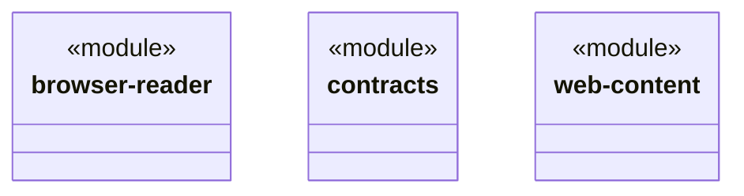

# src/core/web 架构

## 设计意图

定义与平台无关的网页读取输入、浏览器端口和 HTML 正文转换，使网络与 Chromium 实现能够分别接入。

`contracts` 限定输入和策略值，`browser-reader` 描述只读适配结果，`web-content` 提取正文并按段落截断。公共 `index.ts` 仅组合这些便携能力，不发网络请求、不执行脚本，也不持有业务工具或工作区身份。

## 主要组成

| 组成 | 定位 |
| --- | --- |
| [contracts](contracts.ts) | 基础网页读取能力的输入契约，不含 CBIM 工具、工作区或权限身份。 |
| [browser-reader](browser-reader.ts) | 基础网页读取器与浏览器适配之间的小型只读契约。 |
| [web-content](web-content.ts) | 不执行脚本的 HTML 正文提取和按段落截断。 |

<!-- architecture:generated:start -->

## 架构关系

[上层设计](../ARCHITECTURE.md)

<!-- architecture:generated:end -->
