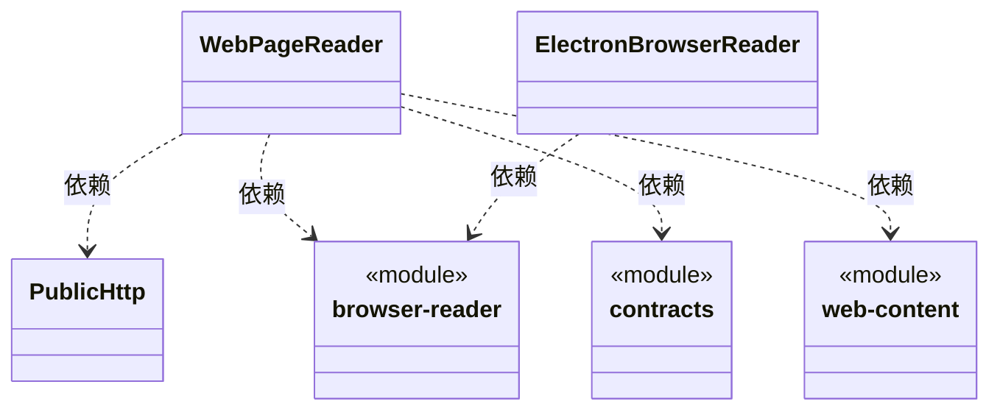
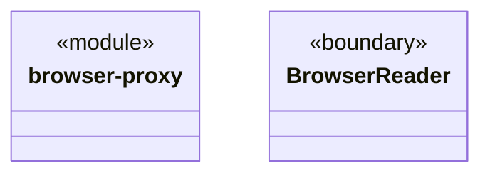

# Core 网页读取

## 设计意图

按执行环境组织网页读取。Node 端编排静态读取，并按需调用桌面宿主注入的浏览器。

## 主要组成

便携入口为 index.ts；Node 调用方使用 node.ts，桌面宿主从 electron.ts 装配浏览器。

| 组成 | 定位 |
| --- | --- |
| [contracts](contracts.ts) | 基础网页读取能力的输入契约，不含 CBIM 工具、工作区或权限身份。 |
| [browser-reader](browser-reader.ts) | 基础网页读取器与浏览器适配之间的小型只读契约。 |
| [web-content](web-content.ts) | 不执行脚本的 HTML 正文提取和按段落截断。 |
| [WebPageReader](page-reader.ts) | 静态正文、一次浏览器兜底、robots、域名节流与短缓存。 |
| [PublicHttp](public-http.ts) | 仅公开 HTTP/HTTPS 的有界传输，供网页工具使用。 |
| [browser-proxy](browser-proxy.ts) | 匿名浏览器专用的本机 HTTP/CONNECT 出口，TLS 与页面协议仍由 Chromium 执行。 |
| [ElectronBrowserReader](electron.ts) | 基础网页能力的 Electron/Chromium 适配，采集脚本执行后的正文及跨域 iframe。 |

<!-- architecture:generated:start -->

## 架构关系

### 关系组 1：WebPageReader

### 关系组 2：browser-proxy

### 跨图协作

按引用方归并目标，保留全部跨图关系；分图只用于阅读，不表示新增模块或依赖边界。

| 引用方 | 关系 | 目标 |
| --- | --- | --- |
| [ElectronBrowserReader](electron.ts)（图 1） | 依赖 | [browser-proxy](browser-proxy.ts)（图 2） |
| [ElectronBrowserReader](electron.ts)（图 1） | 实现 | [BrowserReader](browser-reader.ts)（图 2） |

外部继承／实现边界：[BrowserReader](browser-reader.ts)。

[上层设计](../ARCHITECTURE.md)

<!-- architecture:generated:end -->
