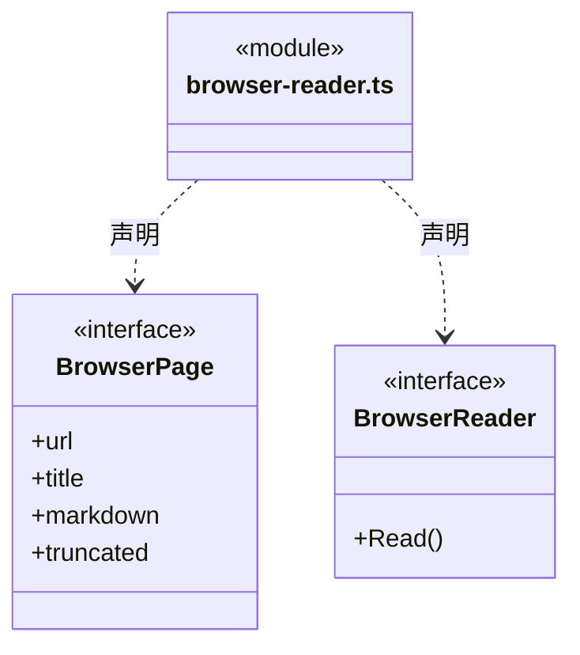
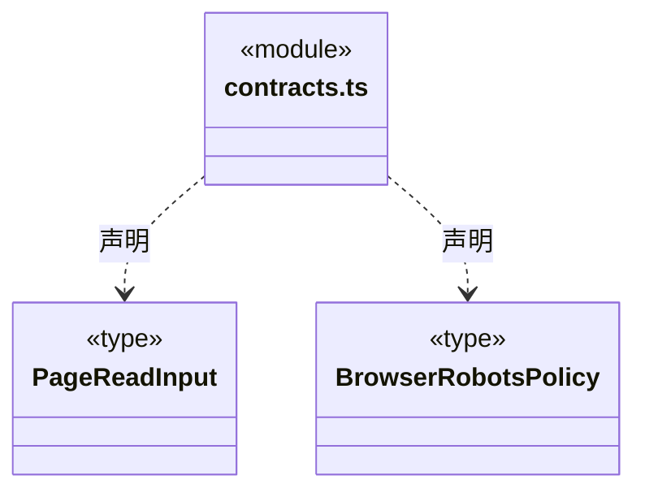
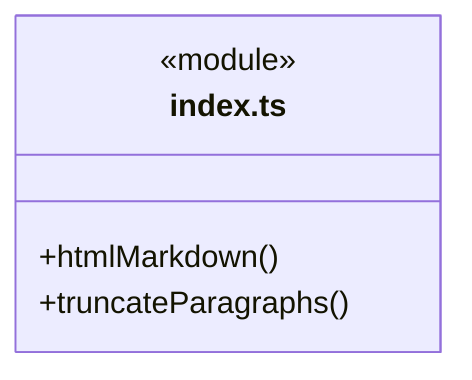
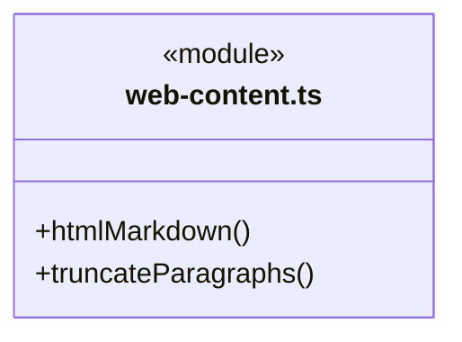
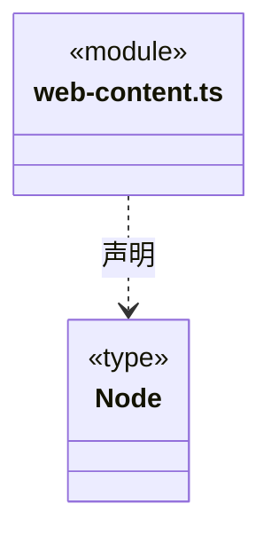
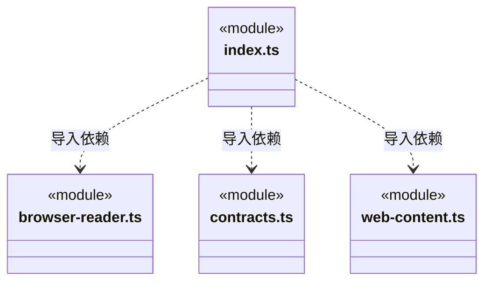

# src/core/web 架构

本目录只维护这一份说明。设计与契约直接编辑本文；文件清单、类图和导航由 [架构脚本](../../../scripts/source-architecture.mjs) 更新，生成区域之外的人工说明会保留。

## 封装意图

纯网页输入/浏览器契约与 HTML 正文算法；公开 index.ts，不加载 Node、Electron 或业务。

## 类与模块的设计意图

下表依据源码声明及文件头说明定位封装。字段表示该实例持有的状态或协作引用，不表示它拥有被引用服务的生命周期；实际资源责任和调用限制见下文契约及源码注释。

| 类／模块 | 实现形式与实例字段 | 封装依据 |
| --- | --- | --- |
| [browser-reader.ts](browser-reader.ts) | 函数／契约模块 | WebPageReader 管理抓取策略，宿主注入真实渲染器；普通 Node 消费者不加载 Electron。 |
| [contracts.ts](contracts.ts) | 函数／契约模块 | 独立使用时也验证 URL 与正文上限；业务层可以另行施加更窄的工具协议。 |
| [index.ts](index.ts) | 函数／契约模块 | 输入校验、浏览器端口和正文算法不加载网络或 Electron；平台实现单向组合本入口。 |
| [web-content.ts](web-content.ts) | 函数／契约模块 | 保留标题、段落、列表与链接；剔除导航和表单，长单段只按 Unicode 字符截取，不冒充全文。 |

## 接口设计契约

### 纯网页契约与正文转换

index.ts 公开输入校验、BrowserReader/BrowserPage 端口、HTML 正文提取与 Unicode 段落截断。只依赖 zod、parse5 和语言能力，不加载 Node、网络或 Electron；不包含工具身份、Brave 搜索设置或凭据。

Node 读取器通过本入口使用契约和算法，Electron 实现 BrowserReader。正文保持原标题、链接和截断规则，不把 iframe 外壳或单个 404 推断为页面私有。契约由调用者组合，缓存、robots 和资源生命周期归平台读取器。

正文算法单元在 tests/web-content.test.ts；完整抓取行为见 [Node 契约](../platform/node/web/ARCHITECTURE.md#contract)。

## 开闭边界

本目录的职责及允许协作由[封装意图](#封装意图)限定，输入输出、状态与失败语义以[接口设计契约](#接口设计契约)为准。扩展从已有公开入口及实际装配位置进入；没有明确可替换契约的部分按真实影响修改和验证，不预建未使用的基类或插件入口。

<!-- architecture:generated:start -->

## 文件清单

| 文件 | 形式 | 当前职责 |
| --- | --- | --- |
| [ARCHITECTURE.md](ARCHITECTURE.md) | 说明文档 | 本目录的文件清单、真实声明、依赖与子封装导航。 |
| [browser-reader.ts](browser-reader.ts) | 源码模块 | 基础网页读取器与浏览器适配之间的小型只读契约。 |
| [contracts.ts](contracts.ts) | 源码模块 | 基础网页读取能力的输入契约，不含 CBIM 工具、工作区或权限身份。 |
| [index.ts](index.ts) | 源码模块 | 环境无关的网页读取契约和 HTML 正文转换入口。 |
| [web-content.ts](web-content.ts) | 源码模块 | 不执行脚本的 HTML 正文提取和按段落截断。 |

## 架构类图

成员标记：`+` 公开、`-` 私有、`#` 受保护、`$` 静态；`function` 为函数值成员，`get`／`set` 为访问器。调用／构造／索引签名按匿名签名列出，不虚构方法名；`global.` 表示全局声明补充，非运行时嵌套类。构造函数单独列出，运行时私有字段保留 `#`。文档和资源仅在文件清单中导航，不作为代码节点。

### browser-reader.ts

[查看源码](browser-reader.ts)。

### contracts.ts

[查看源码](contracts.ts)。

### index.ts

[查看源码](index.ts)。

直接依赖：[browser-reader.ts](browser-reader.ts)、[contracts.ts](contracts.ts)、[web-content.ts](web-content.ts)。

### web-content.ts

[查看源码](web-content.ts)。

### 本目录调用边界

## 子目录导航

无子目录。

[返回上层](../ARCHITECTURE.md)。

每次修改本目录代码，同步维护文件头、关键契约说明及本图。未实现的治理、证据验收和自动编排能力不列入当前类图。

<!-- architecture:generated:end -->
