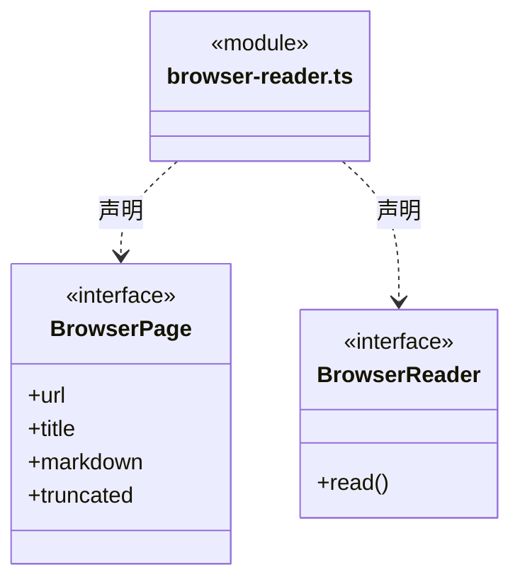
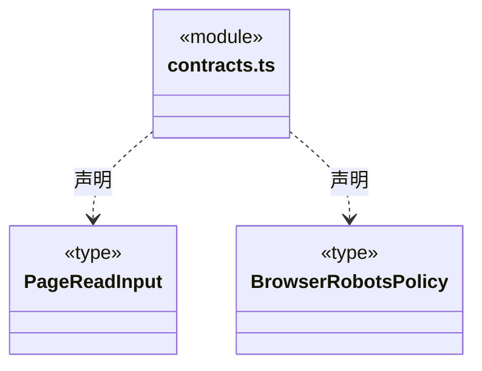
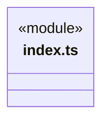
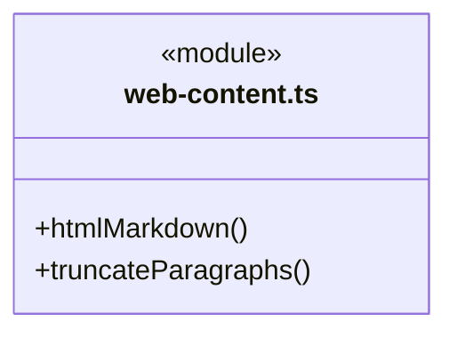
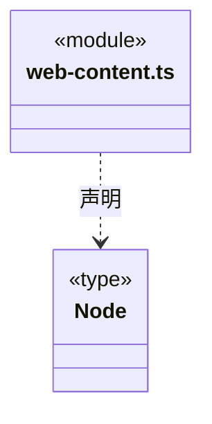
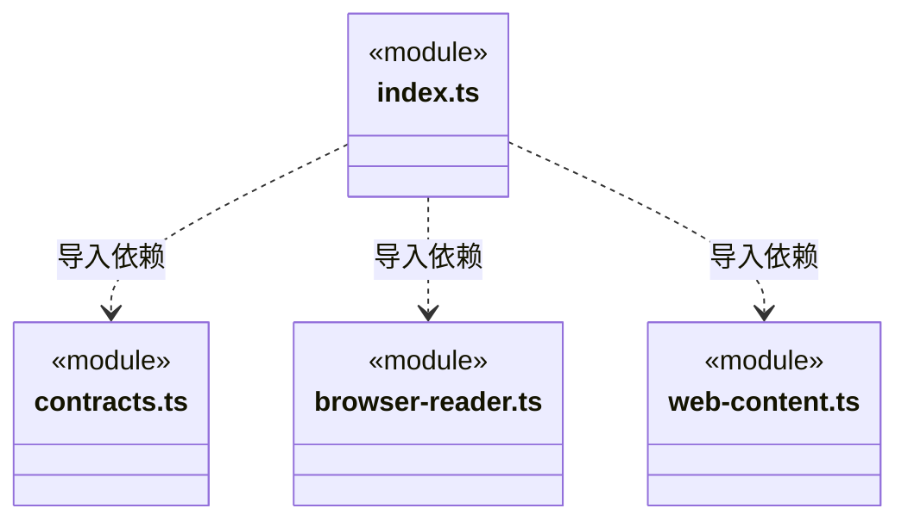

# src/core/web 架构

## 目录定位

纯网页输入/浏览器契约与 HTML 正文算法；公开 index.ts，不加载 Node、Electron 或业务。

本文描述当前实现。通过分析目录边界后维护的 [源码架构脚本](../../../scripts/source-architecture.mjs) 同步清单和声明；代码变更时仍须核对职责、关键成员与关系。

## 代码清单

| 文件 | 当前职责 |
| --- | --- |
| [browser-reader.ts](browser-reader.ts) | 基础网页读取器与浏览器适配之间的小型只读契约。 |
| [contracts.ts](contracts.ts) | 基础网页读取能力的输入契约，不含 CBIM 工具、工作区或权限身份。 |
| [index.ts](index.ts) | 环境无关的网页读取契约和 HTML 正文转换入口。 |
| [web-content.ts](web-content.ts) | 不执行脚本的 HTML 正文提取和按段落截断。 |

## 架构类图

### browser-reader.ts

### contracts.ts

### index.ts

直接依赖：[contracts.ts](contracts.ts)、[browser-reader.ts](browser-reader.ts)、[web-content.ts](web-content.ts)。

### web-content.ts

### 本目录调用边界

## 子目录导航

无子目录。

[返回上层](../ARCHITECTURE.md)。

每次修改本目录代码，同步维护文件头、关键契约说明及本图。未实现的治理、证据验收和自动编排能力不列入当前类图。

## 设计契约 v1 与落地范围

以下内容区分已接通能力与后续设计；以各节的实现状态为准，不将目标图当作现状图。维护源：[CONTRACT.md](CONTRACT.md)；生成类图时同步附加，勿直接修改本附录。

# 纯网页契约与正文转换

index.ts 公开输入校验、BrowserReader/BrowserPage 端口、HTML 正文提取与 Unicode 段落截断。只依赖 zod、parse5 和语言能力，不加载 Node、网络或 Electron；不包含工具身份、Brave 搜索设置或凭据。

Node 读取器通过本入口使用契约和算法，Electron 实现 BrowserReader。正文保持原标题、链接和截断规则，不把 iframe 外壳或单个 404 推断为页面私有。契约由调用者组合，缓存、robots 和资源生命周期归平台读取器。

正文算法单元在 tests/web-content.test.ts；完整抓取行为见 [Node 契约](../platform/node/web/CONTRACT.md)。
