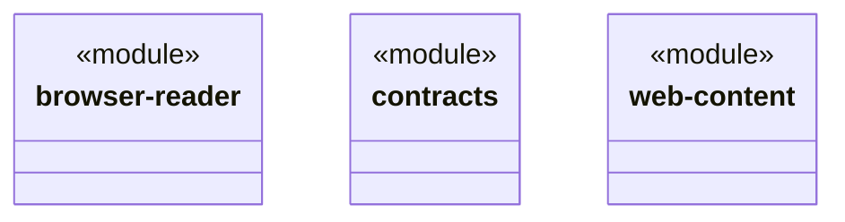

# src/core/web 架构

## 设计意图

纯网页输入/浏览器契约与 HTML 正文算法；公开 index.ts，不加载 Node、Electron 或业务。

## 主要组成

| 组成 | 定位 |
| --- | --- |
| [contracts](contracts.ts) | 基础网页读取能力的输入契约，不含 CBIM 工具、工作区或权限身份。 |
| [browser-reader](browser-reader.ts) | 基础网页读取器与浏览器适配之间的小型只读契约。 |
| [web-content](web-content.ts) | 不执行脚本的 HTML 正文提取和按段落截断。 |

<!-- architecture:generated:start -->

## 架构关系

[上层设计](../ARCHITECTURE.md)

<!-- architecture:generated:end -->
