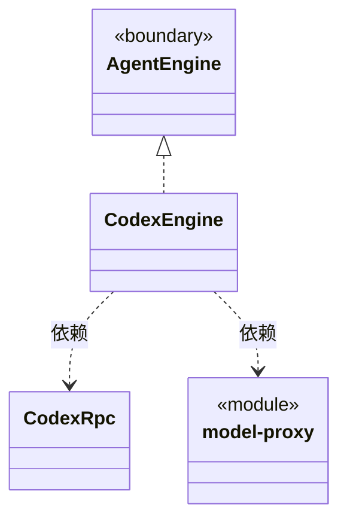

# src/engine-plugins/codex 架构

## 设计意图

通过 Codex App Server 实现统一引擎生命周期，隔离进程协议与宿主业务工具。

`CodexEngine` 协调线程、轮次、会话和工具，`CodexRpc` 关联双向 JSONL 请求与通知；模型代理和会话适配处理本引擎差异。超时、失败和退出保持各自含义，安装选择及业务派发不在此处维护。

## 主要组成

| 组成 | 定位 |
| --- | --- |
| [CodexEngine](engine.ts) | 通过 Codex App Server 管理进程、线程、轮次和动态工具；目标返工明确为系统反馈，不携带用户图片或新授权。 |
| [CodexRpc](rpc.ts) | Codex App Server 的双向 JSONL 通信，分别关联宿主请求、原生请求和通知。 |
| [model-proxy](model-proxy.ts) | 把 Codex 模型网络请求接到宿主配置与请求预算边界。 |

<!-- architecture:generated:start -->

## 架构关系

外部继承／实现边界：[AgentEngine](../../logic-new/execution/rules/types.ts)。

[上层设计](../ARCHITECTURE.md)

<!-- architecture:generated:end -->
