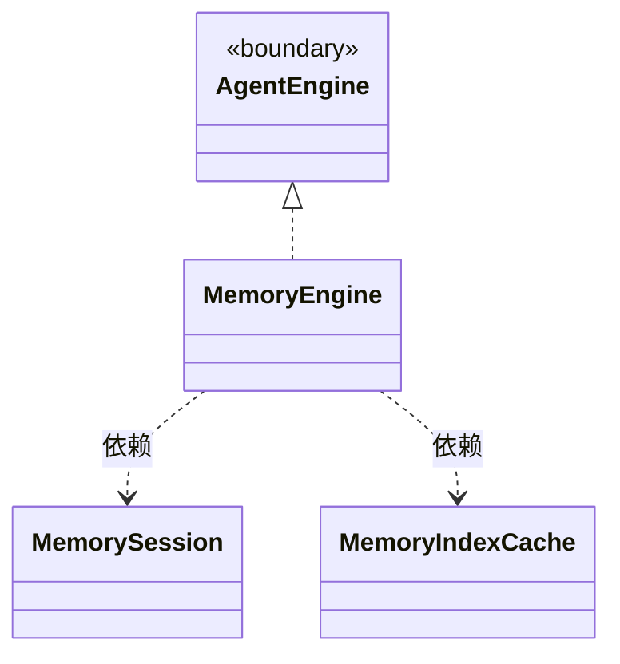

# src/engine-plugins/memory 架构

## 设计意图

实现生成模型与向量检索协作的知识记忆循环，使正式知识与可重建缓存分离。

`MemoryEngine` 组织模型回合和受控知识工具，`MemorySession` 保存原始会话历史，`MemoryIndexCache` 保存按模型与知识版本区分的派生代际。知识修改仍经过宿主端口和事务，缓存命中不授予额外读取或写入权限。

## 主要组成

| 组成 | 定位 |
| --- | --- |
| [MemoryEngine](engine.ts) | 官方记忆领域 Agent Loop，使用生成和 embedding 双模型管理受控知识，不依赖厂商 Agent SDK。 |
| [MemorySession](storage.ts) | 保存单个运行会话的原始历史，配合宿主租约维护读写边界。 |
| [MemoryIndexCache](storage.ts) | 按不可变代际保存派生向量缓存，供记忆引擎复用检索索引。 |

<!-- architecture:generated:start -->

## 架构关系

外部继承／实现边界：[AgentEngine](../../logic/execution/rules/types.ts)。

[上层设计](../ARCHITECTURE.md)

<!-- architecture:generated:end -->
