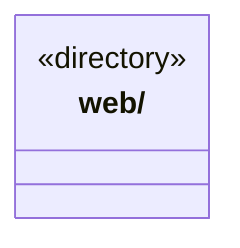

# src/foundations 架构

## 目录定位

独立基础类库，承载高内聚技术解决方案；只依赖本层、标准库和必要第三方库，不依赖 Core 或任何业务模块。能力按独立契约和生命周期组织。

本文描述当前实现。通过分析目录边界后维护的 [源码架构脚本](../../scripts/source-architecture.mjs) 同步清单和声明；代码变更时仍须核对职责、关键成员与关系。

## 代码清单

本层无直接代码文件。

## 架构类图

各图中的同名节点表示同一目录边界；跨组及完整直接依赖如下（无边不代表继承）：

本层无目录间直接导入关系。

## 子目录导航

- [web/](web/ARCHITECTURE.md)：独立网页读取方案：安全公网 HTTP、正文提取、robots/缓存/限速与可注入浏览器兜底；Node 公共入口不加载 Electron，具体 Chromium 适配有独立入口。

[返回上层](../ARCHITECTURE.md)。

每次修改本目录代码，同步维护文件头、关键契约说明及本图。未实现的治理、证据验收和自动编排能力不列入当前类图。

## 设计契约 v1 与落地范围

以下内容区分已接通能力与后续设计；以各节的实现状态为准，不将目标图当作现状图。维护源：[CONTRACT.md](CONTRACT.md)；生成类图时同步附加，勿直接修改本附录。

# 基础类库边界

`foundations` 承载高内聚、可独立复用的技术解决方案，不依赖 Core、Main、Scheduler、Bridge、Frontend 或任何其他项目模块，包含类型依赖。仅允许本层内部、标准库及必要第三方库；各能力拥有自己的契约、状态和资源生命周期，不建立万能工具容器。

当前只迁移已核实的网页能力到 [web](web/CONTRACT.md)。不把其他模块同名的 foundation 目录机械归并，也不据此宣称全仓工具已经解耦。调用者通过各能力公开入口单向使用；平台实现单独入口加载，Node 入口不隐式加载 Electron。

当前消费者是 Main 的 WebService 和桌面装配；业务层仍拥有 Agent 工具注册、用户设置、凭据及来源信任标记。新增消费者应先核实运行环境，再声明允许依赖；不能让基础类库反向引用消费者实现。分层检查器和网页能力公开入口检查共同约束以上方向。
