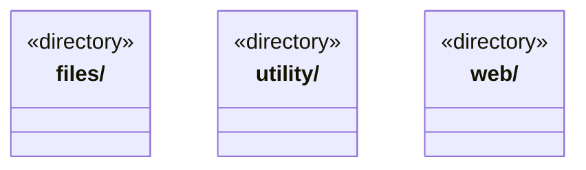

# src/foundations 架构

## 目录定位

独立基础类库，承载高内聚技术解决方案；只依赖本层、标准库和必要第三方库，不依赖 Core 或任何业务模块。能力按独立契约和生命周期组织。

本文描述当前实现。通过分析目录边界后维护的 [源码架构脚本](../../scripts/source-architecture.mjs) 同步清单和声明；代码变更时仍须核对职责、关键成员与关系。

## 代码清单

本层无直接代码文件。

## 架构类图

各图中的同名节点表示同一目录边界；跨组及完整直接依赖如下（无边不代表继承）：

本层无目录间直接导入关系。

## 子目录导航

- [files/](files/ARCHITECTURE.md)：Node 单文件 I/O 基础方案：存在探测、JSON 读取、同步后原子替换；路径授权、跨进程锁和业务事务由消费者拥有。
- [utility/](utility/ARCHITECTURE.md)：通用工具函数与数据结构按类别内聚组织：json.ts 提供 JSON 格式化、严格解析和键排序；async.ts 提供独立实例的串行队列及在途集合；strings.ts 提供文本分帧；bytes.ts 提供有界字节流收集。index.ts 是通用公开入口，node.ts 独立承载 SHA-256。不按函数数量拆文件，不发起文件/网络访问，不拥有业务身份、事务或权限。排序比较器与字段规则由消费者指定；Promise 快照不代表物理退出，文本帧不代表协议校验，生命周期和业务策略留在适配器。
- [web/](web/ARCHITECTURE.md)：独立网页读取方案：安全公网 HTTP、正文提取、robots/缓存/限速与可注入浏览器兜底；Node 公共入口不加载 Electron，具体 Chromium 适配有独立入口。

[返回上层](../ARCHITECTURE.md)。

每次修改本目录代码，同步维护文件头、关键契约说明及本图。未实现的治理、证据验收和自动编排能力不列入当前类图。

## 设计契约 v1 与落地范围

以下内容区分已接通能力与后续设计；以各节的实现状态为准，不将目标图当作现状图。维护源：[CONTRACT.md](CONTRACT.md)；生成类图时同步附加，勿直接修改本附录。

# 基础类库边界

`foundations` 承载高内聚、可独立复用的技术解决方案，不依赖 Core、Main、Scheduler、Bridge、Frontend 或任何其他项目模块，包含类型依赖。仅允许本层内部、标准库及必要第三方库；各能力拥有自己的契约、状态和资源生命周期，不建立万能工具容器。

当前能力为 [utility](utility/CONTRACT.md)、[files](files/CONTRACT.md) 与 [web](web/CONTRACT.md)。utility 收纳领域无关算法与数据结构，SerialQueue 已从原 concurrency 目录迁入；各能力按明确契约独立组织，不把业务辅助代码机械归并。调用者通过公开入口单向使用；utility 通用入口不加载 Node，Node 摘要算法使用独立入口，网页平台实现也单独加载。

utility 同时提供严格 JSON 与传入 Web 字节流的有界消费。接管 reader 不等于负责建立网络连接：地址、授权、期限、编码和业务错误仍属于消费者。Updater 仅获准组合 utility 通用入口，不能借基础层依赖权引用其他方案、Main 或业务运行时。

网页消费者是 Main 的 WebService 和桌面装配；文件原语服务 Core 知识探测及 Main 存储；utility 队列服务 Main 设置/模型，摘要和格式化经 Core 兼容出口服务现有消费者。业务层仍拥有 Agent 工具注册、用户设置、凭据、事务及来源信任标记。Core 可单向消费基础类库，但不因此获得 Main、平台装配或具体引擎的依赖权。新增消费者须核实环境；不能让基础类库反向引用消费者实现。分层检查器和每项能力的公开入口检查共同约束以上方向。

## 共性选择与退出边界

utility 的对象键递归排序保留调用方比较器及 undefined 规则；在途集合只等 Promise 快照；LF 分帧只管理文本尾部。Core/Main/Engines 组合这些能力，原历史指纹、关闭门禁、物理退出和协议限额仍由所属模块拥有。Engines 只获准 utility 通用入口，不因此获得 files/web 或 Node 私有实现的访问权。

文件 I/O、实例排队、摘要和固定格式化有真实消费者，契约仍应随缺陷和真实扩展验证；不因抽取一次即宣称永久稳定。JSON 的领域错误码、字段选取与 canonical 排序、运行日志失败屏障、原生文件身份校验及引擎协议差异仍由所属模块维护。不能把这些差异压成万能工具或让基础库依赖业务识别分支。

新增解决方案前须核实真实消费者、共同不变量、变化点及失败/资源语义；新增同类业务应主要组合机制并实现本地策略。文件和队列的独立单元在 `tests/unit/foundations`，公共基础能力不得依赖完整应用夹具。
