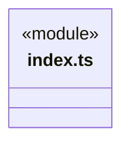
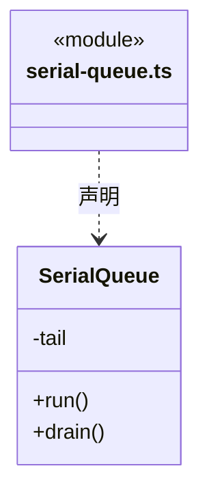
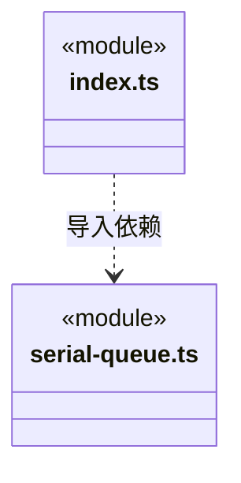

# src/foundations/concurrency 架构

## 目录定位

实例级串行执行基础方案：保证任务顺序并在一次失败后继续；不拥有业务关闭、重试、权限或证据日志失败策略。

本文描述当前实现。通过分析目录边界后维护的 [源码架构脚本](../../../scripts/source-architecture.mjs) 同步清单和声明；代码变更时仍须核对职责、关键成员与关系。

## 代码清单

| 文件 | 当前职责 |
| --- | --- |
| [index.ts](index.ts) | 不依赖平台或业务的实例级串行执行入口。 |
| [serial-queue.ts](serial-queue.ts) | 按提交顺序执行异步任务，同一队列最多执行一个任务。 |

## 架构类图

### index.ts

直接依赖：[serial-queue.ts](serial-queue.ts)。

### serial-queue.ts

### 本目录调用边界

## 子目录导航

无子目录。

[返回上层](../ARCHITECTURE.md)。

每次修改本目录代码，同步维护文件头、关键契约说明及本图。未实现的治理、证据验收和自动编排能力不列入当前类图。

## 设计契约 v1 与落地范围

以下内容区分已接通能力与后续设计；以各节的实现状态为准，不将目标图当作现状图。维护源：[CONTRACT.md](CONTRACT.md)；生成类图时同步附加，勿直接修改本附录。

# 实例级串行执行

公开入口 index.ts 只导出 SerialQueue；无项目模块或平台依赖。每个实例拥有一个 Promise 尾链，按 run 提交顺序执行，同一实例至多一个任务执行，不共享全局锁。

`run` 把本次结果或错误原样交给调用者；无论同步抛错还是异步拒绝，下一项仍可执行。不重试、不吞掉调用者可见的失败。`drain` 等待调用时已提交的队列尾部结束，不汇总错误、不关闭队列、不阻止随后提交。禁止在队列任务里等待同队列后续任务，否则会自锁。

真实消费者为 WebSettings、BudgetSettings、AdmissionSettings、MainAgentSettings、LlmProfiles。版本校验、当前工作区验证、系统加密、关闭策略、配置短锁和写成功后生效的顺序仍在各自模块；基础队列不认识这些业务。

RunJournal 写失败必须阻断后续证据追加，IsolationRecords 也有持久化失败屏障，因此没有迁入这种失败后继续的队列。权限、取消、跨进程锁和重试不通过布尔开关塞入通用类。新增相同排队需求可组合此入口，契约不同则保留独立机制。

模块测试在 `tests/unit/foundations/concurrency.test.ts`，以受控 Promise 验证顺序、同步/异步失败、drain 和实例隔离，不依赖时钟 sleep 或 Application。
