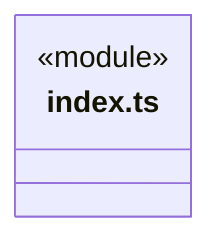
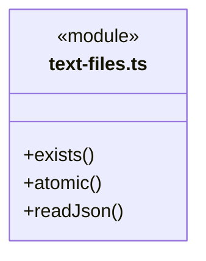
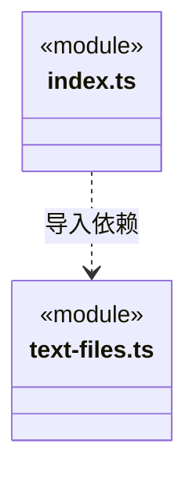

# src/foundations/files 架构

## 目录定位

Node 单文件 I/O 基础方案：存在探测、JSON 读取、同步后原子替换；路径授权、跨进程锁和业务事务由消费者拥有。

本文描述当前实现。通过分析目录边界后维护的 [源码架构脚本](../../../scripts/source-architecture.mjs) 同步清单和声明；代码变更时仍须核对职责、关键成员与关系。

## 代码清单

| 文件 | 当前职责 |
| --- | --- |
| [index.ts](index.ts) | Node 文件基础能力的公开入口，供存储适配使用。 |
| [text-files.ts](text-files.ts) | 公开入口背后的单文件读取与原子文本替换机制。 |

## 架构类图

### index.ts

直接依赖：[text-files.ts](text-files.ts)。

### text-files.ts

### 本目录调用边界

## 子目录导航

无子目录。

[返回上层](../ARCHITECTURE.md)。

每次修改本目录代码，同步维护文件头、关键契约说明及本图。未实现的治理、证据验收和自动编排能力不列入当前类图。

## 设计契约 v1 与落地范围

以下内容区分已接通能力与后续设计；以各节的实现状态为准，不将目标图当作现状图。维护源：[CONTRACT.md](CONTRACT.md)；生成类图时同步附加，勿直接修改本附录。

# 单文件存储原语

公开入口为 index.ts；只依赖 Node 标准库，不依赖 Core 或其他能力。`exists`、`readJson` 和 `atomic` 从原 Core/foundation/files 迁入，旧路径已移除，实际消费者直接引用能力入口。

- `atomic` 创建父目录，用同目录独占 0600 临时文件写 UTF-8 文本，fsync 内容并关闭后 rename。写入或替换失败均清理本次临时文件。返回成功不承诺目录 fsync、断电恢复或多文件原子事务。
- `exists` 保持 access 失败即 false 的原语义，不能区分缺失与无权限；不得据此授予访问。`readJson<T>` 不验证 T 对应的业务 Schema，解析/读取错误由调用方处理。
- 调用者负责可信路径、权限、版本冲突、跨进程锁、序列化格式和提交后状态发布。同一路径的并发写不会由基础库自动合并；需要顺序时消费者组合独立队列。

真实消费者为知识文件探测、Main 的配置、资源、工作区、历史及存储适配。新增一种配置不修改原子替换机制，只在业务模块定义 Schema、路径和生效规则。对受控文件写入、命名空间身份核验、签名更新和多文件日志事务，不以此原语替换其安全/一致性流程。

模块测试在 `tests/unit/foundations/files.test.ts`；失败清理使用真实目录及受控写入故障，不初始化 Application。
