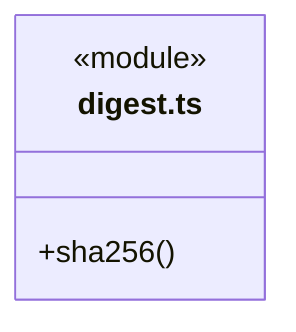
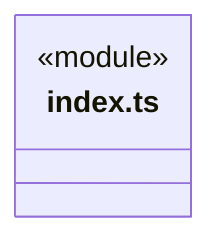
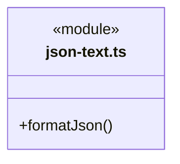
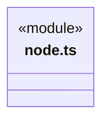
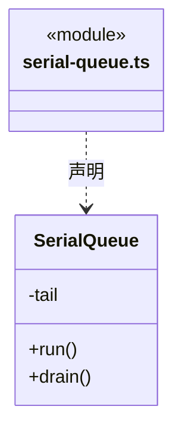
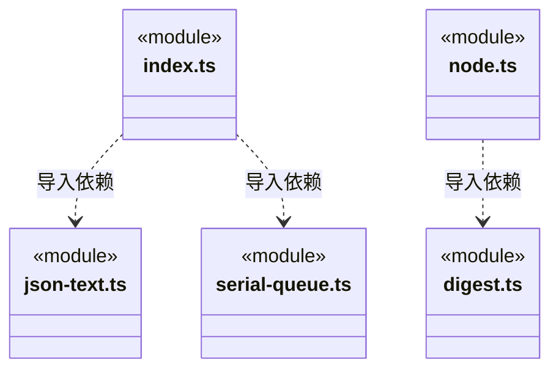

# src/foundations/utility 架构

## 目录定位

通用算法与数据结构：JSON 文本格式化、实例级串行队列及独立 Node 入口的 SHA-256；不拥有文件/网络 I/O、业务身份、事务或权限。

本文描述当前实现。通过分析目录边界后维护的 [源码架构脚本](../../../scripts/source-architecture.mjs) 同步清单和声明；代码变更时仍须核对职责、关键成员与关系。

## 代码清单

| 文件 | 当前职责 |
| --- | --- |
| [digest.ts](digest.ts) | Node 环境的 SHA-256 摘要算法，无文件、网络或业务状态。 |
| [index.ts](index.ts) | 通用数据处理算法与实例内数据结构的公开入口，无 Node 或业务依赖。 |
| [json-text.ts](json-text.ts) | 将给定数据格式化为两空格缩进、末尾换行的 JSON 文本。 |
| [node.ts](node.ts) | utility 需要 Node 标准库的独立公开入口。 |
| [serial-queue.ts](serial-queue.ts) | utility 的实例级串行执行结构，按提交顺序执行，同一队列最多执行一个任务。 |

## 架构类图

### digest.ts

### index.ts

直接依赖：[json-text.ts](json-text.ts)、[serial-queue.ts](serial-queue.ts)。

### json-text.ts

### node.ts

直接依赖：[digest.ts](digest.ts)。

### serial-queue.ts

### 本目录调用边界

## 子目录导航

无子目录。

[返回上层](../ARCHITECTURE.md)。

每次修改本目录代码，同步维护文件头、关键契约说明及本图。未实现的治理、证据验收和自动编排能力不列入当前类图。

## 设计契约 v1 与落地范围

以下内容区分已接通能力与后续设计；以各节的实现状态为准，不将目标图当作现状图。维护源：[CONTRACT.md](CONTRACT.md)；生成类图时同步附加，勿直接修改本附录。

# 通用算法与数据结构

本模块提供领域无关的数据处理算法及实例内执行结构，不依赖 Core、Main、Scheduler、Bridge、Frontend 或其他 foundations 能力。每项能力独立实现、具名导出，不建立万能 Utility 类、全局实例或服务定位器。文件、网络、平台进程、权限和事务不属于本模块。

## 入口与真实消费者

- `index.ts`：公开 `SerialQueue`、`formatJson`；仅使用语言原语，没有 Node 加载。
- `node.ts`：公开 `sha256`，仅依赖 `node:crypto`；调用者明确选择运行环境。
- `serial-queue.ts`、`json-text.ts`、`digest.ts` 是私有实现，消费者只导入上述公开入口。
- WebSettings、BudgetSettings、AdmissionSettings、MainAgentSettings、LlmProfiles 直接组合 SerialQueue。旧 `foundations/concurrency` 目录及入口已移除。
- Core `foundation/serialization.ts` 保留 `hash/json` 名称兼容，直接重导出 utility 的算法；实现只有一份。现有知识版本、证据及配置消费者保持原调用和输出字节。该适配出口尚未退役，后续迁移须核对其真实消费者及逻辑边界，不机械批量改路径。

## SerialQueue

每实例独立持有 Promise 尾链，同实例按 run 提交顺序串行执行。本次结果或错误原样返回，同步抛错、异步拒绝均不阻断后续任务；无重试、取消或自动关闭。

`drain` 只等待调用时的队尾，不汇总错误、不封闭队列；错误由各次 run 的调用者处理。任务内等待同队列的后续任务会自锁，禁止重入等待。业务 revision、模型短锁、当前工作区验证、写后发布顺序仍归消费者。RunJournal、IsolationRecords 的失败屏障不能用此队列替换。

## 数据算法

`formatJson` 保持原两空格缩进、末尾 LF 和 JSON.stringify 的属性顺序/异常行为；不做严格 JSON 解析或规范排序。顶层 undefined、函数、Symbol 沿兼容行为形成 `undefined\n`，不能作为有效 JSON 输入使用。调用者负责约束值，不能在抽取中暗改历史文本或指纹。

`sha256` 接受 UTF-8 字符串或 Uint8Array（含 Buffer），返回小写十六进制；字节视图不扩大到背后的整个 ArrayBuffer。业务选择哪些字段、如何序列化、是否接受摘要仍在原模块；该算法不承担验签或可信来源判断。

## 扩展与验证

新增算法或数据结构须先给出真实用途、状态归属、输入输出、复杂度及失败语义；标准库已足够时直接使用，不为预想需求添加集合、缓存或调度框架。功能按职责拆文件，公共入口只做导出；通用入口不得导入 Node 入口。

模块单元在 `tests/unit/foundations/utility/`，按队列、格式化、摘要分别验证；Core 的名称/字节兼容另做契约测试。模块测试不加载 Application，消费者验证保留版本冲突、失败恢复和原有指纹规则。
