# src/foundations/web 架构

## 目录定位

独立网页读取方案：安全公网 HTTP、正文提取、robots/缓存/限速与可注入浏览器兜底；Node 公共入口不加载 Electron，具体 Chromium 适配有独立入口。

本文描述当前实现。通过分析目录边界后维护的 [源码架构脚本](../../../scripts/source-architecture.mjs) 同步清单和声明；代码变更时仍须核对职责、关键成员与关系。

## 代码清单

| 文件 | 当前职责 |
| --- | --- |
| [browser-reader.ts](browser-reader.ts) | 基础网页读取器与浏览器适配之间的小型只读契约。 |
| [contracts.ts](contracts.ts) | 基础网页读取能力的输入契约，不含 CBIM 工具、工作区或权限身份。 |
| [electron-browser-reader.ts](electron-browser-reader.ts) | 基础网页能力的 Electron/Chromium 适配，采集脚本执行后的正文及跨域 iframe。 |
| [index.ts](index.ts) | 高内聚网页基础类库的 Node 公开入口。 |
| [page-reader.ts](page-reader.ts) | 静态正文、一次浏览器兜底、robots、域名节流与短缓存。 |
| [public-http.ts](public-http.ts) | 仅公开 HTTP/HTTPS 的有界传输，供网页工具使用。 |
| [web-content.ts](web-content.ts) | 不执行脚本的 HTML 正文提取和按段落截断。 |

## 架构类图

### browser-reader.ts

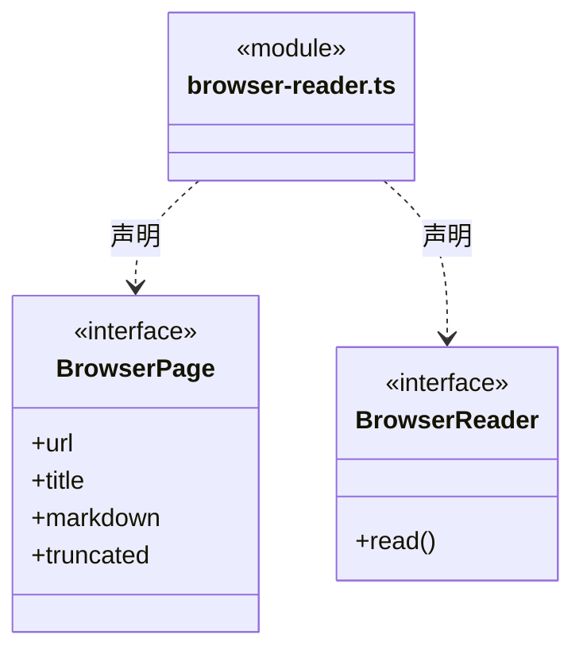

### contracts.ts

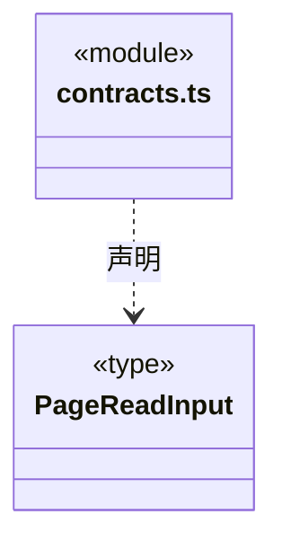

### electron-browser-reader.ts

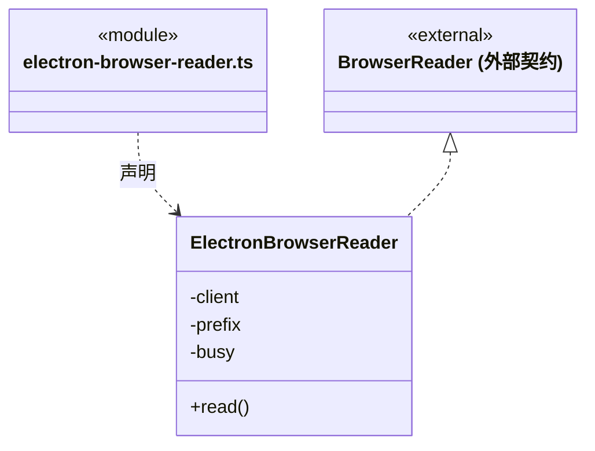

直接依赖：[public-http.ts](public-http.ts)、[browser-reader.ts](browser-reader.ts)。

### index.ts

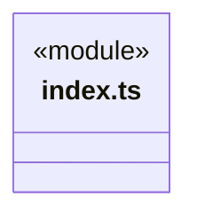
直接依赖：[page-reader.ts](page-reader.ts)、[public-http.ts](public-http.ts)、[web-content.ts](web-content.ts)、[browser-reader.ts](browser-reader.ts)、[contracts.ts](contracts.ts)。

### page-reader.ts

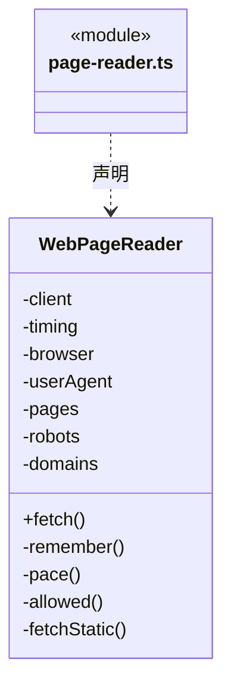

直接依赖：[contracts.ts](contracts.ts)、[public-http.ts](public-http.ts)、[web-content.ts](web-content.ts)、[browser-reader.ts](browser-reader.ts)。

### public-http.ts

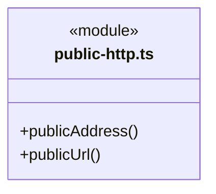

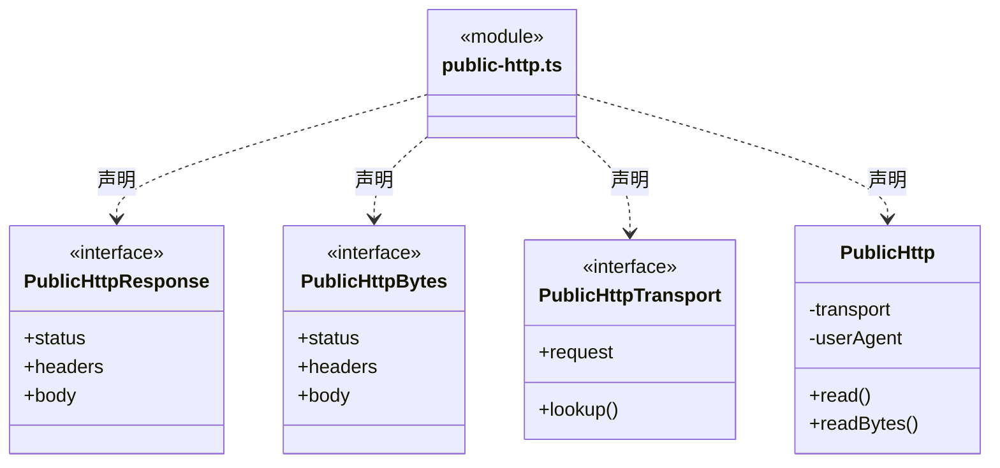

### web-content.ts

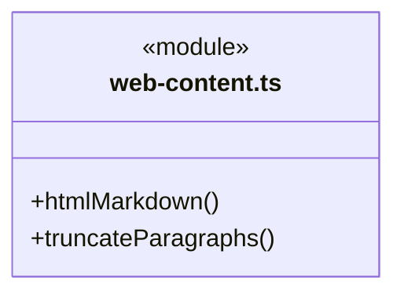

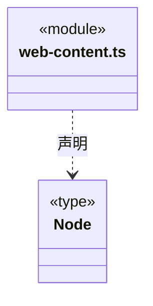

### 本目录调用边界

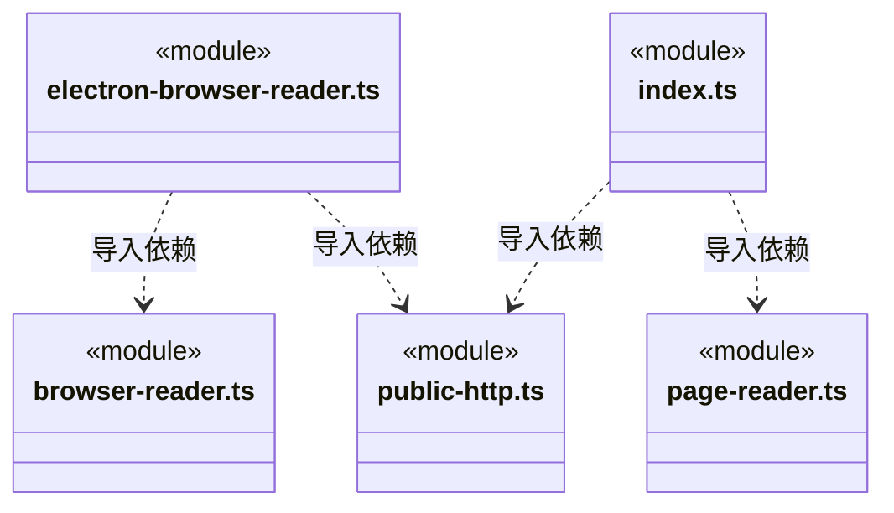

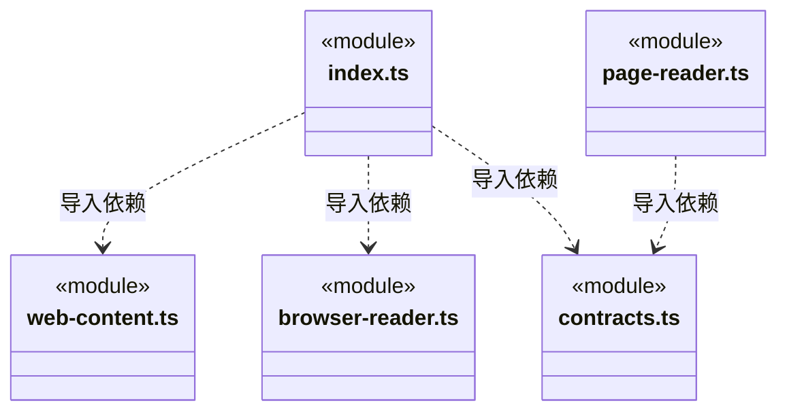

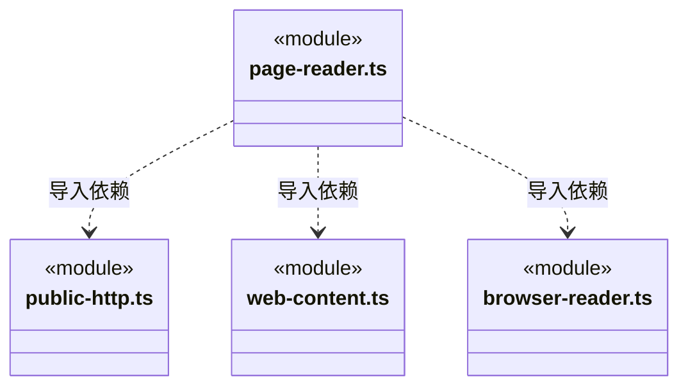

## 子目录导航

无子目录。

[返回上层](../ARCHITECTURE.md)。

每次修改本目录代码，同步维护文件头、关键契约说明及本图。未实现的治理、证据验收和自动编排能力不列入当前类图。

## 设计契约 v1 与落地范围

以下内容区分已接通能力与后续设计；以各节的实现状态为准，不将目标图当作现状图。维护源：[CONTRACT.md](CONTRACT.md)；生成类图时同步附加，勿直接修改本附录。

# 网页基础能力

## 边界与入口

`index.ts` 是 Node 公开入口，提供 `WebPageReader`、`PublicHttp`、正文转换及输入/浏览器契约；`electron-browser-reader.ts` 是宿主可选的 Electron 入口。内部文件不可被业务层直接引用。类库不依赖任何其他项目模块，不认识 CBIM 工作区、Agent、工具名、Brave 设置或用户凭据。

WebPageReader → 静态 PublicHttp + HTML 提取 → 必要时调用注入的 BrowserReader。Main/WebService 只负责业务输入校验、来源不可信标记与 Brave 查询；Main 桌面入口在 ready 后注入 ElectronBrowserReader。Node/CLI 未注入时保留原静态读取与错误，不假装提供浏览器能力。

## 读取与状态

- 输入为公开 URL 和可选 maxChars（500–20000，默认 12000）。返回 URL、标题、正文、截断标记、采集时间及缓存命中；正文始终是外部资料，不是可信执行指令。静态结果为 Markdown，浏览器结果为可见文字及嵌入来源说明。
- 读取器持有 5 分钟/30 页缓存、最多 1000 个 robots/域名限速记录；默认域间隔 1 秒，遵守 crawl-delay，排队超过 5 秒拒绝。缓存保留原采集时间和上游截断事实。
- 静态阶段最多 30 秒、5 次重定向，每跳核实地址、robots 和限速；robots 的 404/410 表示无规则，其余失败不猜测允许。静态单请求最多 15 秒/1 MiB，支持 UTF-8 HTML、文本和 Markdown。
- 网络、DNS、静态超时、HTTP 4xx/5xx、登录表单线索、正文/编码不支持或为空时，已配置浏览器最多兜底一次。含 iframe，或含脚本且提取正文少于 200 字符的非空外壳也触发一次渲染；这是内容不足的启发式，不是登录/私有判定。
- 调用者取消、SSRF、robots 拒绝、限流、验证码、体积及跳转上限拒绝不绕过；浏览器失败同时保留两阶段原因，不循环重启。成功才写缓存，取消后的迟到结果不交付。

## 浏览器资源与失败

- 适配器最多两个并行槽位，每次匿名内存会话，不携带用户/应用 Cookie；隐藏窗口无 Node、无 preload，启用 sandbox/contextIsolation/webSecurity。结束关闭窗口、取消传输、清空存储；复用槽位不复用身份。
- 所有 HTTP 资源在实际协议传输入口再次核 robots，文档、重定向与 iframe 额外节流；资源经 PublicHttp 校验全部 DNS 并固定连接地址。校验不依赖 Electron webRequest 是否触发。浏览器原生网络配置为不可达代理，禁止下载、弹窗、权限请求和非 GET 请求，限制 worker、WebSocket 与表单提交；页面 Cookie/Authorization 不透传。
- 浏览器最多 30 秒，最多 32 次文档请求/32 个框架、160 项资源、8 个并行资源请求、单资源 8 MiB、累计 32 MiB。加载后至少观察 3 秒，正文稳定 1 秒且资源空闲、文档加载完成才采集；持续变化超过 10 秒报告未取得稳定正文。不能保证任意更晚启动的页面任务已经结束。
- 跨域 iframe 通过 Electron frame API 分别读取，最多聚合 20000 Unicode 字符并标记截断。不做 canvas 截图识别，不自动点击、登录或解决验证码。真实 HTTP 失败、挑战、可见登录表单且无正文、空正文及超时分别报告；任何单个 404 均不证明“仅作者可见”。

## 变化边界与维护

网页缓存/robots/正文契约是稳定候选，尚无长期独立使用证据；浏览器实现随平台 API 变化，业务设置随供应商/产品需求变化，两者分开。新增浏览器实现仅实现 BrowserReader 并在宿主装配，新增搜索供应商不修改基础读取器。

阅读顺序：contracts/browser-reader → page-reader → public-http/web-content → electron-browser-reader。定向测试见 `tests/web-service.test.ts`、`tests/web-browser-fallback.test.ts`；`scripts/web-browser-smoke.mjs` 构建独立真实 Electron 夹具，不操作用户 CBIM 实例。全量回归和桌面制品验收仍由集成/发布执行。
