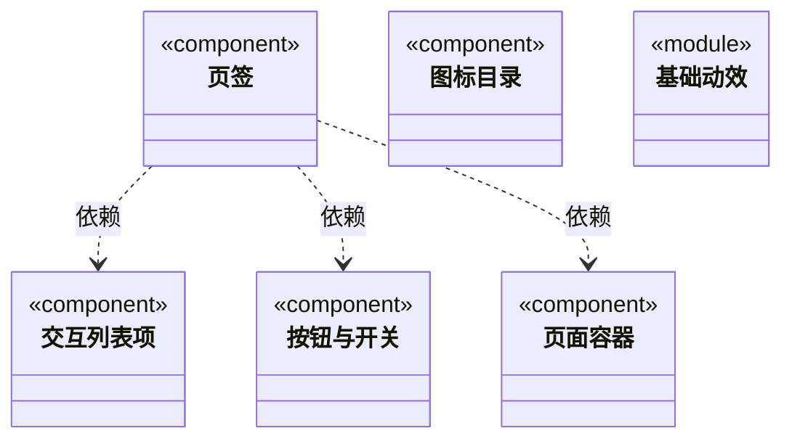
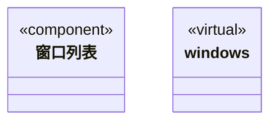

# 通用界面控件

## 设计意图

为桌面页面提供不含业务状态的 React 控件、可见性生命周期和窗口列表。页面通过属性传入内容与交互回调；此层不读取 Bridge、业务服务或项目数据。

接入新页面请查阅[图标与交互控件使用手册](../../docs/ui-framework.md)，其中包含 props、事件和 JSX 示例。动效见[使用手册](../../docs/UI-TWEEN.md)。

## 主要组成

| 组成 | 定位 |
| --- | --- |
| [图标目录](Icon.tsx) | `Icon` 通过 `name` 选图；`iconNames` 可枚举，`IconName` 可用于类型提示。`dot`、`circle`、`spinner`、`more`、`rightClick`、`warning`、`chat` 是常用图形。用 `tone` 指定语义颜色，`motion` 指定旋转或呼吸。 |
| [交互列表项](controls.tsx) | `ListItem` 和 `Button` 接受原生点击、悬停、焦点及右键事件；业务通过 children 组合图标和文字。页签通过每项 `buttonProps` 扩展事件，保留方向键导航。 |
| [按钮与开关](controls.tsx) | 保留原生按钮的焦点、键盘和禁用语义。 |
| [基础动效](ui-tween.css) | 元素使用 `data-ui-fade`、滚动容器使用 `data-ui-scrollbar-fade` 切换可见性。保持挂载，双向过渡 200ms，遵循系统减少动态效果偏好；调用方管理交互时机和键盘可用性。 |
| [窗口列表](list.tsx) | 组合 react-virtuoso，管理可视条目和聊天跟随末尾。 |
| [页面容器](screen.tsx) | 传递可见性，隐藏或卸载时清理活动订阅。 |
| [页签](tabs.tsx) | 组合按钮和页面容器，支持受控选择与键盘导航。 |

新页面随 `ui.css` 自动加载动效。元素用 `data-motion="panel"` 或 `data-motion="popup"` 等预设；伪类或子元素可直接引用相同的 `--tween-*` 预设。新增关键帧、时长和缓动统一放入 `ui-tween.css`。

隐藏页面会清理 useScreenEffect 的订阅，但不代表取消后端任务。任务状态与取消由调用页面通过业务接口管理。

<!-- architecture:generated:start -->

## 架构关系

标注为 `virtual` 的节点是直接子模块的虚拟类封装；内部设计沿下方入口阅读。

### 关系组 1：页签

### 关系组 2：窗口列表

## 子模块

| 虚拟封装 | 整体职责 |
| --- | --- |
| [windows](windows/ARCHITECTURE.md) | 统一确认操作的焦点、取消和关闭行为，调用页面负责执行已确认的操作。 |

[上层设计](../ARCHITECTURE.md)

<!-- architecture:generated:end -->
