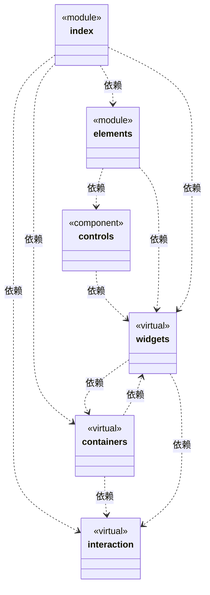
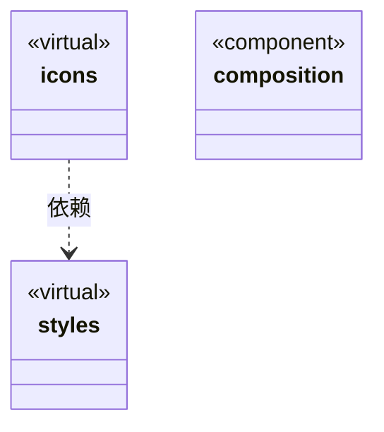

# 通用界面控件

## 设计意图

为桌面页面提供不含业务状态的 React 控件、可见性生命周期和窗口列表。页面通过属性传入内容与交互回调；此层不读取 Bridge、业务服务或项目数据。

接入新页面请查阅[图标与交互控件使用手册](../../docs/ui-framework.md)，其中包含 props、事件和 JSX 示例。动效见[使用手册](../../docs/UI-TWEEN.md)。

## 主要组成

[Framework API](index.ts) exposes widgets and containers; interaction, icons and styles are shared internally.

新页面随 `ui.css` 自动加载动效。元素用 `data-motion="panel"` 或 `data-motion="popup"` 等预设；伪类或子元素可直接引用相同的 `--tween-*` 预设。新增关键帧、时长和缓动统一放入 `ui-tween.css`。

隐藏页面会清理 useScreenEffect 的订阅，但不代表取消后端任务。任务状态与取消由调用页面通过业务接口管理。

| Module | Role |
| --- | --- |
| [composition](composition.tsx) | Container exports |
| [controls](controls.tsx) | Button exports |
| [elements](elements.ts) | Widget exports |
| [index](index.ts) | Public component API |

<!-- architecture:generated:start -->

## 架构关系

标注为 `virtual` 的节点是直接子模块的虚拟类封装；内部设计沿下方入口阅读。

### 关系组 1：widgets

### 关系组 2：styles

### 跨图协作

按引用方归并目标，保留全部跨图关系；分图只用于阅读，不表示新增模块或依赖边界。

| 引用方 | 关系 | 目标 |
| --- | --- | --- |
| [composition](composition.tsx)（图 2） | 依赖 | [containers](containers/ARCHITECTURE.md)（图 1） |
| [index](index.ts)（图 1） | 依赖 | [composition](composition.tsx)（图 2）、[icons](icons/ARCHITECTURE.md)（图 2） |
| [containers](containers/ARCHITECTURE.md)（图 1） | 依赖 | [styles](styles/ARCHITECTURE.md)（图 2） |
| [widgets](widgets/ARCHITECTURE.md)（图 1） | 依赖 | [styles](styles/ARCHITECTURE.md)（图 2） |

## 子模块

| 虚拟封装 | 整体职责 |
| --- | --- |
| [containers](containers/ARCHITECTURE.md) | 组织面板、页签和窗口的可见内容，不持有页面业务状态。 |
| [icons](icons/ARCHITECTURE.md) | 共享与业务无关的图形。 |
| [interaction](interaction/ARCHITECTURE.md) | 复用浏览器的输入与焦点语义。 |
| [styles](styles/ARCHITECTURE.md) | 统一控件与动效的视觉表现。 |
| [widgets](widgets/ARCHITECTURE.md) | 封装原生交互和展示，调用方提供数据与动作。 |

[上层设计](../ARCHITECTURE.md)

<!-- architecture:generated:end -->
