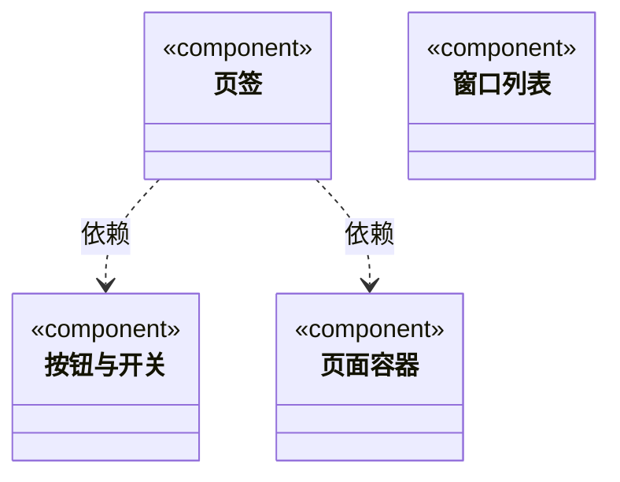

# 通用界面控件

## 设计意图

为桌面页面提供不含业务状态的 React 控件、可见性生命周期和窗口列表。页面通过属性传入内容与交互回调；此层不读取 Bridge、业务服务或项目数据。

## 主要组成

| 组成 | 定位 |
| --- | --- |
| [按钮与开关](controls.tsx) | 保留原生按钮的焦点、键盘和禁用语义。 |
| [窗口列表](list.tsx) | 组合 react-virtuoso，管理可视条目和聊天跟随末尾。 |
| [页面容器](screen.tsx) | 传递可见性，隐藏或卸载时清理活动订阅。 |
| [页签](tabs.tsx) | 组合按钮和页面容器，支持受控选择与键盘导航。 |

隐藏页面会清理 useScreenEffect 的订阅，但不代表取消后端任务。任务状态与取消由调用页面通过业务接口管理。

<!-- architecture:generated:start -->

## 架构关系

[上层设计](../ARCHITECTURE.md)

<!-- architecture:generated:end -->
